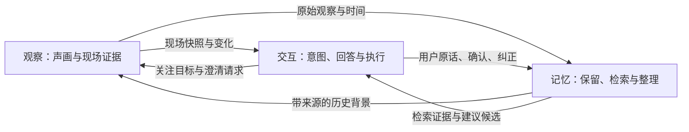

# EgoAssist 主架构：观察、交互、记忆

三链路是系统的核心逻辑与顶层组织方式。它们共享用户、案例、时间和证据，分别承担观察、决策和记忆职责。当前是单进程模块化系统：有独立服务与部分独立后台执行器，也有共同的事件循环、数据库和案例提交锁；不能称为三个完全隔离的服务。本文按 2026-09-23 源码更新。

## 三条链路

三链路共享原始证据底座：历史导入直接保存逐轮 `source.event`，原文 FTS 与版本化证据包不依赖记忆抽取成功。实时表达、原生文字与后台恢复共享事实上下文，记忆卡片和日记是派生层。当前实现范围、原生/旧协议差异和未完成阶段见[原始证据底座验收](docs/SOURCE_EVIDENCE_ARCHITECTURE_2026-09-17.md)。

| 链路 | 输入与职责 | 产出 | 当前主要实现 |
| --- | --- | --- | --- |
| 观察 Observation | 持续接收声画，进行现场分析、任务证据检查与说话人归属分析 | 带采集时间的媒体、观察、疑点与事件候选 | `realtime/observation_service.py`、`scene.py`、`ambient.py`、`perception.py`、`speakers.py`；`omni.py` 的独立视觉通道 |
| 交互 Interaction | 同等处理文字与语音，理解意图、调用工具、执行 Skill、决定回应或主动介入 | 对应原问题的答案、工具回执、任务状态与用户确认 | `realtime/observation_interaction.py`、`interaction_service.py`、`turn_coordinator.py`、`semantic.py`、`work_ledger.py`、`routed_tools.py`、`product/answer_jobs.py` |
| 记忆 Memory | 保存与检索证据，处理纠正与时间，恢复未完成写入，异步整理和生成报告 | 原文证据包、结构化卡片、修订记录、日记与建议候选 | `memory/service.py`、`evidence_service.py`、`source_index.py`、`timeline.py`、`commit.py`、`recovery.py`、`long_events.py`、`diary/` |

记忆链路通过 `MemoryService` 提供在线卡片与来源检索、提交、观察/场景及工具效果写入入口。前台轮次先在工作线程准备 Timeline 与 SourceIndex 检索，再在案例锁内复核并提交；短查询、写入和任务偏好适配仍可同步执行。报告的建议候选属于记忆加工，是否现在提醒用户由交互链路决定。观察中的任务检查只产生证据，不能绕过交互直接推进任务。

## 信息交换

历史背景影响观察重点，不证明当前事实。助手回答和报告是派生输出，不作为新的用户事实回灌。问题绑定提问时可用证据；后来画面必须带新时间和来源，不能悄悄替换原问题上下文。姓名、实体或模型高置信度不代替身份与原始证据校验。

`ThreeLaneRuntime.reviews` 将已有观察调用的历史比对结果投影为 `observation.review` 日志。比对包含实际来源、可见证据序号、采样时间和模型理由；同源引用不计为两份独立证据。交互空闲且允许主动播报时才安排澄清，实际发送音频后才创建待确认记忆。用户明确纠正后，记忆事务按目标卡片 ID 版本化替换；比对本身不能替用户确认。引用、重复抑制、并发实测和限制见[跨链路闭环验收](docs/CROSS_LANE_REVIEW_2026-09-10.md)。

## 代码边界

`egoassist/runtime.py::ThreeLaneRuntime` 是案例的状态投影，由 `CaseRuntimeOwner` 持有，不是统一调度器。`ObservationService` 校验并保存观察，以 `AcceptedObservation` 交给 `ObservationInteraction`；后者负责任务证据摄入、澄清与播报决策。`application/observation_transport.py` 在观察提交锁释放后发送状态，慢客户端不会因这条发送路径占用提交锁。

`TurnCoordinator` 和研究文字 API 通过 `MemoryService.prepare` 在案例锁外准备检索。`InteractionService` 在提交时调用 `accept`，核对账户、案例、政策、来源时钟、查询与语义条件，检查选中卡片和来源；过期证据不重新注入。检索失败和超时标记为 degraded，不表述为“历史不存在”。`MemoryCommitService` 接收任务/Skill 标识、日志及操作记录回调，不接收整个运行时所有者；`MemoryRecovery` 依赖注入的 `MemoryExtractor` 协议，不导入交互解析器实现。

卡片适配、偏好适配、记忆政策和长事件实现归属 `memory/episodes.py`、`preferences.py`、`policy.py`、`long_events.py`。旧 `realtime/` 路径仅保留兼容导出；边界测试禁止 `memory/` 反向导入 `realtime/` 或 `application/`。管理 API、状态投影和专用后台任务仍可使用记忆内部适配器，`MemoryService` 不是覆盖所有数据库操作的总事务。

`run_egoassist.py` 只处理命令行启动。`application/composition.py` 组装服务与生命周期，HTTP 适配按身份、任务、记忆和证据分组；`RealtimeConnection` 管理连接及媒体收发，`TurnCoordinator` 管理分类、排队和执行。前端渲染 `runtimeLanes`。模型连接数和链路数量不同：观察可有开放环境与任务检查两个连接，交互可有路由、工具与回答多个模型，记忆可有恢复与报告多个作业。

共享底座的事件契约、`SessionJournal`、投影和配置放在 `core/`，该包不能依赖 `application/`、`realtime/`、`memory/` 或 `product/`；测试检查这条规则。原有导入路径保留兼容导出。Timeline 索引由记忆模块拥有，产品数据库是派生投影；删除必须先作用于来源并让缓存失效，不能只删除投影。Skill 是交互链路可加载的能力包，携带观察要求与记忆需求；不成为第四条主链路。浏览器和未来眼镜是采集/输出适配器，不承担核心任务状态。

## 运行原则

实时模型传输可通过 `--realtime-backend omni|modular` 切换。默认保留 Omni；模块化方案在 `realtime/modular.py` 中组合 VAD 分段 ASR、VL、文本生成和流式 TTS，复用现有桥接层的权限、调度、工具、上下文重放与播放控制。模型拆分不改变三链路职责，语义路由和记忆服务继续独立运行。模型配置、真实对照及已知限制见[模块化实时后端](docs/MODULAR_REALTIME_2026-09-14.md)。

1. 回答生成、暂停播报和取消某个问题，不自动关闭观察。
2. 模型推理与后台加工不得持有跨链路共享锁；短状态提交可使用事务或锁。
3. 排队、并发、重试有界，超时和被合并的候选留审计记录；不能无限排队掩盖迟延。
4. 采集时间、服务器收到时间、模型结果时间分别保存。处理水位是已完成采样的时间，不声称区间内所有动作都已覆盖。
5. 已受理后台任务独立于页面；断开媒体源不等于任务取消，也不能虚构断开期间的观察。
6. 前端独立展示观察连接/采样/推理，交互排队/分类/输出，记忆待办/运行/失败/整理。会话记忆统计包括恢复、Insight 和长事件；日记状态单独标为账户范围，不计入当前会话任务数。

## 当前边界与后续重构

交互采用并行准备、顺序提交：语义分类与问题视觉预取并行，预取和视觉请求均有并发上限；任务、工具和记忆变更保持输入顺序。最新输入中的纯语义输出控制可提前生效，有副作用的复合指令仍排队。控制目标尚未登记时等顺序提交，避免取消操作落空。停播不要求等待视觉完成，无需视觉的控制显式取消对应视觉请求。

后台补答在短暂纠正等待后可先生成，若仍有未决输入则持久保存准备结果，等纠正判定后发布，避免重复生成。暂停、取消、重启继续遵循原任务状态。前端展示逐问题阶段、阶段等待、排队耗时和原问题的完整答案耗时；模型生成耗时与端到端耗时分别统计。

本轮并行、突发输入、真实语音和报告验证见[异步与延迟审计](docs/ASYNC_LATENCY_2026-09-10.md)。

已实现独立视觉调度、案例级主框架接口、问题证据快照、带来源的历史背景、持久后台记忆/报告/补答，以及前端平级状态。

观察结果处理、交互提交、记忆写入及轮次执行已迁入独立服务，启动文件不再包含业务实现。组合模块仍负责案例恢复与跨服务装配，整体仍为单机模块化单体。增量投影减少重复历史扫描，有界候选检索控制逐条评分成本；完整日志恢复和账户导出仍与历史规模有关。尚无统一跨供应商资源优先级调度，也未实现持续视频事件分割、全量录像和观察请求持久重放。第一视角身份归属与传感器时间同步仍需硬件验证。整改验证见 [2026-09-11 记录](docs/ARCHITECTURE_REMEDIATION_2026-09-11.md)。

本次拆分与隔离回归见[三链路边界核对](docs/THREE_LANE_BOUNDARIES_2026-09-23.md)。目前只把前台 Timeline/SourceIndex 准备和观察状态发送移出案例锁；任务偏好读写、原文持久化、部分控制发送和状态构建仍是共享路径。写入失败并非全部自动恢复；线程超时也不能强杀原生线程，维护可能需要等待其退出。

验收与延迟见[三链路真实运行](docs/OBSERVATION_LANES_2026-09-10.md)，记忆全链路、存储位置、默认参数与删除边界见[记忆机制](MEMORY_ARCHITECTURE.md)（2026-09-23 源码核对），视频方法见[事件分割调研](docs/STREAMING_VIDEO_EVENTS_RESEARCH_2026-09-10.md)。
