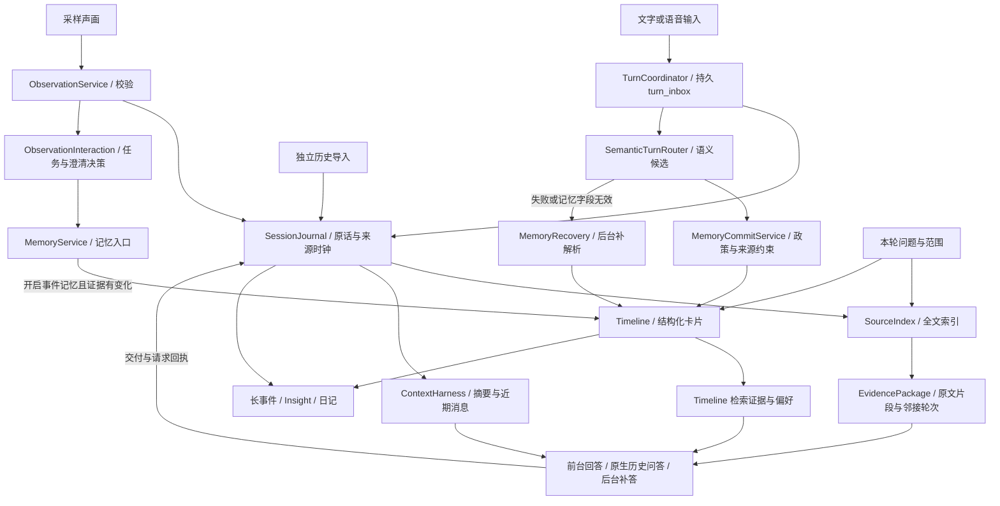

# EgoAssist 记忆机制与完整链路

本文按 **2026-09-23 当前工作区源码**核对；描述实际调用路径，不把历史设计或实验能力当作默认产品能力。主框架见 [ARCHITECTURE.md](ARCHITECTURE.md)，本轮拆分见[三链路边界核对](docs/THREE_LANE_BOUNDARIES_2026-09-23.md)。

当前机制可以概括为：**先保留来源，再按需形成结构化记忆；回答时检索来源与卡片，按预算组装上下文；后台完成恢复、事件整理和日记；纠正与删除分别处理来源、派生记录和缓存。** 模型连接是临时的，本地日志和数据库负责持久化。

## 1. 先区分六类“记忆”

| 层 | 实际内容与职责 | 主要实现 | 默认应用中的位置 |
| --- | --- | --- | --- |
| 原始来源 | 用户原话、已交付助手文本、采样观察、工具回执、请求及状态日志；支持追溯与恢复 | [core/journal.py](egoassist/core/journal.py)、[core/source_events.py](egoassist/core/source_events.py) | 来源底座；并非所有日志类型都进入原文检索 |
| 原文证据索引 | 将部分来源全文切段、FTS 检索、补相邻轮次，生成可复用证据包 | [memory/source_index.py](egoassist/memory/source_index.py)、[evidence_service.py](egoassist/memory/evidence_service.py) | 历史 API 直接使用；实时开启 episodic 时也使用 |
| Timeline 卡片 | 事实、事件、状态、偏好及观察的结构化视图；范围、时间、状态、纠正和确认 | [memory/timeline.py](egoassist/memory/timeline.py)、[commit.py](egoassist/memory/commit.py) | 在线记忆；与原文索引并行存在 |
| 模型工作上下文 | 系统/Skill 政策、状态、摘要、近期消息及本轮检索证据 | [realtime/context_harness.py](egoassist/realtime/context_harness.py) | 每次模型会话的预算内投影 |
| 派生整理 | 长事件、当前建议、个人日记、日/周/月回顾 | [memory/long_events.py](egoassist/memory/long_events.py)、[memory/insights.py](egoassist/memory/insights.py)、[diary/](egoassist/diary/) | 有来源引用的后台加工；不能成为独立事实证明 |
| 离线向量记忆 | 视频分段、向量索引、事件合并、来源展开、关键帧定位 | [memory/store.py](egoassist/memory/store.py)、[qa/pipeline.py](egoassist/qa/pipeline.py) | 研究路径；未作为默认实时检索器 |

`RealtimeEpisodeMemory` 和 `PreferenceMemory` 是同一个 Timeline 的业务适配器，实现已迁入 `memory/episodes.py` 与 `memory/preferences.py`；旧 `realtime/` 导入路径保留兼容导出。`case/participant` 是召回范围，`short/long` 是存储层级，`current` 是检索时派生的近期视图；这些概念不能互换。LiveKit 是媒体传输，Temporal 是提醒工作流，都不是记忆数据库。

## 2. 从输入到回答的完整链路



箭头表示数据依赖，不表示一个统一事务。前台轮次通过 `MemoryService` 在案例锁外准备 Timeline 与原文证据包，排除当前用户消息；提交时复核选中证据，随后写入本轮记忆。原文包的 `evidence.package` 日志在交互处理尾部追加。原生 `/api/history/*` 不经过实时指令路由。

### 2.1 用户发言

1. `TurnCoordinator` 先用 `turn_inbox` 保存收到的原始输入，按轮次组织分类与执行。`turn_inbox_state` 表示处理状态，`turn_delivery` 表示回答交付状态，两者分离。
2. `InteractionService.process_transcript` 取得或写入用户 `message`；若已有来源记录，时钟回到 `sourceRecordedAt` 或原始日志时间，避免排队后改用处理时间解释“昨天”。
3. `SemanticTurnRouter` 提出 `memoryAtoms`、`memoryDraft`、`memoryQuerySpec`、指令和交互候选。单个 `event` 优先保留整段原话；多事件摘录必须存在于原话。结构化事实的字段和范围会验证，但并无通用的事实蕴含证明器。
4. `TurnCoordinator` 在来源消息落盘后调用 `MemoryService.prepare`，按配置检索案例卡片及同账户 participant 记忆；研究文字 API 也在进入案例变更锁之前准备检索。`InteractionService` 复核结果后经 `MemoryService.commit` 调用 `MemoryCommitService` 处理写入、草稿与纠正，任务偏好另经适配器处理。
5. 开启 episodic 记忆且有账户案例时，同一准备阶段调用 `EvidenceService.query` 生成原文证据包；提交时复核选中来源 hash，追加带来源依赖的 `evidence.package` 日志。直接同步调用 `process_transcript` 的兼容路径仍会同步读取，不能将前台优化推广为全部调用都异步。
6. `grounded_user_instructions` 将本轮卡片证据和原文证据包注入前台回答；`turn_answer_context` 将问题、证据、时钟、任务状态和声画快照保存给后台补答。

源码入口：[turn_coordinator.py](egoassist/realtime/turn_coordinator.py)、[interaction_service.py](egoassist/realtime/interaction_service.py)、[semantic.py](egoassist/realtime/semantic.py)、[composition.py](egoassist/application/composition.py)、[answer_service.py](egoassist/product/answer_service.py)。

### 2.2 观察与工具回执

开放观察保存可见证据、疑点、采样时间、来源帧及媒体引用。`ObservationService` 校验授权、采样上下文和模型结构后，记录产品观察和 `ambient_observation`，更新场景并发出 `AcceptedObservation`。`ObservationInteraction` 消费它，调用记忆服务、调度长事件并判断是否澄清；任务观察的 `TaskSession.ingest` 与播报判断也归属这个交互消费者。观察结果仍是模型对采样的解释。

开启 episodic 且满足观察条件时，可见证据与上一观察不同才创建 `observation` 卡片；重复可见文字不建新卡，但已接受的原始观察日志仍保留。任务检查、工具回执和任务状态有各自日志及投影；`remember_tool_effect` 可记录工具效果卡片。当前 `SourceIndex` 并不索引每一种工具、任务或审计事件；日记使用更广的来源收集器。

提问的现场快照绑定当时证据。历史帧回看还要求采样时间和提交时间都不晚于问题边界。旧背景和后到观察不能自动变成“提问当时现场”的证明。

观察写卡失败会记录 `memory.write.failed`，已经接受的来源保留；待确认草稿读取失败时不主动提问。观察服务不执行 WebSocket 发送，传输层在服务返回、案例锁释放后推送状态。观察与交互决策仍在一个顺序提交段内，不是独立进程之间的持久消息队列。

### 2.3 检索准备、复核与失败边界

`MemoryQuery` 携带用户、案例、政策、来源时钟、原文、语义条件、排序查询及排除来源，`PreparedMemory` 携带候选、证据包和分路错误。`MemoryService.accept` 要求请求条件一致，按卡片 ID 复核 active 状态和内容；同案例卡片还检查来源存续，原文包按选中来源 hash 检查。不在复核阶段重新执行 SourceIndex 全量同步。非选中候选只保留分数等审计字段，不把准备时的旧正文再次写回日志。

`EGOASSIST_MEMORY_READ_TIMEOUT` 默认 2 秒（允许 0.05–30 秒）。异步读取最多同时跟踪 4 个工作线程，同一账户最多 1 个；忙、维护或超时返回 degraded。Timeline 与来源索引各自报错，成功一路可继续用于回答；整体超时会丢弃本轮尚未完成的包。提示明确说明检索不完整不等于事件未发生。

超时只停止前台等待，不会杀死 Python 工作线程。`EvidenceService` 继续跟踪线程；来源删除、账户维护和应用退出会等待受管读取结束，再失效缓存。来源删除入口也参加这一生命周期。实时提交重新检查连接代次、轮次终态/修订及输入来源，防止等待期间已取消或已删除的工作继续提交。

这些约束不等于数据库级跨链路事务。同步兼容读取、偏好适配、状态快照、日志恢复及部分写入仍可能占用共享资源；Timeline 提交的所有存储故障也并非都能自动重试。跨案例 participant 卡片主要依靠卡片状态和账户删除传播检查，不能把同案例来源复核描述成跨账户/全来源扫描。

### 2.4 历史导入

`POST /api/history/import` 接收 `conversation_id` 和 1–500 条独立事件，每条允许 `id/text/speaker/source_at/timezone/media_refs/supersedes`，文字上限 100,000 字符。验证账户拥有该案例后，直接追加 `source.event`，不执行 Skill、工具，也不要求抽取卡片成功。

同一来源 ID、同一内容重复导入是幂等的；不同内容复用 ID 被拒绝。修正使用新 ID 和 `supersedes`，目标必须已在该会话中存在。被擦除的 ID 不能用于重新导入。来源日志保存成功而索引同步失败时返回 `accepted-index-pending`（HTTP 202），下次同步可重建索引。

这里的 `supersedes` 目前只是提供给回答的修订关系：旧来源仍可检索，没有自动冲突裁决。它与 Timeline 将旧卡改为 `superseded` 的机制不同。

## 3. 持久化位置与重建关系

以默认 `--memory-path .egoassist/runtime.json` 为例，父目录 `.egoassist/` 是数据根目录；更换文件名但不更换父目录，不会得到独立数据环境。

| 位置 | 保存内容 | 恢复与边界 |
| --- | --- | --- |
| `identity.sqlite3` | 账户、案例、案例记忆政策和时区等 | 决定所有权和范围 |
| `timeline.sqlite3` | `memory_cards`、草稿、全文索引及迁移状态 | 账户共享物理库，查询必须携带所有权条件；不能随意当缓存删除 |
| `product.sqlite3` | 产品状态、观察、任务及隐私政策等 | 产品投影与持久状态，非全文记忆替代品 |
| `users/<user>/sessions/<session>.jsonl` | 原话、历史来源、观察、控制、工具、作业、审计、压缩检查点 | 在线来源与恢复依据；正常追加，隐私擦除会改写为墓碑 |
| `users/<user>/source-index.sqlite3` | 原文 `events`、FTS `passages`、日志游标、证据 `snapshots` | 可从来源重建；删除缓存也会丢掉其中的旧快照 ID |
| `users/<user>/diary.sqlite3` | 日记归档、生成检查点、补记、反馈、定时设置 | 独立数据库；个人补记不能从会话日志重建 |
| 案例关联媒体及 trace | 采样 JPEG/WAV、来源校验值、记忆活动与请求证据 | 并非连续全天录音录像；随隐私和保留流程处理 |

`SessionJournal.project` 维护增量投影，追加时增量归约，文件改写后使投影失效。会话恢复依据本地日志，不依赖云端模型记住上次连接。

整个根目录由单进程写入租约保护。SQLite 单库事务、日志追加、媒体落盘之间没有一个跨文件原子事务；也没有跨设备同步协议。备份应停止写入后复制完整根目录，不能只备份 `runtime.json`。

## 4. 原文检索：SourceIndex

### 4.1 哪些记录进入索引

`core/source_events.project_source` 只投影以下来源：独立历史 `source.event`、状态为 `completed` 的 user/assistant `message`、已接受且有可见证据的 `ambient_observation`。

每条来源带 `sourceId = sessionId:journalEventId`、完整 `text`、`speaker`、`sourceAt`、`receivedAt`、媒体引用和 `sourceHash`。`eventTime/validTime` 初始保持未知。助手文本标为 `assistant-delivery`，只能证明助手交付过这些文字，不能证明用户经历或现实动作。

因此，**原话已在 `turn_inbox` 保存，不等于已经进入 SourceIndex**：还要形成可投影的 completed 消息。会话 UI 能显示后台补答，也不意味着单独的 `answer.job` 就会成为全文索引来源。

### 4.2 同步、召回与预算

`sync()` 检查账户内会话日志的大小、修改时间、文件身份和前缀，追加场景从已读偏移续读；替换或缩短时重建该会话。删除/替换来源时检查旧快照依赖，失效快照不能继续取用。未完成的末行留待下次读取。

默认检索流程：

1. 将英文词和数字分词；连续中文使用双字片段；过滤一组英文停用词。查询最多取 64 个词项，FTS5 使用 OR 匹配和 BM25 排序。
2. 完整原文按 **1,800 字符、步长 1,640** 切段，因此长文本尾部可以被检索，不只搜索开头。
3. 只在指定案例内召回，最多检查 **256 个匹配片段**；通常选最多 **12 个命中锚点片段**。
4. 给命中锚点补前后一条已索引来源，各最多取 1,800 字符；锚点和补充片段共用 **24,000 字符**预算，最终 `sources` 数可能超过 12。
5. 另提供最多 **8 条近期来源**作为 `conversation`，合计最多 **8,000 字符**。这是额外预算，不包含在前述 24,000 内。
6. 返回片段范围 `span`、完整长度、召回原因、候选审计、覆盖统计和快照 ID。

`audit` 覆盖本次取出的候选，不代表全库候选；`candidateTruncated` 说明是否超过 256。相邻来源按索引序号定义，不一定是紧挨着的原始 JSONL 行。没有词法命中时 `sources` 可以为空，而 `conversation` 仍有近期内容。

### 4.3 快照与回答

`EvidencePackage` 包含 `sources/conversation/coverage/audit/conflicts/missingInformation` 等。快照记录此次已选证据，复用要求账户与案例正确、问题文字相同、来源仍存在且 hash 一致。追加其他来源不会扩展旧包；删掉被引用来源会使包失效。不同新查询各自取包，并非全局固定的语料快照。

`POST /api/history/query` 只检索；`POST /api/history/ask` 用共享 `AnswerService` 生成结构化答案，返回 `answer/claims/unanswered_parts/conflicts/status`。校验结构和来源 ID，明确返回 `entailment: not-verified`、`statusAuthority: model-declared`。供应商故障返回 `unavailable`，与缺少证据的 `insufficient` 不同。

实时前台和后台补答复用证据包/上下文契约，但不都经过原生历史 API 的结构化 `validate_answer`。原文检索没有自动向量融合、语义过滤或冲突消解；包中 `vector: not-enabled`、`conflictStatus: not-adjudicated` 正是当前边界。

## 5. Timeline：如何形成、确认和更新记忆

### 5.1 卡片字段与写入授权

卡片包含 `user_id/case_id/scope`、`kind/tier/status`、原文或摘要、`sourceIds`、`subject/predicate/value`、来源时间、事件有效时间、`evidenceContext`、`grounding` 和修订关联。

| 条件 | 默认处理 |
| --- | --- |
| 普通观察到的事实/状态/事件 | `case` 范围，通常 `short + active` |
| 符合路由约束的明确长期保存 | `participant` 范围，`long + active`；受 preference 开关控制 |
| 推测性原子 `consent=inferred` | `pending`，不进入默认 active 召回 |
| 主体、指代或第一人称归属不明 | 记录 grounding 疑点；事实/状态/偏好可转 pending，召回过滤未解决指代 |
| 只提出“记住”但缺主体或值 | 保存草稿，等待后续补充；不把草稿当已记住事实 |
| 任务执行偏好 | 提议后由 `resolve_candidate` 接受/拒绝；按任务和检查点复用 |

语义标准化要求普通 observed 事实/状态/事件留在 case，explicit 保存使用 participant；兼容偏好规则另有分支。范围限制、原文摘录验证和说话人 grounding 是程序约束，用户意图与普通事实内容仍依赖模型判断，不能把 `explicit` 当成独立可靠的同意检测器。

当前 `RealtimeEpisodeMemory.remember` 和 `TimelineMemory.remember` **不再统一截断到 1,000 字符**。UI 预览、提示词预算和各类模型输出仍可能有自己的长度限制。完整来源日志与结构化卡片各自保留，不能假定卡片涵盖全部原话。

成功保存以实际写出的 active 卡片 ID 为准：`memoryResponse.status=committed` 并有 `committedCardIds`。返回 `needs-input/not-committed` 或模型口头说“记住了”，都不等于保存成功。

### 5.2 去重、纠正和晋升

- 同一来源、同一有效时间的重试复用卡片；稳定事实满足条件时合并支持来源。不同时间发生的相同事件/观察保留不同发生记录。
- 单值事实由标准化 `subject + predicate` 形成键。允许更新的 active 状态会版本化旧值；迟到的较旧状态不会覆盖更新的状态。事件、观察、周期计划和带结束时间的陈述不无条件走这条覆盖路径。
- 明确 `replaces` 必须指向给路由的候选，数据库还验证同用户、同案例、同范围、可替换类型和 active 状态。新卡与旧卡退役在同一 SQLite 事务内；同来源的重复原文事件投影也会被退役。原始日志仍保留。
- 原文索引仍可能召回“过去说过的旧值”，它不依据 Timeline 状态自动剔除原文。回答必须区分历史陈述与当前有效事实；当前不是全局矛盾解决系统。
- 默认 `current_window_seconds=600`、`short_term_capacity=40`。短期 active 卡片超容量时，`promote_to_long` 将较旧卡片**原地改为 long**，通常将 short 降到半容量；ID、时间和来源不变。晋升不是摘要、向量合并或删除。

### 5.3 Timeline 检索

`TimelineMemory.retrieve` 首先限定账户、范围、案例、active 状态与允许类型。`capture` 永不作为默认证据；默认类型也排除 `legacy/scene`，普通事件检索额外排除 `task-preference`，任务偏好走专门检索。

范围内记录较少时读取全部候选；较多时结合精确键、FTS、时间窗口和近期记录收集有界候选。默认候选上限 **256**，可由 `EGOASSIST_MEMORY_CANDIDATE_LIMIT` 调整（32–4096）。之后在 Python 检查时间、主体、关系、实体、场景及指代约束。

普通排序分数为 `max(Jaccard 词项重叠, 归一化 BM25)`；精确主体/关系键符合所有硬约束时可置顶为 1.0。默认分数阈值 0.05、Timeline 默认 top-k 为 5；业务适配器和调用点可覆盖数量。分数不是正确率。时间未知的候选不能仅因键精确就回答特定日期的问题。

结果包含 selected、候选拒绝原因、范围、时钟和截断统计。诊断可取完整的本次候选审计，状态页只显示有限窗口。这里既不是默认向量搜索，也不是每次无界全库评分；首次加载、计数和数据库检索仍受数据规模影响。

`EvidenceFirstPolicy` 支持把可选语义检索结果与已通过硬约束的候选做 RRF 排序；当前默认 `InteractionService` 直接调用 Timeline 适配器，未装配该语义检索器。不能因文件存在就宣称实时已使用 embedding。

## 6. 时间、人物与来源约束

来源时间与事件时间必须分别解释：

| 字段或概念 | 含义 |
| --- | --- |
| `receivedAt / recordedAt` | 系统接收/记录时间，不自动等于所述事件发生时间 |
| `sourceAt / sourceRecordedAt` | 原始发言或来源时间；历史导入由来源提供 |
| `effectiveAt / effectiveEnd` | 有依据的事件/状态有效区间，可为空 |
| `happenedAt` | Timeline 存储排序兼容字段；无有效时间时可能回退记录时间，不能据此宣称事件日期已知 |
| `ClockContext` | 来源 UTC、时区、本地日期及偏移，供确定性时间解析使用 |
| `evidenceContext.times` | 多个时间表达、角色和锚点；不是单一“昨天”标签 |

`grounding.evidence_contract` 在写入、恢复和旧卡读取时应用同一来源约束；`source_time.annotate` 为原文回答提供基于 `sourceAt` 的日/月/年表达注释。注释只展开日历含义，不证明某事件属于这个时间。未知日期保持未知；周期习惯和计划不能证明今天已经完成。

例如当地 9 月 20 日说“昨天拿到包裹”，可锚定 9 月 19 日；9 月 22 日回忆时不重新解释为 9 月 21 日。视频 `DAY1` 或导入日期不能凭空变成真实公历事件日期。日记将来源日期/时区不足的导入列入 `unplacedSources`，不擅自塞进导入当天。

API 的 user 角色表示输入通道，不证明说话者就是账户拥有者。声纹、转写归属、账号确认和语义交互判断分别处理；第一人称来自未确认佩戴者时，grounding 可标为待澄清。历史人物名、环境声音和画面人物不能仅凭共现自动绑定。

`evidenceNetwork` 是从卡片生成的人物/场景/来源共现投影，没有通用实体消歧、社会关系图谱或多跳推理保证。复杂引语锚点、别名、代词和时间角色仍可能被模型选错。

## 7. 上下文压缩、会话历史与后台恢复

### 7.1 ContextHarness

默认上下文窗口 32,768、输出预留 4,096、近期尾部 6,000、摘要上限 3,000（估算 token，可用 `EGOASSIST_CONTEXT_*` 覆盖）。`build()` 按 required/priority 组装系统政策、Skill 和任务状态，再容纳预算内历史；超预算时形成 `compaction`。

默认摘要是**确定性摘取**：保存近期尾部、来源时间、关键状态和旧消息摘录；单条摘录及总预算会截断。摘要写回日志，但不删除原消息，不是向量长期记忆，也不能保证保留每个细节。类支持自定义 summarizer，默认装配未提供。重连通过摘要和近期消息重放恢复工作上下文。

会话历史是另一份只读投影：`GET /api/conversation` 从 turn inbox、message 和已完成后台答案按游标分页，默认 50、最大 200 条。UI 的有限工作面板、模型近期上下文、完整日志历史三者不是同一个窗口。刷新恢复文字和持久任务，不恢复旧音频缓存与媒体连接。

### 7.2 记忆恢复与回答补全

| 后台服务 | 触发与处理 | 持久依据及边界 |
| --- | --- | --- |
| `MemoryRecovery` | 路由不可用、输出无效或 memoryAtoms 部分失败后补解析；默认延迟 5 秒、最多 3 次、并发 1 | 保存原话、原始时钟、sourceId、场景和候选；重新检查当前政策，只写记忆/草稿，不重放用户工具控制 |
| `AnswerJobs` | 前台中断、截止或重启恢复后为原 turnId 补文字答案 | 保存问题时证据和上下文；完成、取消和修订分别处理，来源不可用时不能发布迟到答案 |
| `InsightJobs` | 受理报告或建议任务后异步执行 | 保存任务阶段、请求和结果；失败/取消不等于完成 |

`memory.recovery.job` 的 running 在重启时回到 queued；不可重试的供应商错误或达到次数上限会变 failed，可通过审计入口重试。completed 只表示该恢复任务处理完，可能没有生成卡片，需看 `cardIds`。恢复不改用重试当天解释旧时间。

后台回答是模型交付，不写成用户事实。网络中断或进程重启可能重做供应商请求；本地幂等不等于供应商计费、云端推理或外部工具副作用恰好一次。

## 8. 长事件、历史视觉、建议与日记

### 8.1 长事件与原帧回看

`LongEvents` 从已接受采样观察和 completed 用户原话派生阶段事件。当前需要至少一条有效观察，处理其时间之后的来源；按来源时间排序，每批最多 24 条，大于 30 分钟间隙切批。调度默认限频 20 秒，连续失败 3 次后停止自动调度。送入模型的单条来源只取前 2,000 字符并标记截断，旧事件阶段也仅给最近 6 条；完整原始日志仍保留。

事件有 title、summary、phases、状态、来源 ID 和 revision。更新必须含本批新证据；完成事件不能直接重新开启为另一轮发生。`coverage` 给证据跨度、采样数和超过 30 秒的缺口，`continuousDurationSeconds` 保持空值。它是可重建假设，不是连续活动计时或全天视频分割。

`VisualHistory` 则在问题需要时重看原帧：从最近最多 4,096 条观察中筛选问题边界前且有媒体的样本，去重，结合文字相关性与时间覆盖选最多 24 帧，调用视觉模型并验证来源引用。它可以补充描述遗漏，但仍受采样和选择上限影响。

### 8.2 两套报告机制并存

| 项目 | 当前建议/旧 Insight 报告 | 独立个人日记 |
| --- | --- | --- |
| 入口 | `/api/insights` | `/diary.html`、`/api/diary` |
| 持久化 | 案例日志中的任务、请求和结果 | 账户 `diary.sqlite3` |
| 来源 | completed 用户消息与已接受视觉观察；case 或 account 范围，不直接读取 source.event | 账户会话原话、助手交付、观察、历史导入、工具回执、作业结果、Timeline 状态/纠正、个人补记 |
| 长周期策略 | 默认最多 300 条、32,000 字符，优先较新记录，披露遗漏 | 逐日分块、日内多层汇总、周期汇总；不按近期尾部直接丢旧记录 |
| 执行 | 默认并发 2，待办容量 16 | 默认串行执行，调度任务上限 16 |
| 定时 | 主动建议创建依赖在线控制台等触发 | 用户选择开启后，服务端每 30 秒检查最近已结束的日/周/月 |

日记单条来源以 3,500 字符拆分，分块约 14,000 字符，汇总批约 18,000 字符。每个模型节点保留内容 hash、来源映射、输出和调用回执，重启可复用已完成节点。默认日记模型为 `qwen3-max`，可用 `EGOASSIST_DIARY_MODEL` 覆盖。

状态页将 `memory.recovery.job`、`insight.job`、`long_event.job` 投影为会话级记忆任务；长事件按 requestId 合并状态，重置时清除旧批次。日记以只读 SQL 统计 `diary.sqlite3` 的任务状态，不读取正文，也不因状态查询创建账户目录；单独显示为账户任务。

日记周期超过 500 万来源字符、达到 500 次模型请求、无法继续合并、来源读错或输出校验失败时停止，不把部分结果伪装成完成。分块全部被处理不等于模型摘要保留全部细节；引用合法也不保证语义正确。

发布前重新核对来源 fingerprint；来源变化则拒绝发布旧内容。读取已归档日记也检查来源，变化时标记 stale 并移除旧正文/来源快照/节点/调用内容。长事件提示附在原始来源上，不重复计为独立证据。

定时默认关闭。开启后服务持续运行即可在页面关闭时生成最近结束的自然周期；不会自动补齐所有漏掉的历史周期。暂停或停止整个服务时没有后台执行。无记录日明确披露，不能写成“当天没有活动”。

## 9. 开关、遗忘、保留和删除

### 9.1 记忆 profile 的真实范围

| profile | preference | episodic | 配置 scope |
| --- | --- | --- | --- |
| `all-online`（默认） | 开 | 开 | case |
| `context-only` | 关 | 关 | case |
| `confirmed-preference` | 开 | 关 | participant |
| `lexical-episodic` | 关 | 开 | case |

它们是同一套组件的实验开关。`all-online` 仍可另外召回 participant 长期记忆；profile 的 scope 不意味着所有保存都只能用这一个范围。原始日志与上下文压缩一直保留。

尤其要注意：`context-only` 关闭由这些开关控制的实时事件/偏好写入、检索和注入，不关闭原始日志，也不作为独立 `/api/history/*` 或日记的总隐私开关。`remember_tool_effect` 自身没有读取该 profile，成功工具回执仍有单独的效果卡片写入路径；不能将 profile 理解为所有持久化的统一禁写开关。环境观察授权另由观察同意配置控制。

### 9.2 四种不同操作

| 操作 | 当前代码效果 | 不应推断的效果 |
| --- | --- | --- |
| 关闭记忆 profile | 后续实时按开关处理，日志仍保存 | 不等于删除历史或不再存储来源 |
| `/api/memory/delete` 删除卡片 | 标记卡片 deleted，退出 active 检索；相关中间件使原文索引缓存和日记派生失效 | 不擦除原始发言；索引重建后原话仍可能被召回 |
| `/api/history/delete` 删除导入来源 | 将目标 source.event 及同日志中可追踪的依赖改为墓碑，同步索引，旧证据快照失效 | 不是所有数据类别的账户级擦除入口；原生导入本来不自动生成 Timeline 卡片 |
| 账户保留/隐私删除 | 暂停写入与在途任务，处理来源、派生引用、卡片、媒体、缓存与账户数据 | 不删除已经复制到系统外的备份，不保证外部供应商撤回旧请求 |

`AccountRetention` 先停止账户连接、活动请求和后台作业，再运行 `PrivacyGovernance.retention`；`core.retention.erase_expired` 沿显式依赖传播删除，保留最少墓碑和幂等键，避免相同请求重试复活内容。之后丢弃旧运行时/投影、使来源索引与日记失效，并恢复仍有效的工作。默认保留检查间隔 3,600 秒，可配置。

删除依赖建立在已记录的来源 ID 上，不能解释任意文本中的隐式引用。要验证“忘记了”，必须区分删除卡片和删除来源，并测试重启、索引重建和在途任务晚到结果；仅在 UI 看不到卡片不足以证明原文被擦除。

## 10. 离线分层向量机制

`StreamingMemoryAssistant.ingest` 对视频分段，`HierarchicalMemory.ingest` 编码帧、生成描述并附音频文字，保存向量、时间和最多 8 个关键帧。`current` 是时间窗口；事件进入 short 和活动向量索引。

达到整理周期或容量时后台将较旧 short 分组，相邻相似事件合并为均值归一化向量的 long 节点。活动索引移除子节点、加入聚合节点，但 `_items_by_id` 保留原始子节点、描述、音频及来源。

查询先检索活动节点；`expand_sources=True` 沿 child_ids 展开叶子来源，按查询向量相似度重新排序，再供回答与时间定位使用。聚合候选未命中时仍可能漏掉目标来源，保留来源不等于全库精确召回。

`save_memory/load_memory` 保存并校验快照、真实时间和来源，加载重建活动索引。图像数组和来源登记仍占内存，多文件快照不是断电原子提交；不适合据此承诺无限长在线眼镜记忆。习惯归纳、conformal 拒答和可选语义排序属于额外研究组件，未接入默认原文检索链路。

## 11. 排查与验证入口

排查“为什么没记住/没想起来”时，按下面顺序核对，避免只看模型回答：

1. `turn_inbox`、completed `message` 或 `source.event` 是否存在，来源时钟和账户/案例是否正确。
2. 语义路由是否失败；有无 `memory.recovery.job`；实际 `committedCardIds` 是否为空；卡片是 active、pending 还是 superseded。
3. 使用的是 SourceIndex 还是 Timeline：前者看 audit/coverage/片段预算，后者看 candidateAudit/拒绝原因/时间与主体约束；确认 profile 和 participant 范围。
4. 本轮答案究竟注入了哪个 `evidence.package`、Timeline evidence 和声画快照；检索命中不等于已经传给模型。
5. 任务是否完成、取消、来源被删除或结果过期；引用检查通过不等于回答语义正确。

| 回归文件 | 主要验证 |
| --- | --- |
| [test_lane_isolation.py](tests/test_lane_isolation.py) | 检索超时、维护清理、过期来源、轮次失效、慢客户端及依赖方向 |
| [test_source_evidence.py](tests/test_source_evidence.py) | 长文尾部、中文召回、幂等来源、案例隔离、快照失效、在途删除 |
| [test_memory_grounding.py](tests/test_memory_grounding.py)、[test_timeline_memory.py](tests/test_timeline_memory.py) | 来源时间、未知指代、重复发生、纠正、晋升、候选过滤 |
| [test_memory_policy.py](tests/test_memory_policy.py)、[test_preference_memory.py](tests/test_preference_memory.py) | 开关、偏好确认与召回 |
| [test_context_harness.py](tests/test_context_harness.py)、[test_conversation_history.py](tests/test_conversation_history.py) | 压缩恢复、分页历史和交付归属 |
| [test_diary.py](tests/test_diary.py)、[test_long_events.py](tests/test_long_events.py) | 分块覆盖、来源引用、归档失效、定时、事件阶段与覆盖边界 |
| [test_retention_recovery.py](tests/test_retention_recovery.py) | 擦除传播、重启不复活及跨案例依赖 |
| [test_memory_snapshot.py](tests/test_memory_snapshot.py)、[test_retrieval_policy.py](tests/test_retrieval_policy.py) | 离线快照与可选检索政策 |

2026-09-23 拆分后的完整回归 **774 项通过**，包含新增的 24 项链路隔离测试，保留 3 条已有 aiohttp 弃用警告；完整命令见[本轮验收](docs/THREE_LANE_BOUNDARIES_2026-09-23.md)。2026-09-20 文档核对时，原有 12 个测试文件合计 **166 项全部通过**。该记忆子集的复现命令（项目根目录，PowerShell）：

```powershell
.\.venv\Scripts\python.exe -m pytest -q -p no:cacheprovider tests/test_source_evidence.py tests/test_memory_grounding.py tests/test_timeline_memory.py tests/test_memory_policy.py tests/test_preference_memory.py tests/test_context_harness.py tests/test_memory_snapshot.py tests/test_diary.py tests/test_long_events.py tests/test_retention_recovery.py tests/test_conversation_history.py tests/test_retrieval_policy.py
```

其他验证见 [README](README.md#验证)。确定性测试验证程序约束，不证明模型语义质量；本次文档核对未重新调用云端模型或运行真实声画验收。

历史结果保留在各自协议下：原文证据开发集召回曾为 **72.82%**，30 题真实复测新路径回答准确率 **32.22%**、旧路径 **28.89%**，尚不能证明稳定提升。旧 12 题对照的 12/12 来源召回也不是通用准确率。详见 [来源生命周期](docs/SOURCE_EVIDENCE_LIFECYCLE_FIX_2026-09-17.md)、[真实复测](docs/EGOLIFE_SOURCE_RETEST_2026-09-17.md)、[旧机制对比](docs/MEMORY_MECHANISM_COMPARISON_2026-09-09.md)。

本说明替代旧版中的“统一 1,000 字符卡片”“范围内全量评分”“所有日报均无定时/无分块”等描述。带日期文档继续保存当时的实验条件；当前能力与限制以源码及本说明为入口。
