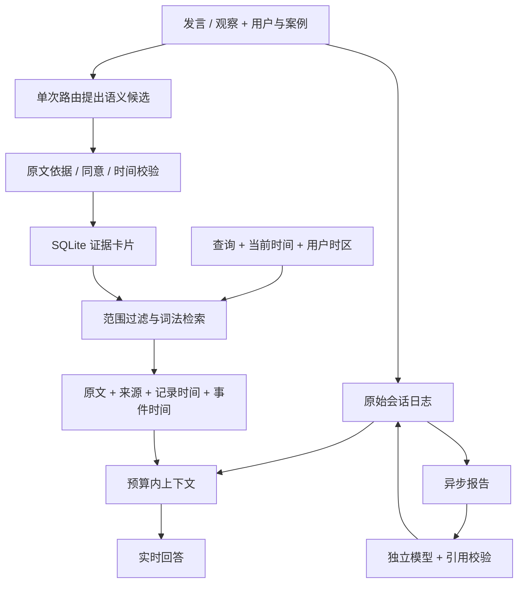

# EgoAssist 记忆机制

本文描述当前代码，而非预期能力。目标是在可审计原始证据上提供低延迟回忆，尽量少规定人物类型、关系本体和专用字段。用户隔离、时钟、来源和执行权限仍是必要约束。

## 组件分工

| 组件 | 实际职责 | 默认实时路径 |
| --- | --- | --- |
| `SessionJournal` / `ContextHarness` | 原始交流、执行轨迹、预算内上下文和确定性摘取 | 是 |
| `TimelineMemory` | SQLite 原文卡片、FTS 词法检索、用户/案例/时间边界 | 是 |
| `RealtimeEpisodeMemory` / `PreferenceMemory` | Timeline 的业务适配器，事件、保存同意与偏好确认 | 是；不是独立算法或第三种数据库 |
| `HierarchicalMemory` | 离线向量研究：事件合并、分层检索、来源展开与帧定位 | 否 |

`memory_policy.py` 的 profile 是共享组件的开关组合，不是四套独立算法。LiveKit 是媒体传输，Temporal 是提醒工作流，均不是记忆模型。

## 数据流

## 原文、索引与状态

追加日志保存发言、模型请求、工具回执、任务转换和报告。摘要或索引缩短不应抹掉来源。Timeline 是可检索视图，单条索引文本目前有 1,000 字符上限，不能代替完整原文日志。

问题原文首先进入 `turn_inbox`。`turn_inbox_state` 表示路由和状态处理，`turn_delivery` 单独表示收到、正在回答、响应完成、中断或失败。新话题不会删除旧问题；已处理却没有完整输出的问题不能标成回答成功。同一问题可能有多个子任务，详细结果仍需查看对应 intent/job/result；问题行不是所有子任务都成功的证明。

明确更正通过 `turn_revision` 关联新旧输入；语义模型仍可能漏识别更正，不能把普通换话题自动解释为撤销已执行的记忆或工具动作。重复文本请求用客户端 ID 去重，音频/字幕用问题 ID 和响应 ID 归属；这些是传输和执行约束，不增加人物关系本体。

| 数据 | 作用 | 边界 |
| --- | --- | --- |
| `user_id/case_id/scope` | 身份与案例隔离 | 数据所有权不等于所有案例自动互相召回 |
| `text/sourceIds` | 证据片段与引用 | 来源存在不证明陈述真实 |
| `recordedAt` | 服务器记录时间 | 不一定是事件发生时间 |
| `effectiveAt/effectiveEnd` | 可解析的事件有效时间 | 不接受模型任意编造日期 |
| `evidenceContext` | 可选实体、场景、多时间引用 | 不是预定义图谱或可靠身份消歧 |
| `subject/predicate/value` | 兼容明确的单值事实和状态更新 | 不强迫交流事件成为三元组 |
| `kind/status/tier` | 类型、生命周期和检索组织 | `long` 不表示事件一定久远 |

`kind` 包含 `fact/event/state/preference/task-preference/scene/observation/tool-effect/capture/legacy`。capture 默认不可召回，空类型集合不能扩大范围。旧卡片通过 schema 迁移保留。

`short/long` 是持久层级，`current` 是根据时间窗口派生的视图。Timeline 整理主要做确定性提升和状态管理，不等同于离线向量有损合并。

## 写入与范围

单次路由可提出事件和查询，不要求额外提取请求。单事件优先使用原始发言；多事件摘录、实体和场景需有原文依据。业务适配器决定能否保存及范围，模型的 `explicit` 标签本身不能授权跨案例长期保存。

普通事件通常留在当前案例。显式保存、已确认偏好等符合政策的内容可进入 `participant` 范围。两种范围都有同一用户边界。任务偏好存在提议与确认流程，不能把建议视为已接受。

有效保存需要实际卡片 ID 和来源。模型说“记住了”不算成功；真实验收需要关闭原连接，在新会话中查到卡片并正确使用随机测试值。

## 检索与人际交流

Timeline 使用 SQLite、FTS5 与词项重叠排序，默认不调用 embedding 或 FAISS。用户、案例、类型、已知主体/关系、实体、场景和时间约束候选；精确键可优先定位明确单值事实。

当前仍读取范围内候选并在 Python 中检查，不是常数时间检索。严格标签能减少误召回，也会漏掉别名、同义词和关系链中间事件。尚未实现通用实体消歧、多跳推理或跨句时间解析。

`evidenceNetwork` 是从卡片构造的共现投影，显示人物、场景、事件和来源的关联，不自动创造“同事”“朋友”等事实边。同名不一定同人，共现不证明某种社会关系。

## 真实时间

`ClockContext` 提供服务器 UTC、用户时区和本地时间。代码计算日期；模型选择原文时间片段、角色和锚点。时区不可解析时披露回退来源。

若当地日期是 2026-09-09：

| 查询 | 可能解释 |
| --- | --- |
| 昨天讨论的前天的约定 | 讨论为 9 月 8 日、约定为 9 月 7 日，均相对当前发言 |
| 昨天讨论、以那次讨论为参照的前天的约定 | 讨论为 9 月 8 日、约定为 9 月 6 日 |
| 昨天他说“前天的约定” | 引语锚点可能不同，不明确时应澄清 |

多个时间表达分别保留，不用单个关键词覆盖其余日期。可解析不表示语义一定正确，模型仍可能选错合法锚点。节日、农历、复杂转述和跨句指代没有全面验收。EgoLife 的 `DAY1` 不是可凭空确定的公历日期。

## 异步报告

中断回答另由 `product/answer_jobs.py` 调度，不混入报告和记忆写入队列。每个已处理的问题保存当时的检索证据、提示词、时钟和任务快照。新问题只抢占语音，旧问题自动产生归属于原 `turnId` 的文字答案；恢复和重试不重放用户控制或工具。后台回答是模型输出，不作为用户事实写回记忆。

`answer.job/request/result` 保留排队、生成、失败、取消、实际请求和结果。界面展示原问题、答案、模型、耗时及请求 ID。前台已经生成完整答案时直接展示其转写；补答只有在中断、前台截止或重启恢复时启动。更正与取消在发布前检查，迟到结果不能覆盖取消状态。提示词位于 `prompts/answer_completion.json`。

真实补答恢复测试发现，模型查询可能把实体和属性合并成一个标签。检索现在允许查询主体精确等于已存主体与属性的拼接，仍拒绝不同主体；没有加入取件码等领域词表。此修复不解决别名和任意同义词。完整验收还观察到时间锚点误判，以及路由超时后仅保留原文、缺少时间索引的降级，见[当前验收](docs/ANSWER_COMPLETION_2026-09-09.md)。

`InsightJobs` 保存任务、参数、状态、执行次数和阶段；`InsightGenerator` 收集原始用户记录，单独调用文本模型。两者复用会话日志，不增加记忆数据库。

1. `POST /api/insights` 持久化任务后返回 HTTP 202。
2. 默认两个任务并行，新提交的总待办容量为 16，相同参数待办去重。
3. 按用户时区计算日/周/月区间，周从周一开始，结束时间不含在内。
4. 收集记录并披露总数、纳入数、遗漏数和错误。
5. 保存实际提示词，调用独立模型，保留请求 ID、原始输出和用量。
6. 校验输出结构与引用 ID，保存结果，前端恢复显示。

默认预算为 300 条、32,000 字符，优先较新记录；超额标记不完整。这不是长周期完整分块汇总，也不是每日自动调度。按记录时间筛选输入，输出仍需区分事件日期、计划与已完成事实。

页面关闭后已受理任务继续执行。重启后未完成报告重新排队，恢复队列在名额释放时自动补位，不依赖页面刷新；连续重启不再触发固定两次执行上限。失败或取消的任务不会自动重试。

进程停止可能导致供应商请求重做及额外费用，无法保证旧请求不会在供应商端完成。结果缓存不是跨外部系统的恰好一次协议。单写租约不支持多机竞争执行。

前端阶段对应可观测事件：读取记录、准备证据、等待模型、验证输出、完成。展示等待时间与请求上限，不伪造百分比或模型隐藏思维链。主动建议目前依赖在线控制台触发；页面关闭不会主动创建新的建议任务。

## 离线分层记忆

`HierarchicalMemory` 保存分段事件的向量、描述、音频文字、关键帧及时间。相邻高相似事件可合并为均值向量节点，活动索引定位候选。`Config` 控制窗口、容量、整理周期与 top-k。

旧实现合并后删除来源且只保留前四段描述，导致信息丢失和不可加载快照。现在保留来源登记表及描述，快照保存真实时间，加载重建活动索引。写快照时锁住内存视图；多文件快照仍非断电原子事务，不应直接覆盖唯一备份。

离线问答先找聚合候选，再展开原始来源按查询向量排序，交给回答与时间定位。存储层级不通过“昨天”“最近”等关键词冒充事件日期。聚合候选没找到时仍会漏检，不保证全库精确召回。

保留来源增加内存和快照体积，图像数组尚未按需磁盘加载。这条研究路径不适合无限时长地直接部署到眼镜端。

## 实测与失败模式

2026-09-09：22 条已下载片段对应的 EgoLife 原始标注、12 题、同一 `qwen-flash` 回答模型、6,000 字符证据预算。向量为真实 `text-embedding-v3`；这是文本摄入实验，不是摄像头或图像模型验收。

| 路径 | 目标来源召回 | 本地检索中位数 |
| --- | --- | --- |
| 近期原文预算窗口 | 7/12 | 0.32 ms |
| Timeline 词法检索 | 12/12 | 15.3 ms |
| 原始向量检索 | 12/12 | 0.22 ms，不含 embedding |
| 分层来源按合并顺序装入预算 | 9/12 | 0.51 ms |
| 分层来源展开后重新排序 | 12/12 | 0.48 ms，不含 embedding |

查询附带目标片段和帧范围，能提高检索表现；不能外推到任意开放对话。近期窗口漏旧事，聚合文本挤掉目标，模型引用合法也可能回答错事件。12/12 来源召回不等于回答准确率 100%。详见[对比记录](docs/MEMORY_MECHANISM_COMPARISON_2026-09-09.md)。

复查旧真实报告还发现：导入的 EgoLife 片段被表述成“2026 年 9 月 9 日发生”，实际该日期只是导入记录时间；`DAY1` 不提供公历事件日期。当前提示词已区分两者，但这份旧输出证明提示词和合法引用都不能保证时间忠实度。该问题需要真实模型复验，不以报告任务 `completed` 当作语义正确。

架构参考包括 [Mem0](https://github.com/mem0ai/mem0)、[Graphiti](https://github.com/getzep/graphiti)、[Letta](https://github.com/letta-ai/letta-code) 和 [DeepSeek Harness](https://github.com/deepseek-ai/deepseek-harness)，涉及模型提取/混合检索、时间图谱、可编辑记忆与后台整理。本仓库没有部署实测这些外部框架，上表不是与它们的排行榜。

## 置信度与数据边界

模型自报概率不是校准正确率。实时证据不要求模型给置信度，来源验证只证明出处，检索分数只用于排序。离线 conformal 需要独立校准数据及分布假设，不能直接用于保证实时路由或任务执行。

评价应分别测原文保留、时间锚点、来源召回、答案忠实度、写入同意、错误执行与延迟。账户导出需披露损坏行，删除需处理相关副本和在途任务。

原始媒体默认不完整保留；有限 UI 投影、保留政策、删除及本地备份决定真实边界，不承诺永久保存所有数据或跨设备同步。

## 源码入口

| 文件 | 阅读重点 |
| --- | --- |
| `realtime/context_harness.py` | 日志追加、恢复、预算组装 |
| `realtime/episodes.py`、`engine.py` | 事件和偏好适配 |
| `memory/timeline.py` | 范围、状态、排序 |
| `memory/evidence.py`、`temporal.py` | 原文标签、共现、时间锚点 |
| `product/insight_jobs.py`、`memory/insights.py` | 报告执行与恢复 |
| `memory/store.py`、`snapshot.py` | 离线分层与快照 |
| `realtime/performance.py` | 性能投影 |
| `prompts/` | 可修改提示词 |

以上路径均相对 `egoassist/`。复现命令见 [README](README.md#验证)。带日期的历史文档保留当时结果，以当前源码和本说明为现状入口。
## 声画证据补充（2026-09-09）

现场音频转写的 API `user` 角色不等于佩戴者。声纹分段先产生匿名声音编号；只有账号明确确认后才附带姓名或佩戴者标记。多人、短段遗漏或不确定匹配不能整句归于佩戴者，未确认声音不能触发个人记忆写入、任务变更或回答取消。自然对话是否需要回应由语义模型结合上下文判断，声音归属与谈话指向是两个问题。

提问时的原始 WAV/JPEG、声纹分段、模型请求和账号确认追加到案例日志并随账户导出、删除。声音和画面人物不会只因同时出现就自动绑定；确认关系限定于参考帧，没有持续人脸跟踪。该层提供可审计证据，不直接将模型的场景猜测写成人际关系事实。连续音视频并未全天保存。详细结构、真实测试和延迟边界见 [声画与前端验收](docs/SHARED_SCENE_2026-09-09.md)。
