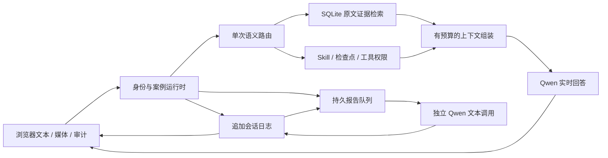

# EgoAssist

面向智能眼镜助手的可运行软件 Demo 和记忆研究项目。浏览器提供文本、麦克风与摄像头入口，Python 服务管理用户、任务、记忆与审计，Qwen 提供语义路由、实时回答和独立报告生成。

真实验收已覆盖云端对话、Skill 工作流、跨会话记忆、报告和性能审计。新增的自动补答通过七种真实打断场景、带记忆的重启恢复及浏览器刷新/取消检查。完整验收仍发现时间锚点误判、路由超时导致时间索引缺失、月报输出截断。**不能宣称整版全部通过；尚未完成眼镜硬件验收。** 证据见[自动补答验收](docs/ANSWER_COMPLETION_2026-09-09.md)。

- [记忆机制](MEMORY_ARCHITECTURE.md)：保存、检索、时间理解、报告和失败边界。
- [文档导航](docs/README.md)：架构决策、代码审查和历史实验。
- [提示词](egoassist/prompts/README.md)：模板、调参方法和实际请求审计。

## 启动

云端 Demo 不需要本地 GPU。主要验证环境为 Windows、Python 3.13、Edge；真实验收脚本使用 Python 3.11 及以上的异步超时接口。项目声明的最低运行版本不等于所有平台都已验证。

```powershell
cd D:\DEMO\EgoAssist
py -3.13 -m venv .venv
.venv\Scripts\python.exe -m pip install -e ".[dev]"
if (-not (Test-Path .env)) { Copy-Item .env.example .env }
```

在 `.env` 填写 `QWEN_API_KEY`，或使用 `DASHSCOPE_API_KEY`。密钥需要对应模型权限，网络需可访问 DashScope HTTPS 和实时 WebSocket。不要提交密钥。

```powershell
.venv\Scripts\python.exe run_egoassist.py --open
```

默认地址 <http://127.0.0.1:8770>。注册本地账户，创建案例，先用文本入口验证云端链路，再启用媒体设备。摄像头和麦克风需要浏览器授权。

第二个实例必须同时使用不同端口和数据根目录：

```powershell
.venv\Scripts\python.exe run_egoassist.py --port 8780 --memory-path .egoassist-real-demo/runtime.json
```

`--memory-path` 的父目录是持久数据根目录，不只是 JSON 文件的位置。每个根目录只允许一个服务进程持有写入租约。

## 演示能力

| 能力 | 实际行为 | 边界 |
| --- | --- | --- |
| 实时对话 | 文本/语音输入，真实 Qwen 音频与转写输出 | 文本测试不测量麦克风 ASR、扬声器和眼镜无线链路 |
| 中断补答 | 新问题优先播报，旧问题自动补完文字并归到原问题 | 明确取消或更正不补答；失败可单独重试，不自动重播旧语音 |
| Skill | 选择、激活、退出、确认、暂停、恢复、回退 | 用户确认检查点不证明物理动作完成 |
| 记忆 | 案例事件、显式跨会话保存、偏好与时间检索 | 可能漏检别名、同义词和复杂指代 |
| 报告 | 按指定日期生成日报、周报、月报，查看来源 | 按需提交，不是每天/月末自动执行的日历调度 |
| 主动建议 | 在线控制台启用后，对新记录生成建议 | 页面关闭后不产生新的建议请求；已受理任务继续执行 |
| 任务恢复 | 刷新后恢复显示，重启后调度未完成报告 | 在途云端调用可能重做，不保证外部副作用恰好执行一次 |
| 审计 | 事件链、提示词、证据、Token、阶段耗时 | UI 是有限窗口，完整数据通过账户导出检查 |
| 资料/求助 | 授权 PDF 预览、确认后的求助连接器 | 外部服务必须配置并可用 |

内置四个 Skill、七个固定任务：`kitchen-coach` 三项、`assembly-coach` 两项、`packing-coach` 两项；`field-notes` 是无固定步骤的对话工作流。Skill 定义政策、资源和可用工具，不替代模型、记忆服务或硬件识别。

## 架构



实时回答、报告、媒体观察和持久提醒是不同执行路径。报告默认最多两个并发请求，不占用实时回答的供应商会话；仍共享进程、磁盘和网络。单个案例的任务状态转换保持顺序，避免多个语义结果同时修改检查点。

刷新会关闭媒体连接；已接收文本、检查点和持久化结果可恢复，旧连接音频无法原地续播。重启会中断计算，报告恢复的是任务与证据，执行可能重新开始。普通工作账本、Temporal 提醒和工具副作用各有恢复规则，不能统称所有任务无条件不中断。

文本入口为每次提交分配 `clientRequestId`。同一案例内以相同 ID、相同内容重发会去重；同一 ID 改变内容会被拒绝。后续问题可以打断旧播报，旧问题由独立 `AnswerJobs` 自动生成完整文字答案，不需要明确继续。原问题、当时的提示词、检索证据与时钟随任务保留，补答不重跑控制或工具。明确更正和取消阻止旧答案发布；失败显示原因，可只重试回答。

音频、字幕携带 `turnId/responseId`，服务端过滤过期代次，前端按问题和响应分开字幕。已完整生成的语音转写也在原问题下显示，即使播放被打断仍可阅读。补答任务在服务重启后恢复；断线留下的未处理新输入最多阻塞补答一个前台截止窗口。记忆文字回执、后台处理完成、模型响应完成是不同状态；模型完成也不等于扬声器已经播完。补答完成不证明物理任务、工具操作或等待确认的动作已完成。

未获回执的文本暂存在该标签页的 `sessionStorage`，按账户和案例隔离，刷新后连接同一案例会用原 ID 重发，回执后移除。关闭标签页、清除站点数据不在该暂存保证内；已获回执的数据由服务端日志保留。

## 代码地图

| 路径 | 职责 |
| --- | --- |
| `run_egoassist.py` | HTTP/WS、案例所有权、生命周期与模块组装，目前仍是较大的集成入口 |
| `egoassist/realtime/` | 云端桥接、路由、Skill、工作账本、上下文日志与视觉观察 |
| `egoassist/memory/` | SQLite 证据记忆、时间解释、报告、离线分层与快照 |
| `egoassist/product/` | 报告调度、隐私、资料、通知、提醒与外部接口 |
| `egoassist/console/` | 原生 JS 审计界面及打包媒体/PDF 库 |
| `egoassist/prompts/`、`skills/` | 模型政策、Skill 清单、参考资源与任务定义 |
| `egoassist/capture/`、`backends/`、`qa/`、`retrieval/` | 离线采样、模型后端、检索、定位与问答 |
| `egoassist/habits/`、`abstention/`、`eval/` | 习惯推断、拒答研究和指标，不自动校准实时模型 |
| `tests/`、`scripts/` | 行为回归、环境诊断、真实供应商验收和机制对比 |
| `docs/validation/` | 已归档实验摘要和失败证据 |
| `outputs/`、`data_real/`、`.egoassist*/` | 本地产物、数据集与用户数据，默认不进入 Git |

## 配置

完整样例见 [.env.example](.env.example)。

| 配置 | 默认 | 含义 |
| --- | --- | --- |
| `--model` | `qwen3.5-omni-flash-realtime` | 实时回答模型 |
| `EGOASSIST_TURN_ROUTER_MODEL` | `qwen-flash` | 单次语义路由 |
| `EGOASSIST_TURN_ROUTER_TIMEOUT` | `3.0` 秒 | 路由截止时间 |
| `EGOASSIST_ANSWER_MODEL` | `qwen-flash` | 中断后自动文字补答 |
| `EGOASSIST_ANSWER_CONCURRENCY` | `2` | 全局补答并发 |
| `EGOASSIST_ANSWER_TIMEOUT` | `20` 秒 | 单次补答截止时间，不含排队 |
| `EGOASSIST_FOREGROUND_ANSWER_TIMEOUT` | `45` 秒 | 前台无终态时转文字补答，以及等待新输入分类的上限 |
| `EGOASSIST_INSIGHT_MODEL` | `qwen-flash` | 报告模型 |
| `EGOASSIST_INSIGHT_CONCURRENCY` | `2` | 全局报告并发，不超过待办容量 16 |
| `EGOASSIST_INSIGHT_TIMEOUT` | `30` 秒 | 单次报告 HTTP 截止时间 |
| `EGOASSIST_INSIGHT_JOB_TIMEOUT` | `45` 秒 | 获得执行名额后的截止时间，不含排队 |
| `EGOASSIST_AMBIENT_MODE` | `0` | 无任务观察，另需用户授权 |
| `EGOASSIST_TEMPORAL_TARGET` | 空 | 持久提醒服务，未配置时对应能力不可用 |
| `LIVEKIT_URL/API_KEY/API_SECRET` | 空 | 配齐后使用 LiveKit，否则使用 WebSocket 媒体路径 |

求助 webhook 和 ntfy 通知需另配地址/凭据。MCP 客户端已实现，但默认入口未自动连接 provider。可选功能的运行配置与安装依赖是不同概念，不能据此认为其 SDK 均未安装。

## 验证

```powershell
# 确定性行为回归，不需要 API Key
.venv\Scripts\python.exe -m pytest -p no:cacheprovider

# 真实供应商，每次使用新的输出目录
.venv\Scripts\python.exe scripts/verify_real_turn_attribution.py --output outputs/new-attribution
.venv\Scripts\python.exe scripts/benchmark_realtime_latency.py --output outputs/new-latency --repeats 3
.venv\Scripts\python.exe scripts/verify_real_social_memory.py --output outputs/new-social

# 真实浏览器，需要 Playwright 和已安装的 Edge
.venv\Scripts\python.exe -m pip install playwright
.venv\Scripts\python.exe scripts/verify_browser.py --output outputs/new-browser --real-turn

# 已下载 EgoLife 标注的真实 embedding / 回答模型比较
.venv\Scripts\python.exe scripts/compare_memory_mechanisms.py --output outputs/new-memory-comparison
.venv\Scripts\python.exe scripts/verify_insight_recovery.py --output outputs/new-report-recovery --source outputs/new-memory-comparison/dataset.json

# 统一真实软件验收：19 组独立运行，失败继续记录，不自动重试
.venv\Scripts\python.exe scripts/verify_real_acceptance.py --output outputs/new-full-real --source outputs/new-memory-comparison/dataset.json
```

真实脚本没有可用供应商时应失败，不以 mock 冒充通过。`compare_memory_mechanisms.py` 使用已下载片段对应的 QA 原始文本标注，不重新推理视频。使用替身的单元测试只证明软件行为。

统一验收包含连续输入、播报中打断、文字口误更正、重复提交、在途断线、自动补答、取消、带记忆的补答重启、延迟、记忆、时间、Skill、浏览器报告和报告重启恢复。它不覆盖实物眼镜、真实麦克风口误识别、所有可选连接器及无限并发。具体证据与未验证项见[自动补答验收](docs/ANSWER_COMPLETION_2026-09-09.md)。

视频全链路研究另用 `run_egolife_benchmark.py --help`。它的采样、图像编码、视觉回答和定位开销不同，不能把旧视频评测的分钟级耗时当作当前实时延迟。少于两段视频时没有独立测试集，必须检查 `split_status` 和 `n_test`。

## 性能与限制

自然停止交互不使用停止关键词表。检测到用户开口后先停止设备播放，语义路由再区分停止声音、撤销回答、新问题和引述/否定。纯停止不检索记忆、不产生口头确认。“先别出声”保留后台补答，“这个答案不需要了”取消对应问题，换话题不自动取消。提示词集中在 `egoassist/prompts/answer_completion.json`。

真实 Qwen TTS 音频经实时 ASR 测试，开始发送音频到停播通知约 288-299 ms；真实 Edge 播放队列清零约 313 ms。识别整句话及语义判断仍需另外等待；这是合成语音的软件链路实测，不是眼镜或真人麦克风数据。详见[自然语音停止审查](docs/NATURAL_VOICE_STOP_2026-09-09.md)。

2026-09-09 的四轮真实 Qwen 文本控制验收中，从发送文本到首音频约 **1.01-1.42 秒**，四轮均通过。样本很小，不代表 P95/P99 或硬件延迟。对应本地产物为 `outputs/async-realtime-latency-20260909/summary.json`。

22 条 EgoLife 记录的独立报告约 **14-22 秒**。异步受理并不缩短模型输出时间。前端显示排队、读记录、准备证据、等待模型、校验和耗时，不伪造生成百分比。[记忆对比](docs/MEMORY_MECHANISM_COMPARISON_2026-09-09.md)区分本地检索与云端 embedding 成本。这些本地产物默认忽略，克隆后需重新运行或查归档证据。

尚未验收：眼镜型号与协议、麦克风和回声打断、无线断网、后台录制、连续长时间运行、功耗、温度、多设备同步、生产认证和灾难恢复。原始媒体默认不完整保存；模型可能遗漏、混淆或错误引用已找回的证据。

## 部署与数据

本机优先绑定 `127.0.0.1`。远程访问需 TLS、访问控制和持久卷；浏览器远程媒体也需要安全上下文。Docker 应挂载整个数据根目录：

```powershell
docker build -t egoassist .
docker run --rm -p 127.0.0.1:8770:8770 --env-file .env -v egoassist-data:/app/.egoassist egoassist
```

Docker 文件存在不代表已完成容器验收。备份应在停止写入后复制整个数据根目录，包括 SQLite、日志及相关文件，不要只备份 `runtime.json`。账户可导出和显式删除数据；安全说明见 [SECURITY.md](SECURITY.md)。

## 开发

领域政策进入 Skill/提示词，权限和时钟进入可验证代码，状态进入持久账本，模型输出只是提议。异步执行必须处理重复提交、取消、退出、恢复和结果归属。

不要用无来源摘要覆盖原文，不把模型自报置信度当作正确率。修复后运行受影响测试，再按风险运行全量和真实验收。保留失败日志，检查安装包资源，明确未验证条件。

许可证：[Apache 2.0](LICENSE)。第三方归属见 [NOTICE](NOTICE)。
