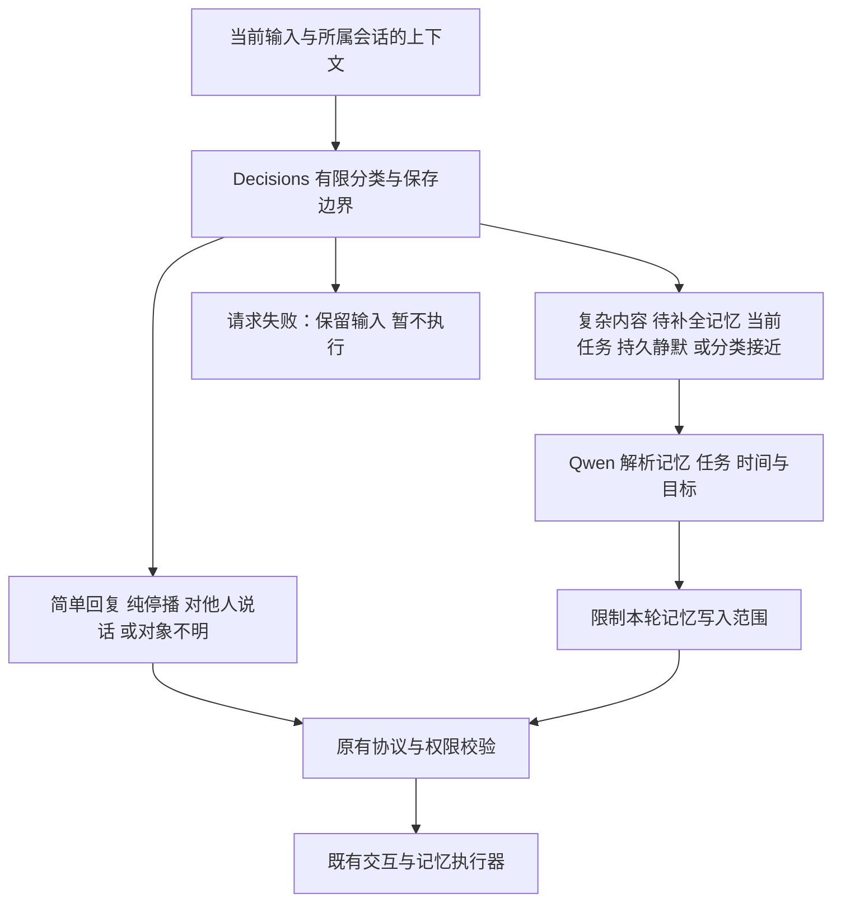

# Decisions 主路由接入

> 本文保留 2026-09-24 的 v1–v3 接入方案与实验。当前为 [JEV 优先路由 v6](JEV_FIRST_ROUTER_2026-09-25.md)：简单记忆、任务、Skill、答案目标及独立控制复核已扩展到 JEV；下文的强制解析条件和 Qwen 复核描述属于历史实现。

Decisions 已接入生产 WebSocket 的路由创建入口，可使用 `EGOASSIST_TURN_ROUTER_BACKEND=openrouter-decisions` 选择。它替代第一层路由判断；有自由文本、时间参数、任务或记忆内容要提取时，继续调用 Qwen 的完整解析协议。**这不是完全移除 Qwen 的实现**，两个供应商的凭据都需要。

## 执行路径



- 参数为空的简单分支直接转成现有 `interaction` 协议。停播仅改变声音许可，不取消任务；未知对象不发声。
- 复杂分支继续完成原话提取、时间参数、复合任务、Skill、记忆查询、纠正目标等工作，并通过现有来源、范围与目标校验。任务完成和取消仍使用原有独立核验。
- 已有任务、未完成保存草稿或持久静默状态强制进入完整解析。新输入造成的临时声音暂停不是持久静默，不因此禁用简单分支。分类前两项分布差距小于 0.2 也进入完整解析；这个值只是保守分流规则，未经过概率校准，不赋予执行权限。
- 普通陈述的记忆提取最多保留为 `observed/case` 的来源事件；明确禁止保存、仅问题/任务指令、范围混合不清时，去掉本轮提取的写入候选和新保存草稿。明确保存或兼容草稿只保留解析器提出的候选，仍需原有校验，不凭分类制造事实。
- 本轮“不要保存”的限制针对这次路由输出的记忆候选。它不自动删除此前账户记录，不擦除原话审计，也不替代账户隐私设置或未来保留策略。
- 记忆恢复服务继续专门使用原 Qwen 解析器，不再经过交互前置分流；日记、观察、回答模型与工具模型不由该配置选择。

## 配置和回滚

```dotenv
OPENROUTER_API_KEY=你的密钥
EGOASSIST_TURN_ROUTER_BACKEND=openrouter-decisions
EGOASSIST_DECISIONS_MODEL=typesafe/jev-1.13
EGOASSIST_DECISIONS_TIMEOUT=2.0
EGOASSIST_TURN_ROUTER_MODEL=qwen3-max
EGOASSIST_TURN_ROUTER_TIMEOUT=4.0
```

Qwen 继续使用已有 `QWEN_API_KEY` 或 `DASHSCOPE_API_KEY`。切回 `EGOASSIST_TURN_ROUTER_BACKEND=qwen` 即恢复原路由。未设置后端时源码默认仍是 qwen，避免让未配置 OpenRouter 的克隆环境启动后失去路由。修改环境文件后重启服务并建立新连接；既有路由对象不会动态重配。

本机 `.env` 已设置 `EGOASSIST_TURN_ROUTER_BACKEND=openrouter-decisions`，新进程配置检查通过。验收均在隔离应用中运行；原有 8770 服务未由本轮重启，重启后加载这个选择。密钥和 `.env` 不提交 Git。

Decisions 子请求最多 2 秒，主分类请求与复杂解析合用原 4 秒截止时间；继承的任务/取消复核仍有各自既有期限，不将 4 秒称为包含一切核验的总端到端 SLA。传输为 aiohttp 异步请求，超时或取消会释放连接，不把阻塞 HTTP 放进后台线程继续运行。不自动跟随重定向，不将 OpenRouter key 发送给 Qwen。

接口错误、非法字段、超时均返回 `invalid/unavailable`，保留待处理工作并暂不发声；不在供应商失败后暗中换模型执行。401/402/403 打开连接级熔断，通过既有失败重置或重连恢复。

## 审计

完整路由结果增加 `routerBackend`、`modelsUsed`，`model` 表示实际生成当前协议的模型；复杂分支为 Qwen，简单分支为服务端返回的 Decisions 模型版本。

`requestMetrics.decisions` 保存 typed 请求、问题定义、返回分布、原始响应、request ID、provider、usage、耗时、所选路由和保存边界。复杂分支另保留限制前的原始结构化输出以及 `structuredReason`。最终 `rawOutput` 是进入原有校验器的协议，不冒充模型直接返回的全文。轮询投影剔除大请求和原始响应；当前账户的完整审计接口保留它们。

## 验证入口

```powershell
.\.venv\Scripts\python.exe -m pytest tests/test_decisions_router.py tests/test_openrouter_decisions.py tests/test_router_transport.py tests/test_router_context.py -q -p no:cacheprovider
.\.venv\Scripts\python.exe scripts/compare_decisions_router.py --output outputs/decisions-router-new --repeats 3
```

对照使用同一批 12 个已有路由开发案例及 10 个新增人工边界案例，共 22 个独立文本。两种后端的文本、背景、Skill、结构化模型与期限相同，调用顺序交替；连续重复不扩大独立样本量。检查的不只是分类，还包括提醒秒数、静默条件、记忆作用域和纠正目标。它仍是开发回归，未覆盖 ASR、真人多人交谈或新留出分布。

首轮 [r1](../outputs/decisions-router-20260924-r1/report.json) 两种后端都是 20/22 通过。两者均暴露普通陈述错误升级为明确长期保存、否定保存仍产生写入候选的问题；原始输出保留。随后加入独立 retention 判断和限制，构成 v2。不得将 r1 与 v2 混成同一冻结运行。

真实延迟需分简单与复杂分支报告：简单分支可能减少开销，复杂分支增加了一次分类请求。不能沿用离线五问题的 356 ms 来描述完整生产路由，也不能将不同任务量的结果当作模型能力排名。

## 已完成的结果与失败

| 运行 | Decisions 组合 | 原 Qwen | 口径 |
| --- | --- | --- | --- |
| [r1](../outputs/decisions-router-20260924-r1/report.json) | 20/22 | 20/22 | v1，无独立保存范围限制 |
| [r2](../outputs/decisions-router-20260924-r2/report.json) | 66/66 | 58/66 | v2，22 个开发案例各重复三次；无生产临时 paused 状态 |
| [r3](../outputs/decisions-router-20260924-r3/report.json) | 21/22 | 20/22 | v3，当前实现；输入包含生产的临时 paused=true；每题一次 |

表中保留冻结断言原分数。事后核查发现 r2 的原 Qwen 两次 recall、r3 的 Decisions 一次 recall，仅因原文查询末尾没有问号而被断言判错。用生产 `retrieval_text` 验证，它们均为可直接使用的完整原文查询片段。复核另存 [r2 review](../outputs/decisions-router-20260924-r2/review.json)、[r3 review](../outputs/decisions-router-20260924-r3/review.json)，没有重写原预测或原分数。这不等于实际问答一定召回正确证据。

r2 的完整路由中位耗时：Decisions 组合 1444.25 ms、Qwen 1092.75 ms。其中 10 次未调用结构化解析，耗时中位 360.7 ms；56 次进入结构化解析，中位 1605.4 ms。Decisions 的 66 次响应 `usage.cost` 合计 0.004936554，不含 Qwen 解析与核验，不能称为总成本。r3 中位为 1534.0 / 1086.85 ms；该轮与浏览器验收、回归检查重叠，不是隔离性能基准。未知服务器缓存和网络负载，少量重复不提供 p95 或统计显著性结论。

真实产品验收：

- [浏览器 r3](../outputs/decisions-browser-20260924-r3/acceptance.json)：通过。真实模型文字输入/语音输出、引用报告、断线恢复、后台补答、取消后刷新、登录恢复、1440/390 宽度布局均通过，无页面异常或失败请求。日志实际包含 `routerBackend=openrouter-decisions`，不是仅配置环境变量后假定生效。
- 浏览器 r1/r2 保留失败。r1 的取消按钮位于折叠的历史面板；r2 的答案查询定位到三个重复展示节点。修正脚本为展开 `turnWorkHistory` 所在面板并限定该面板内的 turnId，未放宽业务效果断言。r2 退出清理时还出现 TTS 向关闭连接写入的后台异常，未将其解释为 Decisions 分类失败或声称修复该问题。
- [跨会话复杂时间记忆](../outputs/decisions-social-memory-20260924-r1/acceptance.json)：未通过。两条来源真实写入，但 Qwen 将查询中的“前天”错误锚定到前一个时间表达式，导致回答证据缺失。Decisions 正确选择 structured，且没有改动 query spec。用 [原 Qwen 路径](../outputs/decisions-social-memory-qwen-20260924-r1/acceptance.json) 重测也失败；这是共享解析/检索链路的现有限制，本轮未解决，不能报告完整记忆验收通过。
- [最终全量回归](../outputs/decisions-router-regression-final-20260924.xml)：当前共享工作区 827 项通过，0 失败/错误/跳过，105.122 秒，3 条既有 aiohttp 弃用提示。该工作区同时包含另一项长会话性能改动，827 是工作区测试总数，不全部归因于本路由改动。路由专项覆盖异步超时/取消释放、熔断和重置、临时暂停、并发上下文隔离、结构化委托、记忆范围限制与审计投影。

因此当前可以替换第一层路由入口，但完整自由文本解析仍依赖 Qwen，真实记忆的时间推理仍有未解决失败。这个集成没有证明跨人群泛化，也没有让全部请求更快。
