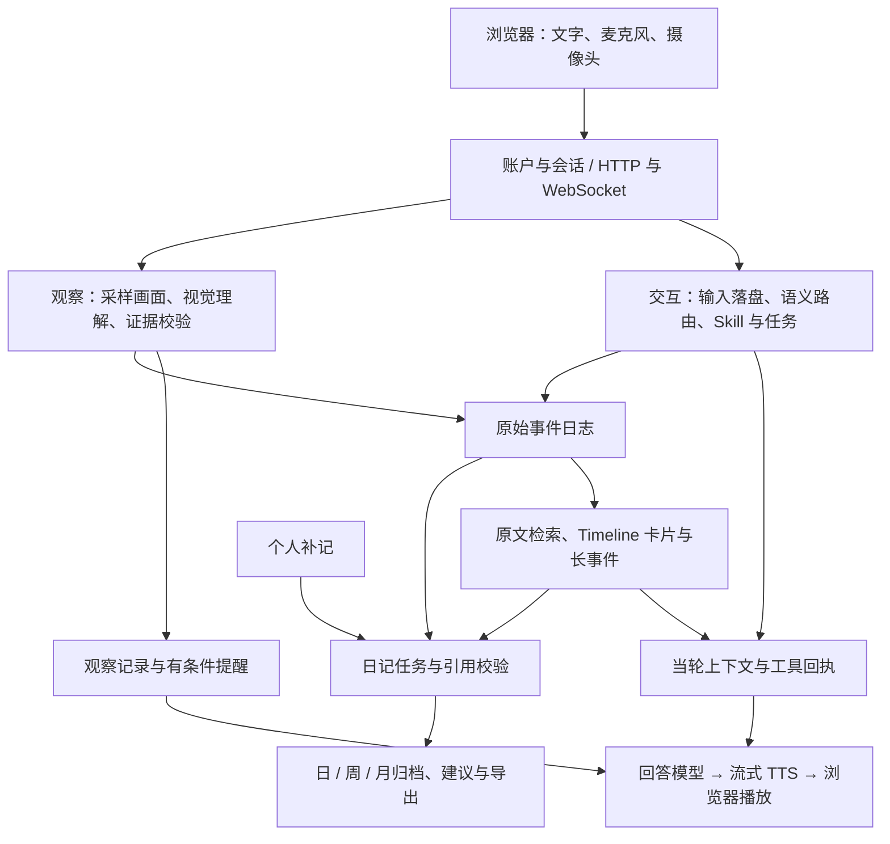

# EgoAssist 完整演示指南

目标是本机或团队现场流畅演示核心功能。主入口是单进程 Python 服务和浏览器；云端模型需要联网，摄像头与麦克风需要浏览器授权。无需 GPU、Docker、Temporal 或 LiveKit 即可演示核心链路。

## 启动

在项目根目录执行，建议 Windows + Python 3.13 + Edge：

```powershell
# 首次安装
py -3.13 -m venv .venv
.\.venv\Scripts\python.exe -m pip install -e ".[dev,modular]" playwright
if (-not (Test-Path .env)) { Copy-Item .env.example .env }

# 填写 .env 后检查本地依赖、密钥是否存在和随包资源
.\.venv\Scripts\python.exe scripts/demo.py check

# 启动演示并打开浏览器
.\.venv\Scripts\python.exe scripts/demo.py start
```

`.env` 至少配置 `QWEN_API_KEY` 或 `DASHSCOPE_API_KEY`。使用 `EGOASSIST_TURN_ROUTER_BACKEND=openrouter-decisions` 时，还需要 `OPENROUTER_API_KEY`。检查命令不打印密钥，也不调用模型；它通过不等于云端已连通。

演示入口使用模块化语音、`qwen3-max` 回答、开启工具调用，并将 JEV 单阶段/整体路由预算设为 4/8 秒。真实验证中，快速回答模型在缺少物品信息时出现过编造；演示配置选择回答质量更稳定的模型。该配置仅传给子进程，原有 `.env` 和 `run_egoassist.py` 的默认配置不变。

默认地址为 `http://127.0.0.1:8770/`。演示数据保存在 `.egoassist-demo/`，可以注册专门的演示账户。已有进程占用端口或目录时，同时更换两者：

```powershell
.\.venv\Scripts\python.exe scripts/demo.py start --port 8780 --memory-path .egoassist-demo-2/runtime.json
```

演示前打开页面，完成注册，启用设备并允许浏览器播放声音。现场使用有线耳机能减少扬声器声音被麦克风再次收录。文字输入是可独立使用的入口；刷新页面后需要重新连接媒体设备。

## 项目逻辑

三个运行链路共享有来源的持久事件，各自负责观察、交互和记忆。账户下可创建多个会话，任务状态属于会话，日记归档属于账户。



| 层 | 关键入口 | 状态及职责 |
| --- | --- | --- |
| 启动和装配 | `run_egoassist.py`、`application/composition.py` | 配置、账户、会话、服务生命周期和接口 |
| 媒体连接 | `application/realtime_connection.py`、`realtime/omni.py` | 连接恢复、回答队列、播放回执、停止与补答；桥接模块化和 Omni 后端 |
| 当轮执行 | `realtime/turn_coordinator.py`、`interaction_service.py` | 原话先保存；语义判断、任务变更、记忆读取、回答义务各有记录 |
| 模型适配 | `realtime/modular.py` | ASR、视觉、文字和 TTS 分工；每次回答固定输入快照 |
| 观察 | `observation_service.py`、`observation_reviews.py` | 绑定采样帧与当前授权；记录模型假设，校验后决定是否提醒 |
| 原始依据 | `core/journal.py`、`memory/source_index.py` | JSONL 是来源记录；SQLite FTS 是可重建检索索引 |
| 派生记忆 | `memory/service.py`、`memory/timeline.py`、`realtime/long_events.py` | 卡片、偏好、纠正、恢复与跨天进展；摘要不能覆盖原文 |
| 长任务和回顾 | `product/answer_jobs.py`、`diary/` | 持久任务、日记快照、来源引用、归档及恢复 |
| 页面 | `egoassist/console/` | 对话、三链路、任务、当前建议、审计；`diary.html` 共享登录 |

一次文字问答依次经过：持久化用户原话 → 路由判断 → 接受任务/Skill 变更 → 按范围检索记忆 → 固定当前上下文 → 生成文字与语音 → 记录播放和回答完成。不能用“生成完成”代替“播放完成”。停止声音、暂停计算和取消问题也是不同操作。

观察模式独立采样，不要求用户持续提问。画面描述、提醒候选、通过校验、已发送音频、设备已播放分别记录。采样图像不能证明中间动作、人物身份或实物操作已经完成。

日记与“当前建议”入口不同：前者按账户汇总选定日期的来源和补记，形成持久归档；后者针对当前会话生成分析作业。日、周、月回顾只能总结实际覆盖的记录，不会把一天数据冒充完整一周或一月。

长事件目前在同一持久会话内关联，读取近 30 天未完成事件，最多 16 个候选；日记则可以汇总账户下多个会话的来源。这两种范围不能混为一谈。

## 建议演示顺序（约 15–25 分钟）

| 段落 | 操作或示例输入 | 应展示的结果 |
| --- | --- | --- |
| 通用对话 | “请用一句话解释浏览器 cookie 是什么。”；接着问一个新话题 | 当前回答有文字和声音；不误激活 Skill |
| 语音交互 | 请助手详细解释一个概念，播报期间说“先别出声”；随后使用继续播报入口 | 播放停止、游标恢复；新问题仍可回答。附和“嗯嗯，你继续”保留发言 |
| 通勤核对 | “帮我做通勤出门核对，今天只带手机、钥匙和门禁卡，请告诉我第一步。” | 清单确认 → 找齐 → 携带核对；逐步明确确认后才完成 |
| 任务控制 | “我要做番茄炒蛋，请告诉我第一步。”；重复、暂停、继续、回到上一步 | 页面检查点与回答同步，暂停不丢失任务 |
| 参考资料 | “我要组装凳子，请告诉我第一步。”；“请展示当前步骤的参考资料。” | 执行 `show_reference`，打开随包 PDF。演示用参考资料不能替代实际产品手册 |
| 现场记录 | 先退出 Skill；口述“仓库收到六箱配件，其中一箱外包装潮湿，内部是否损坏还没检查”；要求整理，再更正为七箱 | `field-notes` 草稿保留不确定性；更正后数量更新；退出后不恢复旧任务 |
| 跨会话记忆 | “请记住：我的储物柜编号是482719。”；看到保存回执后新建会话并询问编号 | 卡片保存、原始依据可检查、跨会话检索。单纯生成草稿不等于长期保存 |
| 视觉问答 | 摄像头对准桌面，问“请描述桌上实际可见的物品，不要猜测姓名。” | 使用当次画面证据；关闭相机后不假装仍看得见 |
| 独立观察和提醒 | 开启观察，将目标设为“看到桌上的红色杯子时提醒我喝水”，再提供符合条件的新画面 | 三链路状态、观察记录、提醒与播放回执；关闭提醒后不再自动出声 |
| 当前建议 | 打开“当前建议”，生成并等待完成，再刷新 | 有来源的报告恢复；生成期间可以继续对话 |
| 日记归档 | 打开个人日记，保存示例补记，分别生成日记、周回顾、月回顾 | 进度、引用展开、补记恢复、建议反馈与 Markdown 导出 |
| 审计与数据 | 展开语义决策、实际模型请求、记忆来源，导出演示账户数据 | 能解释回答、任务与记忆从何而来；最后在专用测试数据中演示删除 |

其余内置任务可用“我要做香蕉燕麦粥”“我要做水果沙拉”“我要安装净水壶滤芯”“帮我做两天短途出行打包”进入。共四个 Skill、七个固定任务；现场记录没有固定检查点。确认步骤只是演示用户声明，不能声称摄像头验证了真实完成。

跨天事件需要有真实日期的历史输入；用下面验收命令生成独立的合成改期案例，可检查计划、准备、改期、反馈及原文引用。不要改系统时钟来伪造生活数据。

## 可复现验收

```powershell
# 确定性行为回归
.\.venv\Scripts\python.exe -m pytest -p no:cacheprovider

# 页面、账户、导航和布局，不调用云端回答
.\.venv\Scripts\python.exe scripts/demo.py verify --output outputs/demo-ui-new

# 真实模型：对话、四种 Skill、全部任务入口、参考资料、记忆、日记、语音、跨天事件
.\.venv\Scripts\python.exe scripts/demo.py verify --real --output outputs/demo-real-new

# 加上 EgoLife 视频帧与音频重放；需要本地素材及 av 依赖
.\.venv\Scripts\python.exe -m pip install av
.\.venv\Scripts\python.exe scripts/demo.py verify --real --with-media --output outputs/demo-media-new
```

`--real` 会调用实际供应商并产生费用。每次使用新的输出目录，脚本逐项串行执行；根目录的 `acceptance.json` 汇总退出状态，每项保留日志及原始结果，失败不会被自动重试覆盖。媒体重放需要 `data_real/egolife/A1_JAKE_DAY1/DAY1_A1_JAKE_11100000.mp4`，素材不随仓库分发。实体麦克风、相机、声学回声和眼镜硬件仍需现场试用。

## 条件功能

| 能力 | 演示条件 |
| --- | --- |
| 当前画面触发提醒 | 核心功能，需观察授权、当前提醒目标和新画面 |
| 将来的定时提醒 | 另需 Temporal 服务和 worker；未配置时显示不可用 |
| 联系他人、人工求助 | 另需真实连接器和明确的发送授权 |
| LiveKit 音视频传输 | 另需 LiveKit 服务器与完整凭据；默认 WebSocket 可完成核心演示 |
| 外部 MCP、本地大模型、离线科研评测 | 独立配置与入口，不属于默认现场演示 |

这些条件能力不以模拟“已成功发送”代替接通。现场主线使用核心能力，配置条件和模型失败可以在审计中如实说明。
