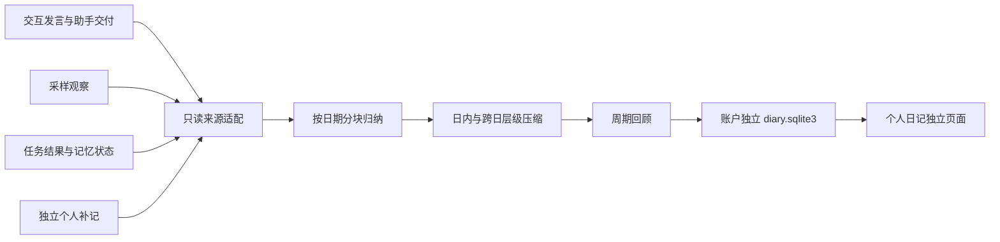

# 独立个人日记：实现与真实验收

2026-09-17。承接 [现状检查](DIARY_REPORT_AUDIT_2026-09-17.md)，根据“独立功能，不影响其他功能”的要求实施。

## 可打开的结果

- [实际输出、录屏、来源与失败记录](../outputs/diary-real-20260917-final/index.html)
- 实际应用：<http://127.0.0.1:8779/diary.html>
- 本机隔离演示账号：`diary-demo`，密码：`Diary-local-demo-20260917`。
- [实测汇总](../outputs/diary-real-20260917-final/verification.json)

这次已交付独立日记、周回顾、月回顾页面和账户级 SQLite 归档，支持日期查阅、历史分页、来源展开、个人补记、建议反馈、Markdown 导出和可选自动归档。
真实模型与浏览器链路通过；内容归纳仍有语义误判，见下方边界，不将功能验收解释成建议有效性已验证。

## 架构与隔离



实现位于 `egoassist/diary/`：`sources.py` 负责来源与时区，`generator.py` 负责分块及模型审计，`store.py` 负责归档，`service.py` 负责独立队列与恢复，`api.py` 负责认证接口和生命周期衔接。提示词在 `egoassist/prompts/diary.json`。

数据保存到 `users/<uid>/diary.sqlite3`，包含任务、检查点、版本、补记、建议反馈和自动归档设置。页面为 `console/diary.html`、`diary.css`、`diary.js`。不建立实时 WebSocket，不请求摄像头或麦克风，不向运行时提交动作，不回写记忆卡片，不迁移原业务数据库。

对原产品的接点仅为组合层可选挂载、首页新标签入口，以及账户导出/删除/保留策略的派生数据清理。原对话、观察、任务及旧 `/api/insights` 路径保留。共享进程及模型供应商仍有资源竞争可能，测试通过不代表任何负载下完全零影响。

`EGOASSIST_DIARY_ENABLED=0` 可禁用日记服务挂载；`EGOASSIST_DIARY_MODEL` 默认 `qwen3-max`。单独生成队列并发为 1，最多 16 个排队任务。自动归档默认关闭，开启后每 30 秒检查最近结束的日、周、月，更早历史须手动补做。

## 取材与持久化行为

- 只读账户所属会话中的完成发言、助手已交付文本、accepted 观察、执行回执和任务终态，以及未删除的账户记忆卡片。任务日志只投影明确业务字段，排除路由提示词和庞大运行时快照。
- 助手交付只证明交付过文字，不证明文字中描述的现实任务完成。记忆保留状态、替换关系和 grounding，后续更正参与旧周期回顾。
- 使用自然日、周一开始的自然周、自然月；按本地日期分块，并逐层压缩。所有已读取来源都进入分块，超容量明确失败，不默默只取最新尾部。
- 每个成功处理节点持久化；失败或重启后可重试并复用相同输入、模型与提示词的节点。请求审计含 provider request ID、耗时、原始输出、引用映射及输入摘要；无模型响应的超时没有虚构 request ID。
- 每条正文引用原始 source ID，生成时使用短别名避免模型抄错长编号，返回后映射回原始 ID。严格校验结构和引用存在性，尚不能保证每条引用在语义上充分支持整句。
- 页面刷新、切换会话、进程重启保留归档；每页 12 条并提供更早分页。重新整理保留新版本。
- 2026-09-25 更新：新日记保存输入来源清单及整理快照时间；新增记录提示可重新整理，不再使正在生成或已归档的旧快照失效。原依据被修改、删除或无法读取时，旧正文、来源快照、处理节点与原始模型输出仍撤下。旧版未保存清单的日记继续使用严格 fingerprint 校验；显式删除和保留策略执行时暂停派生任务。详见[修复与验收](FRONTEND_LANES_DIARY_2026-09-25.md)。

## 测试与实际调用

完整回归：**670 passed**，53.79 秒，3 条已有 aiohttp 弃用提示。随后加入失败历史记录字段后，日记与保留/删除专项：**23 passed**，11.78 秒。`git diff --check` 通过。

```powershell
.\.venv\Scripts\python.exe -m pytest -q -o addopts= -p no:cacheprovider
.\.venv\Scripts\python.exe -m pytest tests/test_diary.py tests/test_retention_api.py tests/test_retention_recovery.py -q -o addopts= -p no:cacheprovider
```

专项覆盖 30 天 3,000 条来源不丢天、长记录切分、层级压缩、检查点复用、错误引用拒绝、跨账户隔离、跨会话归档、分页、补记与反馈保存、重启恢复、自动归档去重、来源删除传播和旧报告接口兼容。3,000 条为确定性合成边界测试，不是真实模型长月质量评测。

真实演示从老人记忆纠正、职业回顾及 EgoLife 历史画面演示日志导入 77 条来源：8 条记忆状态、21 条用户亲述、15 条任务结果、21 条助手交付、12 条采样观察。原 ID、时间及导入 provenance 保留，没有改写成多天生活经历。

| 周期 | 最终状态 | 成功模型处理 | 实际来源日期 |
| --- | --- | --- | --- |
| 日记 | 已归档 | 6 | 2026-09-16 |
| 周回顾 | 已归档 | 6 | 2026-09-16 |
| 月回顾 | 超时后恢复并归档 | 6 | 2026-09-16 |

共 18 次保存的成功模型处理，此外月回顾首次最终请求超时。重启服务后在真实页面点击“从已保存分块重试”，复用前 5 个成功结果，只新增最终 1 次处理。首次失败 `verification-before-resume.json`、`monthly-before-resume.json` 与恢复后结果均保留。

浏览器使用 Edge 实测：三种正文显示、依据展开、反馈后刷新保留、按日期查阅、返回全部档案、新会话仍可查看、Markdown 导出、390px 手机宽度无横向溢出且正文先于目录、无 JS 异常、无实时连接。录屏长 115.88 秒、1440×1000，展示实际产品操作，无配音，不代表重新实时生成了全部三份报告。展示页本地链接与视频解码通过验证，见 `showcase-verification.json`。

## 未完成的质量边界

1. 素材是之前实际运行系统产生的演示记录，包含脚本化对话和 EgoLife 画面重放，并非真人连续生活记录；只有一天有来源。周/月输出证明周期链路可运行，不能证明连续一周或一月的建议效果。
2. 实际输出仍把部分已交付草稿、尚待确认的事项归入未完成；这说明业务状态的语义归并仍需改进。原始输出未人工修饰成更好的答案。EgoLife 选项只代表系统当时的回答，日记不验证其是否符合 ground truth。
3. 每个分块被处理不等于每个重要事实最终保留。当前栏目条目数有上限，缺少重要事件召回率、矛盾解决率与建议有效性的独立人工标注评测。
4. 周/月内部从原始资料生成逐日摘要并再压缩；还没有跨报告复用已有每日归档，也没有上一周期对比基线。只允许总结已观察周期内变化，不支持无依据的环比结论。
5. 消息按记录日、观察按采集日、记忆按发生时间归档；未完整解决“昨天发生的事今天才讲”等自然语言事件日期归属。
6. 单次上限为 500 万来源字符、500 个模型处理记录、12 层合并；超限明确失败。超大历史扫描仍会增加 I/O，尚未做长期真实账户压力验证。

## 复现与现场使用

已有隔离演示服务启动命令（端口已运行时无需重复启动）：

```powershell
.\.venv\Scripts\python.exe run_egoassist.py --port 8779 --memory-path outputs/diary-real-20260917-final/runtime/runtime.json
```

打开日记页登录，日期选 `2026-09-16`，分别切换日记/周回顾/月回顾，点击“查看已有日记”，展开依据，修改建议反馈并刷新验证保存。要重新生成，点“整理这段时间”，会产生新版本并真实调用模型。补记保存后重新整理相应周期才纳入正文。

```powershell
# 新目录执行全链路；需既有演示素材与有效模型凭据
.\.venv\Scripts\python.exe scripts/verify_diary_real.py --help
# 恢复验收与页面录屏
.\.venv\Scripts\python.exe scripts/verify_diary_browser_resume.py --source outputs/diary-real-20260917-final
.\.venv\Scripts\python.exe scripts/record_diary_walkthrough.py --source outputs/diary-real-20260917-final
.\.venv\Scripts\python.exe scripts/build_diary_showcase.py --source outputs/diary-real-20260917-final
```

历史实验 `diary-real-20260917-r1` 至 `r4` 保留：分别记录目录准备失败、引用校验失败、因不必要路由上下文过大主动中止，以及较早可运行版本。最终目录为 `diary-real-20260917-final`，不覆盖历史失败。
