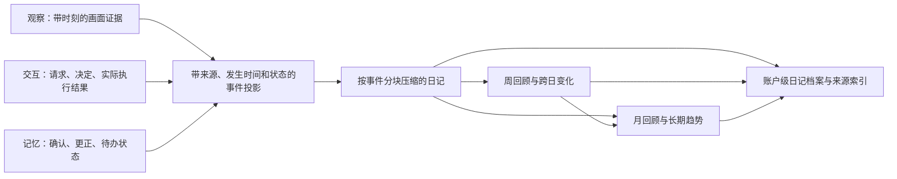

# 日报、周报、月报：个人日记定位检查

检查日期：2026-09-17。范围：当前代码、现有专项测试、真实应用 API 与浏览器展示。

## 结论

当前功能是**带来源引用的周期记录摘要**，已具备生成、保存、恢复和建议的基础，
但尚未形成用户所需的“三链路大量信息整理压缩 → 个人日记 → 生活与工作建议”。
最大缺口是取材覆盖、账户级归档和周期分析，不是模型换名或页面换标题。

本次只检查现状并保存可复现证据，没有修改产品生成逻辑或伪造新的模型报告。

## 已实现

| 能力 | 当前行为 | 代码位置 |
| --- | --- | --- |
| 日/周/月范围 | 本地自然日、周一开始的自然周、自然月，包含起点不含终点 | `memory/insights.py:19` |
| 输入取材 | 当前会话或账户下全部会话的用户发言、accepted 采样视觉描述 | `memory/insights.py:37`、`application/composition.py:413` |
| 输出 | 最多 12 条摘要、3 条建议，各带 sourceIds | `memory/insights.py:99` |
| 真实性约束 | 区分观察/亲述、计划/完成、历史相对日期；无依据允许空建议 | `prompts/insights.json` |
| 后台执行 | 队列、并发限制、取消、超时、重启恢复、相同输入缓存 | `product/insight_jobs.py` |
| 保存 | 请求、来源快照、模型输出、最终结果写入会话 JSONL | `memory/insights.py:149` |
| 展示 | 周期/日期/来源范围选择、任务状态、摘要、建议、来源展开、审计 | `console/index.html:154`、`console/app.js:1619` |

报告不会因页面刷新消失。账户导出包含日志。但这与独立日记库、跨会话历史浏览、
将日记接入后续问答检索是不同能力，后面几项尚未形成完整路径。
来源保留策略可能连带清除其派生报告；持久化不应解释为独立于用户删除策略的永久保留。

## 按优先级排列的差距

### P1：大周期取材退化为最近片段

`collect_sources` 扫描日志后，从最近记录向前装入最多 300 条、32,000 字符。
它没有按天覆盖配额、事件去重、分块归纳或层级压缩；日、周、月共用这一算法和输出上限。

复现：30 天每天 100 条合成用户记录，共 3,000 条。默认预算仅留下 95 条，
全部来自 9 月 30 日；2,905 条被省略。此时模型根本收不到前 29 天的内容。
覆盖标记诚实地为 incomplete，但页面只显示记录数量，无法看出哪些天完全遗漏。
这不是模型摘要质量问题，无法靠提示词补回未输入的数据。

### P1：三链路没有形成可用的事件与结果视图

报告只消费 `message(role=user,status=completed)` 和
`ambient_observation(status=accepted)`。交互执行回执、后台任务最终结果、
记忆卡片的当前状态/替换关系、以前的日记结果均未直接纳入报告输入。

因此“用户请求生成周报”可进入取材，但“后台实际生成成功”不能仅凭请求认定；
“曾计划做某事”也不能代替当前完成状态。用户在另一条消息里自行说明的结果可以被读到，
但这不是系统执行结果已接入。记忆更正只有对应原始消息仍在预算内时，模型才可能看到。

修复方向应为类型明确、带来源和状态的事件投影，而不是把所有运行日志或助手回答
直接当作生活事实输入。观察只证明采样画面，执行回执只证明对应动作，
记忆提取结果不能当作独立第二份证据重复计数。

### P1：全账户取材，仍是会话级保存和查阅

`scope=account` 只改变取材路径，输出仍写入当前会话日志。
`GET /api/insights` 要求指定 session，只返回该会话最近一份结果或指定 ID 的结果。
`visible_insight_jobs` 仅保留最近 12 个终态任务供页面列出，没有历史分页。

浏览器/API 复现：同会话刷新后报告仍在；切到新会话看不到已生成的账户范围报告；
14 条合成任务索引只显示 12 条。旧数据仍可按已知 ID 读取，问题是没有长期可发现的入口，
不能称为数据已丢失。

### P2：日、周、月只是时间窗口不同，内容结构相同

目前全部输出 `summary + suggestions`，没有日内故事线、生活/工作归类、
周内变化、月度趋势、长期事项连续状态。没有读取上一周期作为对比基线。
报告未纳入后续报告取材，因此不存在日→周→月的压缩链。

日期筛选也不是成熟的事件日历：发言按记录时间，观察按采样时间。
例如今天说“昨天完成了评审”，系统能按提示词解释“昨天”，但这条发言不会自动被取入
昨天的日报。回顾发生日与记录日需要显式区分。

### P2：建议有引用约束，但没有效果闭环

已实现来源引用和“不能声称已代用户执行”的限制。但没有建议优先级、
采纳/忽略/完成状态、后续效果回访，不能证明建议对生活或工作有效。
在线主动建议是浏览器在新用户消息之后触发的当前会话建议，不是服务器按日/周/月
定时生成。网页关闭后不能依赖这个前端触发器完成周期日记。

### P2：展示仍以运行任务为中心

实际页面上方保留实时连接、被动观察授权、三链路运行状态和延迟。
正文只有“记录摘要 / 建议”，左侧是生成任务列表，缺少日历、周期起止范围、主题、
进展和缺失日期。周/月标题使用 anchor 日期，不能直接看出整周/整月范围。

手机虽没有横向溢出，但生成任务列表排在正文前，需要长距离滚动才能阅读。
来源目前展示 ID、时间、文字/序列化描述，缺少适合日记的来源类型、缩略图和时刻跳转。
完整 JSON 审计可保留为次级入口，不适合作为主要阅读体验。

## 推荐实现边界

日记是三链路资料的派生投影，不能变成独立真相来源。周/月汇总不能只反复总结上一层文字：
必须保留根来源、覆盖日期、未决事项、更正与删除依赖，必要时回查原事件。
高频重复观察先归并，关键变化和执行失败不能因位于月初而被淘汰。

建议分三步实施：

1. **先补完整性和档案。** 账户级报告索引，按规范周期起止时间和时区定位；
   游标分页；三链路事件适配；按天/主题分块压缩；记录缺失天和处理水位。
   保留生成版本，来源变化时标为待更新。不要把同一周不同 anchor 当成互不相关的周报。
2. **再做日记阅读。** 默认“我的生活与工作”，提供日/周/月切换、日期导航、
   周期概览、生活与工作、关键事件、已完成与待办、下一步建议。
   运行监控移到审计页；移动端先展示正文。来源可展开，个人补记与模型归纳分开保存。
3. **最后做连续建议。** 建议绑定具体证据、可执行下一步和用户反馈；
   提醒/任务创建仍走现有交互授权。支持服务器持久化调度、迟到记录补算和断线恢复。
   月度统计只在数据覆盖支持时展示，不能把摄像头离线视为“没做事”。

## 验收标准

- 一个月高频记录下，月初关键事件、月中更正、月底结论都有来源，预算不抹去整天。
- “请求执行”与“实际成功/失败”能区分，记忆更正后旧结论不作为当前状态继续建议。
- 周/月能跨日追踪同一事项，并回到原始证据，而不是三种标题下重复同样的摘要。
- 切换会话、退出登录、重启服务后，可以从账户日历找回所有历史日记，超过 12 份可分页。
- 日期范围、时区、发生日/记录日、缺失覆盖明确；迟到记录不会静默改写已确认日记。
- 建议可采纳、忽略、跟进；效果评估必须有真实反馈，不能只凭模型说“有帮助”。
- 来源删除和用户纠正使关联摘要正确失效，不能在下一级报告中残留已删除内容。

## 本次验证与限制

- `python -m pytest tests/test_insights.py -q -o addopts= -p no:cacheprovider`：**10 passed**。
- 新增检查脚本：`scripts/audit_diary_reports.py`，只创建独立检查目录，不修改产品逻辑。
- 压力和来源类型探针是**合成数据**，用于检查算法，不代表真实一个月生活。
- 浏览器加载当前应用与 API，恢复 2026-09-09 已存的真实模型报告；没有新模型调用。
  原报告为导入 EgoLife 文本的分析，**不是用户真实日记**，也不证明当前模型输出语言或质量。
- 14 条任务索引为合成目录探针，内容引用同一份归档结果，不是 14 次真实生成。
- 实测刷新、切换会话、按 ID 读取，1440/390 宽度均无横向溢出、无页面脚本错误。
- 产物：`outputs/diary-audit-20260917/audit.json`、`selection-probes.json`、三张现状截图。
- 检查入口：[现状截图与实测记录](../outputs/diary-audit-20260917/index.html)。
