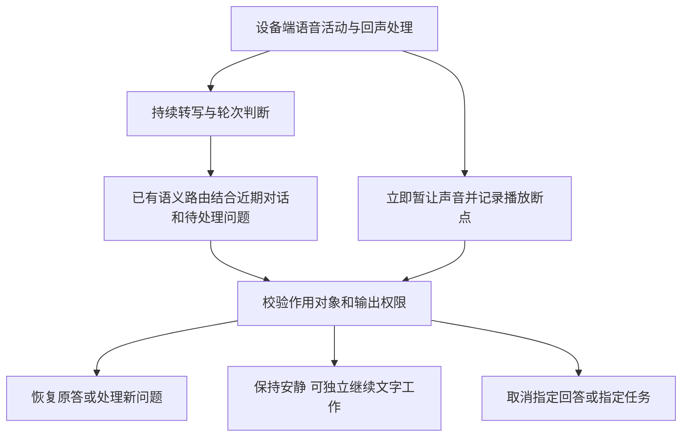

# 自然打断研究与重构建议

后续实现与实测见[自然打断验收](INTERACTION_IMPLEMENTATION_2026-09-09.md)。下文保留原审查基线及失败记录，不代表最新代码状态。

审查基线：`f3babd6`。结论：没有停止关键词匹配，但仍有固定且过窄的交互策略。现有实现能迅速停播，不能据此认定自然打断已完成。本轮只增加研究样例、探测脚本和文档，以下产品缺陷尚未修复。

## 什么仍是固定规则

| 层次 | 当前实现 | 判断 |
| --- | --- | --- |
| 词句识别 | `_STOP_RE` 已删除，当前语义路由调用真实 Qwen | 不是命令词匹配，但模型仍会误判 |
| 提示词 | 直接要求安静保留旧问题；撤销答案指向 `previousAnswer`；否定、引述不算命令 | 是人为制定的交互策略，不能称为无归纳偏置 |
| 播放器 | 任意供应商 VAD 开口事件清空播放队列 | 是固定策略，缺少可恢复暂停和附和识别 |
| 回答任务 | 未撤销的中断回答自动转后台文字生成 | 是防遗漏策略，未必符合所有用户的暂停意图 |
| 状态校验 | 只允许已有 ID、隔离过期响应、不接受非法协议 | 应保留，但合法 ID 不代表语义目标正确 |

自然交互的目标不是去掉所有状态或规则，而是允许多种表达、话语对象和上下文产生合适的行为，同时由确定性协议约束执行范围。不能要求用户掌握“停止播报”与“取消回答”的产品术语。

## Review 发现

1. **P1：取消目标可能指错，作用范围也过大。** `run_egoassist.py:5078` 只给路由最近的一个回答；`semantic.py:680` 附近只校验目标是否属于提供的 ID。真实文本探测中，要求取消更早的酒店问题、继续当前乘法问题，两次都产生针对乘法问题的取消。另一个代码风险是 `work_ledger.py:174` 的 `revise_turn()` 会取消该原始输入下所有未完成 intent/job，单纯“不用回答”可能影响同一轮请求里的独立任务。后者是代码审查发现，尚未做真实混合任务复现。
2. **P1：说话对象和当前句内口误没有可靠处理。** 真实语音中的“小王，你先别说话，助手你接着解释”被判静默；“不要再说了，我说错了，你继续讲”被判为替换原问题，旧回答因此取消。`answer_completion.json` 的策略未明确区分当前句自我修正和替换历史问题；主路由提示词又另有一套 revision 定义。
3. **P1：安静不是持久输出权限。** `run_egoassist.py:5319` 只取消当下生成和队列，未保存安静期限或恢复条件；`omni.py:1587` 的主动播报可再次请求声音。文本探测中“五分钟不要主动说话，等我问你再回答”仅留下单次 `stop-speaking`，期限与恢复条件没有进入可执行状态。重新连接、任务提醒后的具体表现尚待专项全链路验收。
4. **P1：路由失败会重新允许对话。** `semantic.py:564` 附近遇到异常返回普通 `foreground-dialogue`，随后可能重新请求语音。已经让出声音时，未知意图不应自动等同于“可以开口”。此次 40 次真实文本请求没有超时，该项为代码路径风险，不是假称本轮复现了网络故障。
5. **P2：播放完成与云端生成完成混淆。** `app.js:1097` 调度 PCM，但没有向服务端提交按响应标识关联的播放进度；`run_egoassist.py:5021` 将供应商完成事件用于回答完成判定。用户实际听到的位置无法确认，继续原答也没有准确断点。现有 300 ms 左右停播不解决这个问题。
6. **P2：附和和误打断不可自然恢复。** `omni.py:999` 在 VAD 开始时停播，并通常取消生成；空 ASR 路径直接返回。`app.js:1115` 丢弃播放队列，不保存暂停位置。`嗯嗯` 被当作普通对话，协议没有“只是附和、不生成新回答”的路径。
7. **P2：静默和继续工作无法独立表达。** `semantic.py:513` 附近将带有其他工作的 stop 标签清除；当前“别念出来，继续整理好后放到屏幕上”两次都只输出停止，随后提前结束处理。已有后台补答可能继续，但不代表这条新的工作要求被理解执行。

上述引用相对审查基线。代码路径风险与真实复现分开记录，不能把所有风险都计入实测失败率。

## 真实模型与全链路证据

### 文本路由

`scripts/fixtures/interruption_cases.json` 是人工编写的研究样例，不是真人对话数据集。20 个样例各运行两次，直接调用生产 `SemanticTurnRouter`、生产提示词和真实 `qwen-flash`。使用固定的上一条输入和上一条回答，不提供技能目录；因此它是隔离路由研究，不代表完整应用上下文。

共 40 个请求，均正常返回并保存供应商 request ID。36 次有明确协议预期，按行为效果复核后 27 次符合、9 次不符合；另 4 次是“够了”“算了”等没有强设唯一答案的探索样例。路由耗时中位数 413.4 ms，最大 899.4 ms。样本小且人工挑选，不能解释为线上准确率或尾延迟。

| 样例 | 两轮结果 | 含义 |
| --- | --- | --- |
| 不要再说了，啊我说错了，你继续讲 | 两次判停止 | 当前句内更正被忽略 |
| 小王，你先别说话。助手你接着解释 | 两次判停止 | 无视明确的话语对象和继续要求 |
| 小王，你先别说话 | 两次判停止 | 把对第三方的要求当成对助手的要求 |
| 不要再回答之前那个订酒店的问题，乘法这个问题继续 | 两次取消 `question-b`，即乘法问题 | 合法 ID 校验没有阻止错误取消 |
| 耳边有点吵，给我留点安静吧 | 一次停止，一次普通对话 | `temperature=0` 也不保证结果稳定 |
| 乘法原理不用解释了，改为告诉我今天是星期几 | 一次 cancellation，一次 correction，都保留新问题 | 两种标签都可实现替换，不应机械算失败 |
| 接下来五分钟不要主动说话，等我问你再回答 | 两次只有 stop-speaking | 局部“不取消”断言通过，但持续免打扰能力仍缺失 |

原始产物：`outputs/interruption-research-20260909/results.json`。初版判分把替换问题的 correction 也算成失败，得到 10 次；复核按取消旧答的实际效果修正为 9 次。修正仅重算原始响应，没有重新调用模型挑选好结果，原始日志未覆盖。复核产物：`outputs/interruption-research-reviewed-20260909/summary.json`。

### 真实音频与应用

`outputs/interruption-audio-research-20260909/audio-research.json` 保存两段实际 `qwen3-tts-flash` 合成音频，经 16 kHz PCM 实时发送、Qwen 实时 ASR、应用生产技能目录、语义路由、回答账本及输出调度。另存 WAV 和会话日志。观察窗口覆盖完整输入后约 12 秒，没有收到一个 stop 事件就提前判成功。

| 输入与识别 | 实际效果 |
| --- | --- |
| 输入“不要再说了，啊我说错了，你继续讲”；ASR 去掉“啊” | VAD 停播通知 312.18 ms；路由返回 correction，原回答账本变为 cancelled / explicit-correction；新建另一轮回答并说“好的，那我继续讲……” |
| 输入“小王，你先别说话。助手你接着解释”；ASR 将中间句号识别为逗号 | VAD 停播通知 286.16 ms；约 4997.61 ms 发出错误 stop-speaking；原回答只在后台完成文字，未遵从让助手继续讲话 |

时间起点均为第一块音频开始发送，不是人声声学起点。语音与文本路由结果不同说明 ASR、生产上下文和输出执行都必须测，不能只验证分类标签。本次没有实物麦克风、多人真实录音、回声环境、蓝牙或眼镜播放延迟测量。

音频研究中还观察到一次原始乘法提问被模型选中 `assembly-coach`，保留在原始日志；这是独立的技能选择问题，不归因为停播实现。

## 可参考的实现

阅读日期：2026-09-09。

| 来源 | 可借鉴机制 | 不能直接假定的能力 |
| --- | --- | --- |
| [LiveKit Turns](https://docs.livekit.io/agents/logic/turns/) | 区分 VAD、轮次结束、打断；误打断恢复；截断对话历史到播出部分 | 当前项目只接了 LiveKit 传输，不等于已使用 AgentSession 的轮次管理；Qwen 能否同步截断历史需单独核实 |
| [LiveKit Adaptive Interruption](https://docs.livekit.io/agents/logic/turns/adaptive-interruption-handling/) | 根据流式声学信号区分真正插话和附和 | 官方说明要求 Cloud/dev 环境、VAD、对齐转写，且默认适用条件排除 realtime LLM；不能在当前 Qwen 实时连接上加个参数就获得该能力 |
| [Pipecat Speech Input](https://docs.pipecat.ai/guides/learn/speech-input) | 本地 Silero VAD、独立起止策略、Smart Turn 判断是否说完 | VAD 不知道在和谁说话，Smart Turn 的结束判断也不等于取消意图；官方延迟数据不是本项目测量 |

这些资料支持分层处理，不支持“只需一个万能提示词”或“换框架即完成”。自动恢复也不能仅由 ASR 为空触发，因为识别失败时用户可能确实在要求停止。

## 建议的最小架构

保持现有 Qwen 实时链路和异步任务账本，先补齐输出控制与证据。初期不引入第二个串行大模型，不整体迁移框架。



只保留三类必要状态，不把每种中文表达编码为状态：

1. **播放进度与话轮归属。** `responseId`、当前设备报告的播放位置、暂停原因和输出代次。进度是设备已播放的证据，不证明用户注意到了或真正听见。已发送、已播放、已理解三者不可合并。暂停缓存受时长和容量限制，网络丢包、模型取消后的续播需显式处理。
2. **输出权限。** 当前是否可发声、作用范围、用户明确给出的截止时间或解除条件，持久化到已有日志。静默输出与任务工作量分离。用户在免打扰期间主动提问，可允许该轮答复，不应顺便恢复全部主动播报。未给期限时不替用户发明“五分钟”等时长。
3. **回答和任务身份。** 复用已有 turn/intent/job ID；模型从相关候选中选择对象，也允许“目标不清楚”。取消回答不能顺带取消同一轮的闹钟、报告或其他任务。取消执行也不等于撤销已经发生的外部操作。

路由上下文应加入近期助手发言、设备播放进度、用户最近几轮话语、相关未完成问题和现有静默约束，按可调 token 预算选取。不能只增加 `previousAnswer` 然后强制所有指代都指向它。当前句内修正应先求出最终意图，再判断有没有修改历史问题。提示词保留一份控制语义定义，删除与主路由重复或矛盾的定义。

模型可以返回对话对象、用户想改变什么、对应的证据片段和目标 ID，但不能把自报“0.95 置信度”当作授权。证据片段匹配只能证明引用存在，不能证明理解正确。目标不明时保留任务和当前静默状态；只有确实阻碍下一步才在适合的时机澄清，不能每次打断都追问确认。

后台补答仍可作为防遗漏机制，但应允许明确暂停工作、只留文字、取消指定问题；不要把所有未撤销的输入都自动当成值得再调用一次模型的工作。附和和有效新问题需要不同处置。

## 实施顺序与验收

1. 先修取消目标与取消范围、句内修正、路由失败后的输出权限。这些是正确性问题；先实现专门的效果断言，再做保留日志的真实对照测试。
2. 接入播放进度反馈、可恢复暂停和持久静默状态。所有主动输出经过同一个权限检查，旧模型结果不能解除新静默状态；测试刷新、重连、迟到音频与任务完成提醒。
3. 确定端侧运行环境后接入现成的本地 VAD/AEC，评估中文声学轮次检测。继续保留云端降级路径；测端侧 CPU、功耗和延迟，再决定是否采用 LiveKit/Pipecat 的更完整管线。

延迟分别报告：音频活动到本地暂停、语音结束到意图确定、意图确定到新音频、误打断到恢复、取消请求到任务停止。不要把说完整句话的时间全部算成模型延迟，也不要用单次本地 event enqueue 的时间冒充耳机停播时间。

验收用未参与调提示词的中文录音、不同表达/对象/上下文的配对样例，加入附和、口误、噪声、多人对话、ASR 失败、超时、重连和复合任务。既测停止漏判，也测误停、错误取消、漏恢复与无请求播报。人工标注明确歧义，不让另一个未经验证的 LLM 充当唯一裁判。

## 复现

```powershell
.venv\Scripts\python.exe scripts/research_interruption_semantics.py --output outputs/new-interruption-research --repeats 2
.venv\Scripts\python.exe scripts/research_interruption_semantics.py --output outputs/new-interruption-audio --audio-cases self-correction-continue third-party-explicit
.venv\Scripts\python.exe scripts/research_interruption_semantics.py --recorded outputs/interruption-research-20260909/results.json --output outputs/new-interruption-review
```

文本模式发现预期不符时退出码为 1，继续记录全部样例。音频模式的退出码仅表示采集是否完成，`productAccepted` 始终为 false，不把收集到失败日志误认为产品验收成功。`outputs/` 不进 Git，样例与脚本进 Git；克隆后需重新运行或另外归档原始证据。
