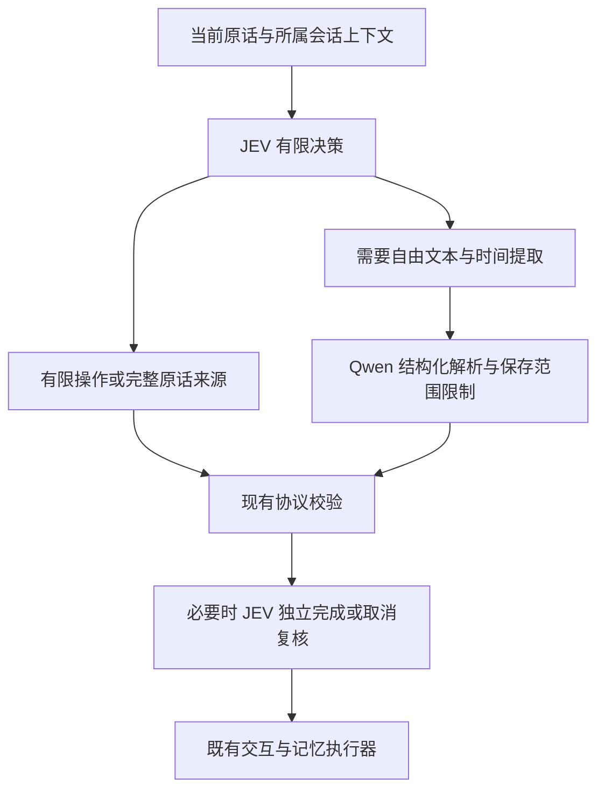

# JEV 优先路由

> 本文保留 v6 的冻结实验。后续快速交互发现目标选择与输出格式问题，当前已更新至 v8，见 [快速真实交互验证](RAPID_REAL_INTERACTION_2026-09-25.md)。下列 66 次调用结果不重标为 v8。

当前 `openrouter-decisions` 后端使用 `typesafe/jev-1.13` 完成可以枚举的路由判断，只有需要提取自由文本、复杂时间或复合工作时才委托 Qwen。实现位于 [decisions_router.py](../egoassist/realtime/decisions_router.py)，提示词版本为 `decisions-router-v6`。本机已选择此后端；源码在未配置时仍默认 `qwen`。

## 分工

| 工作 | 当前路径 |
| --- | --- |
| 回复、只显示文字、停播、对他人说话、等待 | JEV 有限判断 |
| 目录内 Skill 选择、退出 Skill、当前步骤控制 | JEV；完成步骤另发一次 JEV 独立复核 |
| 取消、暂停或恢复已有答案 | JEV 从当前提供的目标中选择；取消另发一次 JEV 独立复核 |
| 不带时长的静默设置或解除 | JEV；保留现有输出权限校验 |
| 单个简单事实的保存 | JEV 判断范围，保存完整当前原话作为来源事件 |
| 单个简单记忆问题 | JEV 标记检索，完整当前问题进入既有检索链路 |
| 日期/相对时间、人物关系、代词指代、纠正旧记忆、偏好规则、保存草稿 | JEV 分流后，Qwen 提取结构化候选 |
| 提醒秒数、限时静默、多个新工作、取消同时提出新问题 | JEV 分流后，Qwen 解析 |

任务或静默状态的存在不再强制调用 Qwen。任务控制和答案目标来自本会话提供的目录，模型不能制造目标 ID；缺失取消/暂停目标时保持不确定，不替换成最近答案。要求续播但没有任何历史候选时，允许回答器询问上下文。

简单保存不生成 subject/predicate/value，也不从原话重新编写事实。明确保存为 `participant/explicit`，普通个人陈述仅为 `case/observed`。两者都仍经过既有来源、同意范围和账户权限校验。禁止保存或混合范围时不新增本轮记忆候选；这不代表删除历史记录或清除原话审计。

`details` 独立判断是否需要自由文本提取。其 `extract` 概率达到 0.3 时，即使最终 choice 是 `none`，也补充结构化解析。这是开发集上的保守分流启发式，未经过概率校准，不是执行授权。普通来源进入解析器后仍受保存范围限制；单个来源的时间 context 会保留。



回答生成、观察、语音识别/合成、日记和后台记忆恢复仍使用各自模型；本次扩展的是交互路由与控制复核。使用 JEV 更多并不等于将整个系统换成分类模型。

## 配置与审计

```dotenv
EGOASSIST_TURN_ROUTER_BACKEND=openrouter-decisions
EGOASSIST_DECISIONS_MODEL=typesafe/jev-1.13
EGOASSIST_DECISIONS_TIMEOUT=2.0
EGOASSIST_TURN_ROUTER_MODEL=qwen3-max
EGOASSIST_TURN_ROUTER_TIMEOUT=4.0
```

需要已有 `OPENROUTER_API_KEY` 和 Qwen 凭据。设置 `EGOASSIST_TURN_ROUTER_BACKEND=qwen` 可回滚。配置在新进程加载，已有服务需重启并建立新连接；本轮验收使用隔离应用，没有重启共享 8770 服务。

JEV 主判断与 Qwen 按需解析共用主分类截止时间，独立复核另有 JEV 请求期限。请求失败、非法响应或复核失败保持不可执行状态，不隐式转到另一供应商执行。异步取消、凭据分离和账户错误熔断保持有效。

完整审计包含 `routerBackend`、`modelsUsed`、实际模型版本、typed 请求/分布/原始响应、`structuredReason` 及独立复核记录；紧凑轮询剔除完整请求和原始响应。

## 实测

最终冻结运行 [jev-first-r3](../outputs/jev-first-20260925-r3/report.json)：22 个开发文本各重复三次，66/66 通过，无组件错误。运行后核对全部冻结文件哈希一致。重复调用不是 66 个独立样本，不代表留出集泛化。

| 指标 | 结果 |
| --- | --- |
| 路由不调用 Qwen | 48/66，72.7% |
| Qwen 结构化解析 | 18/66，27.3% |
| 全部路由中位耗时 | 397.2 ms |
| 仅 JEV 路由中位耗时 | 378.15 ms |
| JEV 请求 | 66 次主判断 + 3 次步骤完成复核 |
| JEV 返回的 usage.cost 合计 | 0.009901962；不含 Qwen，不能作为系统总成本 |

历史 [2026-09-24 r2](../outputs/decisions-router-20260924-r2/report.json) 的同批文本有 56/66 次 Qwen 解析，中位 1444.25 ms。本次降为 18 次，但这不是同时交替运行的性能对照，不能将差值全部归因于模型或承诺线上延迟。复杂分支仍增加一次前置判断。

- [控制开发集 r2](../outputs/jev-controls-20260925-r2/report.json)：9/9 通过，全部只用 JEV，覆盖指定旧答案、未知目标、引用取消、文字续答、暂停、退出 Skill 和静默权限。只验证路由，不执行动作。
- [真实跨会话记忆](../outputs/jev-memory-20260925-r1/acceptance.json)：保存随机编号、新会话召回并继续使用，确认实际提交卡片被选中；保存与首轮回忆均为 JEV 路由。
- [真实交互](../outputs/jev-interaction-20260925-r1/acceptance.json)：文字续答、声音续播、取消旧答案保留新答案、限时静默重连，4/4 通过。
- [真实浏览器](../outputs/jev-browser-20260925-r1/acceptance.json)：通过，1440/390 布局、真实模型回答、后台补答、取消、刷新和账户会话流程；无页面异常或失败请求。以上为文字控制输入和真实模型输出，不是麦克风硬件或真人 ASR 验收。本机此次实际回答链路为 modular；报告顶层 Omni model 参数不能代替实际请求日志。
- [复杂时间记忆](../outputs/jev-social-memory-20260925-r1/acceptance.json)：仍失败，两个来源写入成功，但“昨天讨论的前天的约定”没有得到正确回答。JEV 委托了结构化解析，不能据此宣布完整记忆能力通过。此前原 Qwen 路径也有此失败，详见 [历史记录](DECISIONS_ROUTER_2026-09-24.md)。
- [全量回归 r3](../outputs/jev-first-regression-20260925-r3.xml)：842 项通过，零失败、错误、跳过，107.119 秒；3 条既有 aiohttp 弃用提示。总数包含共享工作区其他改动。路由及相关专项 52 项也通过。此前 [回归 r2](../outputs/jev-first-regression-20260925-r2.xml) 保留配置串扰导致的失败：加载本机 `.env` 后，应用模拟测试意外实例化 Decisions，父类模拟结果缺少 `requestMetrics`；修复为测试环境隔离，没有放宽生产协议。

早期失败全部保留：[路由 r1](../outputs/jev-first-20260925-r1/report.json) 21/22，否定停播被当作无目标续播后静默；[控制 r1](../outputs/jev-controls-20260925-r1/report.json) 7/9，保留另一个答案被误判为混合记忆范围、未知答案的时间描述触发不必要解析。修订针对语义分工，不新增特定句子的硬编码。

[路由 r2](../outputs/jev-first-20260925-r2/report.json) 虽为 66/66 且仅 13 次 Qwen，但事后发现部分时间字段缺失，旧断言没有覆盖，不作为最终结论。[r2 时间字段复核](../outputs/jev-first-20260925-r2/temporal-review.json) 仅 1/6 通过；[r3 复核](../outputs/jev-first-20260925-r3/temporal-review.json) 为 6/6，三次“今天”写入和三次“上周”查询都保留了对应时间 context。此项事后复核与原冻结分数分开记录，不证明复杂锚定问题已解决。

## 复现

```powershell
.\.venv\Scripts\python.exe -m pytest -q -p no:cacheprovider
.\.venv\Scripts\python.exe scripts/compare_decisions_router.py --backends openrouter-decisions --output outputs/jev-new --repeats 3
.\.venv\Scripts\python.exe scripts/verify_jev_controls.py --output outputs/jev-controls-new
.\.venv\Scripts\python.exe scripts/verify_real_memory.py --output outputs/jev-memory-new
.\.venv\Scripts\python.exe scripts/verify_real_interaction.py --output outputs/jev-interaction-new
.\.venv\Scripts\python.exe scripts/verify_real_social_memory.py --output outputs/jev-social-new
.\.venv\Scripts\python.exe scripts/verify_browser.py --real-turn --output outputs/jev-browser-new
```

单元测试显式隔离路由后端为 qwen，以免其他测试加载开发者 `.env` 后改变模拟对象；Decisions 专项显式选择新后端，真实验收独立进程读取本机配置。此隔离不改变产品后端。

`outputs/` 是本机证据，不随 Git 提交；日期按本地 2026-09-25 命名，JSON 中 UTC 时间可能为 2026-09-24。
