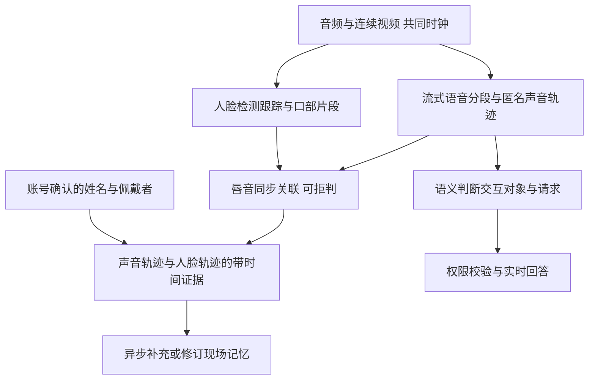

# 多人现场识别与模型路由审查

调研与实测日期：2026-09-09。本文区分已实现、上游公开结果与待验证设计。当前系统不能保证在所有多人场景中自动识别人名、声音和对应人脸。

## 1. 到底需要解决什么

| 问题 | 需要的证据 | 当前状态 |
| --- | --- | --- |
| 哪段话是谁说的 | 连续音频、说话人分段、跨段声纹匹配 | 已有本地 sherpa-onnx + pyannote segmentation 3.0 + CAM++；按 ASR 完整片段分析，尚非持续流式分离 |
| 声音来自眼前哪个人 | 连续人脸轨迹、清晰口部运动、校准后的音画时间轴 | 未实现自动唇音关联；当前仅保存同期采样帧，不能从时间相近推出同一人 |
| 这个人叫什么 | 用户确认、已有可验证身份来源 | 已有账号确认的声音标签与参考帧关联；声音相似度不是身份认证 |
| 他在问助手还是别人 | 对话上下文、称呼、视线等交互证据 | 语义路由已有；本轮补上未知声音必须明确判断对象的执行边界 |
| 多人同时说了什么 | 重叠检测、分离或多通道音频、词级时间戳 | 可标记重叠并保留原音频；单通道重叠不强行逐字归人 |

以上判断必须独立。例如“识别到小王的声音”不代表“小王正在对助手下指令”；画面里只有一个人也不代表录到的声音来自他。佩戴者通常不在画面中，不能要求每个声音都匹配一个可见人脸。

可交付的多人产品应允许：已确认佩戴者、匿名声音 A/B、可见人脸轨迹、画外声音、重叠、未知、稍后修订。不能为了展示完整而把未知填成猜测姓名。

## 2. 一手项目考察

下列数字均为上游公开结果，不是本机或眼镜实测；不同数据集、标注和计算条件不可直接排名。

| 项目 | 核实的能力与限制 | 本项目选择 |
| --- | --- | --- |
| [sherpa-onnx](https://github.com/k2-fsa/sherpa-onnx) | 本地 ONNX 运行与离线说话人分段；当前已安装，可在 Windows CPU 跑 | 保留当前轻量基线，记录加载、排队、分段、声纹提取分别耗时 |
| [3D-Speaker 多模态方案](https://github.com/modelscope/3D-Speaker/tree/main/egs/3dspeaker/speaker-diarization) | 完整音频/多模态离线流水线，不只是 CAM++。上游明确提示短于 30 秒、人数多时可能变差；音频 CPU RTF 0.03 不等于 30ms 首结果。其多人视频集 DER 从 5.3% 到 3.7%，不代表眼镜场景 | 最值得参考的音频、视觉模块组合；不能把当前复用一个 CAM++ 权重宣传成已具备其完整多模态能力 |
| [diart](https://github.com/juanmc2005/diart) | 500ms 更新的滚动缓冲和增量聚类，支持 overlap-aware embedding；算法延迟可调 0.5–5 秒。公开 CPU/GPU 运算时间使用 5 秒窗口，尚需加上等待窗口的时间 | 优先考察持续流式分段与跨段聚类；需要隔离环境验证 pyannote 版本兼容性，不能直接把新依赖灌进演示环境 |
| [Streaming Sortformer v2.1](https://huggingface.co/nvidia/diar_streaming_sortformer_4spk-v2.1) | 模型卡明确低延迟输入缓冲 1.04 秒，尚不含计算；示例大块配置缓冲可达 30.4 秒。最多 4 个说话人，5 人以上退化，主要英文训练。许可为 NVIDIA Open Model License | 适合 GPU 伴随计算设备的对照实验；不作为“不限人数、零等待”的默认替换 |
| [pyannote community-1](https://github.com/pyannote/pyannote-audio) | 强离线整理基线，需要接受权重访问条件。README 报告 Ego4D dev DER 46.8%，premium precision-2 为 39.0%；H100 上每小时音频 31–37 秒是离线处理速度 | 适合会后修订与准确性对照；证据说明第一视角远比会议录音困难，付费 API 也不是全场景解法 |
| [TalkNet](https://github.com/TaoRuijie/TalkNet-ASD) | 判断屏幕中的脸是否正在说话。官方 demo 含人脸检测、跟踪、裁剪、同步音频与视频特征，使用 25fps 视频处理 | 可作为主动说话人检测的准确性基线；当前零散 JPEG 不足以直接接入 |
| [Light-ASD](https://github.com/Junhua-Liao/Light-ASD) | README 报告 AVA val mAP 94.06%。源码 `model/Classifier.py` 的 GRU 前向后再反向处理，使用未来帧；轻量不等于因果或零等待 | 作为口部轨迹模块的部署候选，必须先测有限窗口、实际 lookahead、中文、侧脸、遮挡和头动退化 |
| [Ego4D AVD](https://ego4d-data.org/docs/benchmarks/av-diarization/) | 官方任务分别标注可见人脸跟踪、含佩戴者的主动说话人、分段和转写；该版转写仅考虑英语 | 优先使用其标注评估音画关联，再补真实中文眼镜数据。EgoLife 现有模糊人脸不能代替此验收 |

已读取上述 README、Sortformer 模型卡、Light-ASD 的 Model/Classifier 源码及 TalkNet demo。3D-Speaker README 声明 Apache-2.0；权重、第三方检测器和数据集条件须分别核对。部分独立 LICENSE 下载遇到 TLS 错误，因此没有给这些候选新增商用许可结论，也没有安装未验证的模型。LoCoNet 的尝试链接未核实成功，不列入已考察完成的选择依据。

## 3. 推荐的产品实现路径



这是目标设计，不是当前已完成的模块图。实现顺序：

1. 先解决输入：音视频统一单调时钟、时间戳映射和丢包审计。当前是服务端接收时间，误差未校准；浏览器摄像头采集 30fps 不代表服务器获得连续 30fps，当前发送默认约 2fps。
2. 在手机、伴随计算设备或现有 PC 上持续运行语音分段，把等待移到用户说话期间。先输出匿名轨迹，再异步修订；身份尚未确定时不执行个人数据变更。
3. 本地保存短窗口连续视频，建立人脸轨迹和口部片段；先离线复现 TalkNet/Light-ASD，再做受控窗口流式实验。不要把 25fps 全部上传给通用大模型。轨迹失配、侧脸、低光或口部不可见时停止关联。
4. 只有关联证据足够时，才把声音轨迹与人脸轨迹临时连接。姓名必须来自确认；仅凭声音、人像、LLM 自报置信度不能创建真实身份。
5. 回答无需等待全部现场人物识别完。无身份要求的明确提问可先回答；人际记忆在后台追加来源与更正记录，旧证据不覆盖。重叠无法分解时保存“不确定”，不能把混合转写归给佩戴者。

硬件选型应提供：稳定时间戳、足够清晰的口部图像、可取得原始通道的麦克风；麦克风阵列与 DOA 需已知几何、校准和回声处理，波束方向本身仍不是身份。当前机器的 RTX 5070 8GB 可做对照，但尚未测候选模型实际 VRAM、耗电与温升，不能推出眼镜端可独立运行。

## 4. 当前实际模型路由

| 路径 | 模型/执行位置 | 是否阻塞当前回答 | 触发与预算 |
| --- | --- | --- | --- |
| 流式 ASR 与语音回答 | Qwen `qwen3.5-omni-flash-realtime` | 是 | 共用对话实时连接；server VAD 静音阈值 650ms，不包含后续路由 |
| 语义、交互、记忆意图、Skill 选择 | `qwen3-max` | 是 | 每个受理回合一次综合判断；单请求 4 秒，失败可能再试一次 |
| 明确取消的二次核验 | 同一语义模型 | 是，仅取消路径 | 保留，防止把短暂停播或换话题变成不可恢复的撤销 |
| 显式文字问题的定向视觉证据 | `qwen3-vl-flash` | 与语义路由并行，回答前等待 | 有问题时间画面时启动，256 输出 token，排队加 HTTP 总计 4 秒 |
| 通用现场与可见人物描述 | `qwen3-vl-flash` | 否 | 当前约上次结果后 4 秒再观察；同帧缓存；600 输出 token，HTTP 8 秒 |
| Skill / 已授权 ambient 视觉判断 | 第二条 Qwen Omni 实时连接 | 否 | 按任务/ambient 节奏请求；本轮改为首次有观测需求才连接，不阻塞对话就绪 |
| 说话人分段与声纹匹配 | 本地 sherpa-onnx | 与语义路由并行，权限决定前汇合 | CPU 2 线程；当前全局模型锁，不可假设多用户线性扩容 |
| 多说话人片段补转写 | `qwen3-asr-flash` | 否 | 只在一个原 ASR 片段包含多声源时调用。本轮改为会话总并发 2，排队与请求合计 10 秒 |
| 中断后的后台补答 | `qwen-flash`；含原始图像则 `qwen3-vl-flash` | 否 | 独立任务、默认并发 2、请求 20 秒；保留原问题归属 |
| 日报/周报/月报与建议 | `qwen-flash` | 否 | 独立任务默认并发 2，请求 30 秒、任务 45 秒 |
| TimelineMemory 证据检索 | 本地 SQLite | 是，但通常较小 | 不能把离线研究脚本中的 embedding / 视觉定位链路算作实时每轮必调 |

仓库还有离线实验与其他后端适配器，配置名或类存在不代表 8781 实时链路正在调用。`.env` 的 `EGOASSIST_BACKEND=mock` 是旧离线适配器默认值，不代表这里的 Qwen 实测使用 mock。验证以真实 requestId、usage、审计事件为准。

语义路由不是每个子功能各调一次 LLM。不要仅因为 `qwen3-max` 名称大就替换：已有较早协议的真实回归记录里，qwen-flash 为 20/24，qwen-turbo 为 20/26。它们不证明当前协议上的最终能力，但足以反对未经当前回归就换模型。

## 5. 实际浪费与本轮修复

读取 `outputs/review-demo`、`outputs/visual-latency-ab-1`、`outputs/visual-focused-browser-final` 中 10 个会话的日志，得到 `outputs/model-route-audit-before.json`。这是历史与受控测试的混合样本，覆盖不同时段的代码，不是线上全量统计或账单。

| 已记录调用 | 次数 | 已记录阶段延迟中位数 | 输入 token 总计 |
| --- | ---: | ---: | ---: |
| 语义路由 | 102 | 990.5ms | 537,785（101 次有 usage） |
| 定向视觉结果 | 6 | 582.5ms | 2,807 |
| 全现场视觉结果 | 31 | 2,434.4ms | 15,815 |
| 实时回答结束 | 28 | 不用缺失值推算 | 106,003 |
| 后台补答 | 64 | 旧结果未记录该阶段耗时 | 86,305 |
| 报告/建议结果 | 10 | 11,656ms | 100,258 |

全现场请求为 33 次、结果 31 次；日志不能据此把缺失结果当免费或成功。有 4 次定向问题与后台现场请求使用同一帧。所选日志未记录 Skill gate 的实际请求，不能据架构推断它一直在烧 token；代码确实会为无任务连接第二条实时通道，此等待已去掉。

本轮完成：

- 精简语义模型上下文：移除媒体哈希、文件引用、重复帧元数据、重复 playback 和无关账本字段；保留说话人、原话、时间、画面存在性、音画不确定性、回答目标与输出权限。原始日志和媒体没有删除。审计新增 `contextOriginalChars` / `contextSentChars`。
- 现场描述、定向视觉和补转写复用会话 HTTP 连接，避免每次新建连接。各路径保留独立请求截止时间，关闭会话时释放连接。
- 多声源 ASR 并发限制从“每个回合 2 个”改为“整个会话 2 个”，避免多回合同时补录时不断叠加请求。
- 第二条实时观测连接按需建立；无工作时断连不主动反复重连。前台对话就绪不等它。
- 修复 Skill 观测被对话麦克风 VAD 卡住的问题：新画面独立触发有任务或已授权的观察，用户安静操作也能运行；通用场景采样和任务协议保持各自职责。
- 观测通道必须等 `response.done` 才释放下一帧；原先 `response.text.done` 先释放，可能让旧终止事件消费新请求。
- 观测调用记录实际模型、提示词、结束耗时与 usage；本地声纹分析拆分 queue/load/diarization/profileEmbedding 四项耗时。
- 会话建立后异步预热已安装的本地声纹模型，避免第一句语音才加载；没有额外云调用。若用户先于预热完成开口，仍需等待剩余加载时间。
- 未确认声音的空交互决策不再默认生成回答；必须明确判断为向助手提问。统一了三份提示词中与此冲突的“普通问题可省略交互判断”规则，没有增加关键词匹配。

当前语义策略版本为 `semantic-turn-router-v17`。本轮早先实测记录仍带 v16，完整提示词保存在各自日志中；策略改动与历史记录不会被重写。取消核验也开始记录 provider usage，旧日志缺失的 token 仍视为未知。

尚有开销及取舍：

- **文字输入时有新画面便并行发起定向视觉**，即使最终是不需要视觉的问题也可能耗费一次调用。先等语义再决定能省调用，却会让真正视觉问题串行多等约一次视觉请求。当前优先首音，保留此并行策略，不声称已消除所有浪费。
- **后台全场景与 Skill gate 可以分析同一现场，但目标不同**：前者给人物/环境描述，后者按任务协议判断观测与风险。未经验证不能把一种结果当另一种结果。本轮保留功能；后续可让一个有明确消费者的观察调度器管理取样，再验证联合输出的 token 与时延。
- **说话人模型内部为聚类提取 embedding，外层再提取用于持久声纹匹配**，用途不同；当前 API 未提供直接复用的对应向量。不能直接删除外层提取。新增分阶段耗时后再确定是否值得换接口。
- 全局本地模型锁、报告长输出、长会话路由上下文和上游网络仍可能成为瓶颈。单请求 4 秒不是整个回合的 4 秒 SLA，重试及取消核验需单独审计。

## 6. 真实验证与失败记录

最终全量自动测试：417 passed，62.79 秒，5 条已有 aiohttp/pytest 缓存警告。单元测试覆盖连接复用和关闭、未知声源默认静默、身份与时间投影保留、观测终止事件与下一帧隔离；它们使用受控替身验证状态机，下面的真实模型实验另行列出。

1. **定向视觉全链路**：`outputs/route-audit-visual-1/report.json`，真实 EgoLife 图像 + Qwen，交替 3 轮，共 6 次，全部正确返回桌布颜色/格纹。旧 scene 路径首音中位数 4,497.1ms、完成 7,168.4ms；定向路径首音 1,565.1ms、完成 2,884.2ms。与上一轮快速路径约 1.50s/2.92s 相近，不能把网络波动说成新一轮巨大提速。
2. **历史路由上下文 A/B**：`outputs/router-context-ab-1/report.json`，8 对真实 Qwen 调用，只重放分类，不执行日志中的动作。原输入总 token 48,350，投影后 36,181，减少 25.2%；延迟中位数 691.1ms → 656.35ms，样本太小，不证明稳定提速。7/8 原始决策完全一致，1 个真实歧义现场片段不一致，因此该实验的严格一致检查是失败，未隐去。
3. 上述歧义暴露了未知声源默认回答的问题。最初补充提示后，直接提问仍被旧提示的省略规则吞掉，失败保存在 `outputs/real-addressee-1` 与 `-2`。移除冲突规则后 `outputs/real-addressee-3/report.json` 的 8/8 真实模型检查通过：直接提问、直接视觉请求、安静、旁人对话、引述、否定、日志歧义及未知声源写入限制。该测试是文本输入到真实语义模型和实际权限执行层，不是 ASR、身份识别或全部工况的验收。
4. **真实控制全链路**：`outputs/route-audit-interaction-1/report.json`，停止播报后的文字补答、取消较早问题、静音跨重连，3/3 通过，模型未 mock。
5. **真实浏览器链路**：`outputs/route-audit-browser-final/report.json` 通过，1440/390px 无横向溢出，历史滚动及恢复正常。视觉问题从服务端收题到首音 1,900ms、完成 2,841ms。使用真实 Qwen 和 EgoLife 音频，图像 fixture 注入浏览器视频流；它能检查 UI、ASR、问题证据及恢复，但不是物理摄像头、眼镜扬声器或真人声源标注。
6. **真实声纹与补转写**：`outputs/route-audit-speakers-1/report.json` 通过。EgoLife 12 秒样本首次分析 1,091.7ms，其中加载 888.4ms、分段 162.4ms、声纹提取 39.8ms。后续两种真实 Qwen 合成声音分析 856.4ms，加载为 0ms，识别到两个簇；4 个实际 ASR 请求均有 requestId。合成两声音测试不能代表真实多人识别准确率。
7. **无语音的任务观测**：`outputs/real-perception-lane-1` 首次失败，定位到错误依赖麦克风 VAD，保留失败记录。修复后 `outputs/real-perception-lane-2/report.json` 通过：初始化观测连接为 idle，真实激活做菜 Skill，再仅发送 EgoLife 画面，按需连接后完成观测，生成耗时 1,333.7ms；输入 801 token 中含 336 video token，输出 174 token。这里的耗时不包含建连，不能替代端到端首音。本地预热 820.1ms 在后台完成。这次观测与通用现场描述确实各有一个请求，目标不同，尚未合并。

旧的纯视觉极速探针不算成功：直接往实时 conversation item 塞图像曾出现拒绝请求、超时或内容错误，本轮没有把这些未打通形式替换进默认路径。详见 [视觉延迟实验](VISUAL_LATENCY_2026-09-09.md)。

## 7. 如何验证“多人真的可用”

用带说话人时间段和人脸轨迹真值的数据测 DER/JER、词级说话人归属、关联误配率、轨迹切换次数；单列重叠、画外、佩戴者、低光、遮挡、多人互相说话。再测未知拒判时的覆盖率，以及助手不该回答时的误响应率和该答却不答的漏响应率。只测正确回答的平均延迟会掩盖系统静默失败。

相似度、分段后验、关联分数必须在独立验证集上校准，报告阈值下的误报与漏报。不能把模型生成的“我有 95% 把握”当统计置信度。固定目标错误率并允许未知，比假装覆盖所有现场更可审计。

延迟分别测：采集/窗口等待、ASR 末字、分段就绪、路由、视觉、首文字、首音频数据、设备开始播放；同时看冷启动、P50/P95、超时率和持续多人运行。当前尚没有真实中文多人眼镜的完整标注集，也没有候选 ASD 模型在本机的实测，不能给出识别准确率或硬件可部署承诺。

## 8. 复现

```powershell
.venv\Scripts\python.exe scripts/audit_model_routes.py outputs/review-demo --output outputs/routes.json
.venv\Scripts\python.exe scripts/verify_router_context.py <会话.jsonl> --output outputs/router-replay-new --count 8
.venv\Scripts\python.exe scripts/verify_real_addressee.py --output outputs/addressee-new
.venv\Scripts\python.exe scripts/verify_visual_latency.py --rounds 3 --output outputs/visual-new
.venv\Scripts\python.exe scripts/verify_real_interaction.py --output outputs/interaction-new
.venv\Scripts\python.exe scripts/verify_shared_scene.py --output outputs/speakers-new
.venv\Scripts\python.exe scripts/verify_shared_scene_browser.py --output outputs/browser-new
.venv\Scripts\python.exe scripts/verify_real_perception_lane.py --output outputs/perception-new
```

验证脚本输出目录必须新建。真实脚本读取已配置密钥并产生实际 API 使用量；不会打印密钥。完整真实日志含会话内容，留在被忽略的 `outputs`，本文仅归档汇总。参见 [共享现场机制](SHARED_SCENE_2026-09-09.md)。
