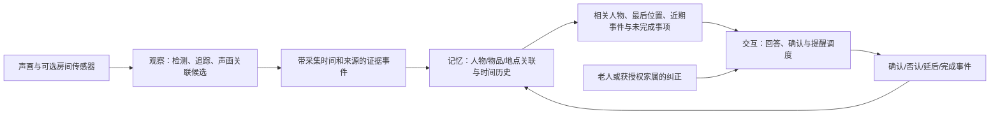

# 人物识别、环境建模与长期记忆：公司、产品及助老应用调研

核验日期：2026-09-27（Asia/Shanghai）。对象是与 EgoAssist 助老定制有关的可穿戴助手、通用多模态助手、家庭感知、视觉辅助、养老服务及记忆基础设施。本文是公开资料调研，不是购买后的横向实测，也不声称覆盖全球所有产品。

## 1. 核心结论

1. **“能看见”“能认出熟人”“能记住经历”“能完成照护流程”是不同能力。** 大公司经常分别部署它们，不能根据视觉问答演示推断产品具有长期人物档案、持久三维地图或跨天事件记忆。
2. **实时交互已经是强竞争区。** Google Astra、Gemini Live、Meta AI 眼镜及字节 SeedRealtime 都公开展示或提供实时感知/交互能力。尤其 SeedRealtime 的 2026-08-05 官方文章，已展示用户介绍后在同一会话中关联姓名、人脸、声音，以及条件触发的主动提醒。[S01][S02][S05][S24]
3. **熟人识别已有成熟的产品路径。** Apple Photos、Google Nest、Envision 和 OrCam 分别展示人物聚类、可编辑熟人库或已学习人脸的识别。正确方向是“小范围人物库＋用户确认＋可纠错”，而不是让通用视觉模型直接猜人名。[S04][S08][S10][S28][S29][S30]
4. **完整三维地图并非助老记忆的前提。** RoomPlan、Aria、NVIDIA 解决几何与定位；CarePredict、Aqara 等可以使用房间/区域、设备位置、穿戴归属和行为时间序列。找物回忆优先需要“某件物品最后在哪被看见”，不一定先需要厘米级地图。[S06][S09][S20][S21][S26][S35][S36]
5. **养老产品最值得学的是持续使用机制。** ElliQ 强调个体化陪伴、提醒、家庭联系和照护端；CarePredict 强调个人行为基线；Nobi 强调事件检测、通知和介入。它们的价值不能仅用模型问答准确率衡量。[S32]–[S38]
6. **我们的潜在研究贡献应落在证据与时间上。** 人物/物品关联错误如何纠正、旧状态何时失效、采样缺口如何影响结论、提醒确认如何更新记忆，比“接入摄像头和大模型”更适合形成可检验的贡献。

## 2. 证据口径与调研方法

本轮直接读取官方产品页、帮助文档、开发文档、官方代码仓库和研究项目页；小米和 Meta 的产品页使用浏览器渲染后核对正文。OpenAI 部分使用官方文档检索与正文获取。普通搜索返回的无关结果、403 验证页面、404 页面和仅有网页壳的内容未作为功能证据。

来源分为三类：

| 标记 | 意义 | 可以支持什么 |
| --- | --- | --- |
| 产品/帮助 | 官方产品页或操作说明有明确描述 | 厂商公开提供/宣称的功能及使用条件；不等于独立效果验证 |
| 技术公开 | 开发文档、官方代码、公开研究文章 | 已披露的机制；历史文章不能当作当前版本全部实现 |
| 原型/研究 | 项目页、论文或演示 | 技术方向与实验设置；不自动等同于消费者已可使用 |

“本轮未核实”表示没有取得足够证据，**不是断言厂商没有该功能**。不推断闭源产品的向量库、图数据库、具体模型路由或训练结构。不将厂商的“零漏报”“全天续航”“准确率”等不同条件的宣传数字拼成排行榜。来源的发布日期与本轮访问日期分开；动态页面以后可能变更。

与报告配套的 `PERSON_ENVIRONMENT_MEMORY_SOURCES_2026-09-27.json` 保存采用来源的 URL、标题、访问时间、抓取方式、可用的内容校验信息及核验说明。完整网页文本只保存在本地忽略目录 `outputs/person-environment-survey-20260927/`，不将整篇第三方内容转载进仓库。

## 3. 先把“识别”和“记忆”拆开

| 层次 | 典型问题 | 不能混淆的地方 |
| --- | --- | --- |
| 人体/人脸检测 | 画面里有没有人？ | 检出人不等于知道姓名 |
| 连续追踪 | 这几帧是否还是同一人/物？ | 当前轨迹编号不等于跨天身份 |
| 熟人识别 | 是否与已登记的小王匹配？ | 匹配有误识风险，需要未知类别 |
| 说话人分离 | 哪段声音属于同一说话者？ | speaker 1 不等于本人或小王 |
| 声画关联 | 当前声音对应画面里的谁？ | 画面中有人不证明他正在说话 |
| 实体记忆 | 今天的小王和昨天的人物记录是否同一实体？ | 同名、换衣、遮挡和别名不能强行合并 |
| 场景理解 | 当前画面有什么？ | 单帧描述不等于环境模型 |
| 几何建图 | 房间结构、相机位置、距离是什么？ | 地图本身不说明谁何时移动了钥匙 |
| 事件记忆 | 谁在何时何地把什么放到哪里？ | 需要来源、时间、关系和不确定性 |
| 行为基线 | 与这个人平常相比是否发生变化？ | 偏离基线不是疾病诊断 |

记忆产品还应区分：会话上下文、持久偏好、经历时间线、实体关系、物理空间状态、未来待办。一个产品声称有 memory，未必同时具备这六项。

## 4. 大公司与技术平台：实际公开了什么

### 4.1 Google：实时助手、个人上下文、家庭熟人库是不同产品面

**Astra / Gemini Live。** Astra 官方页明确写明其为有限可信测试者使用的研究原型，并说明部分能力正进入 Gemini Live。当前公开方向包括视频理解、上下文相关的发言、偏好保留、多模态记忆、工具使用和跨设备会话延续；面向盲人/低视力用户的 Visual Interpreter 与 Aira 合作，测试项目包含专业人工支持。[S01]

Gemini Live 产品页提供语音、相机及屏幕等交互入口；Live API 文档提供低延迟音视频流接口。[S02][S03] 这支持“实时多模态助理”路线，**不能据此确认一个公开可用、全天持续、跨天准确的人物—物品—空间记忆系统**。Astra 的内部存储、实体纠错和长期地图更新算法未在采用资料中充分公开。

**Nest 熟人识别。** 官方帮助给出更具体的产品闭环：发现陌生脸，询问是否认识，允许加入熟人库；用户可改名、删除档案，识别结果可进入摄像头事件历史。当前帮助还提到身体大小、衣服颜色等辅助信号，用于脸不可见的情况；并列明订阅和地区限制。[S04]

**借鉴：** 人物库、事件历史与模型问答分开；识别需要可维护的用户界面。身体特征可以辅助短期关联，但不能把衣服颜色当作长期身份依据。

### 4.2 Meta：消费眼镜、研究感知平台、记忆设备布局不能混为一谈

**Meta AI / Ray-Ban Meta。** 当前产品页明确提供拍摄、语音助手、翻译、消息和提醒。2024-09-25 官方发布还给出记住停车位置、稍后提醒的例子。[S05][S51] 后者是带日期的发布声明，不表示所有型号、地区都具有相同能力，也没有公开证明其采用完整三维地图或通用陌生人身份识别。

**Project Aria Gen 2。** 官方研究文档列出 RGB、计算机视觉相机、IMU、眼动、空间麦克风、接触麦克风等传感器，以及设备端机器感知和向本地 PC 流式传输。MPS 文档公开相机/设备轨迹、点云等派生数据的使用方式。[S06][S07][S52]

这说明 Aria 的优势是**同步、标定和可研究的传感器数据**。消费眼镜功能不能直接当作 Aria API；MPS 中存在离线处理，也不能把所有派生结果说成设备端实时可得。

**Limitless。** 官网当前公告确认被 Meta 收购，Pendant 自 2025-12-05 起不再向新用户销售；FAQ 写明继续服务现有 Pendant 用户至 2026 年，Rewind 进入停止服务流程，多个地区已停止支持。[S41] 可以作为记忆穿戴路线案例，不能按仍独立销售的常规候选推荐。收购也不证明相关能力已经并入 Ray-Ban 产品。

**借鉴：** 研究采集优先看 Aria 的同步和来源数据；日常入口学习消费眼镜；长期数据设计还要考虑导出、迁移及产品退役。

### 4.3 Apple：最清晰的公开人物聚类方案之一，但功能模块彼此独立

**Photos。** Apple 2021 年技术文章公开：检测人脸和上半身，分别提取特征；先形成保守的小簇，再做更广范围聚类；利用时间和地点形成的 moment 限制身体外观特征的使用，跨 moment 关联更依赖人脸。部分聚类在后台、例如充电时运行。[S08]

这里的关键不是“用了 embedding”，而是**先控制错误合并，再增加召回，并限制短期外观的有效范围**。这是历史公开实现，不能保证今日每个版本仍使用同一算法。

**HomeKit Secure Video。** Home 支持借助照片中命名的人物识别访客，并管理已知人物；安防录像在家庭中枢分析和加密，事件可以按人、车辆、包裹等类别筛选。[S10][S53] 这是有明确家庭范围的身份与事件系统。

**RoomPlan / Magnifier。** RoomPlan 使用支持设备的相机与 LiDAR，输出房间尺寸、墙体及家具等结构；Magnifier 检测附近的人、门和家具，并提供可访问的提示。[S09][S11] Magnifier 检测“有个人在前方”不等于识别他的姓名；RoomPlan 扫描结果也不会自动成为长期生活经历。

**借鉴：** 人物聚类与实时问答解耦；几何、可访问提示、个人记忆各有职责；小物件如钥匙不能假设都由房间扫描 API 识别。

### 4.4 Microsoft：视觉辅助、身份服务和“看过什么”的记忆分工明显

**Seeing AI。** 官方页面确认其为面向盲人/低视力用户的免费视觉辅助应用，支持阅读、图像描述和产品识别。本轮部分更详细功能页访问受阻，不依靠记忆补写其当前人物档案的具体上限或实现。[S12]

**Azure Face。** 开发文档明确区分人脸检测、身份验证、识别和活体相关场景，并说明访问资格限制。[S13] 它提供身份组件，不自动提供“昨天这个人说过什么”的社会记忆。

**Windows Recall。** 官方文档描述可选的本地屏幕快照、语义搜索、时间线及回到来源应用。它可以“找回电脑上看过的内容”，但输入是电脑活动，不能当作居家物理环境建模。[S14]

**借鉴：** 问答结果应该能回到原始来源；身份服务、检索记忆与语音交互不必依赖同一个模型。

### 4.5 OpenAI：对话/工作记忆、活动时间线、实时交互是不同层

官方文档说明 ChatGPT 与本地 Codex 记忆使用不同存储和控制；不能把本地文件型记忆机制直接套到所有 ChatGPT 产品。[S15]

当前 Computer History 文档描述 macOS 上自愿开启的活动历史：使用应用/网站交互事件与可访问文本，定期生成可查看和删除的摘要、记忆与时间线；**当前说明明确不把截图纳入历史，也不录制麦克风或系统音频**。因此不能将它与 Recall 的屏幕快照机制写成同一方案。[S16]

Realtime API 提供实时语音会话、工具和交接能力；ChatGPT Voice 文档描述打断、自然轮次和工作协调。[S17][S18] 这些能力与跨天人物身份、实体消歧、房间地图并不等价。采用文档没有建立“OpenAI 已提供可直接部署的助老人脸＋家庭空间＋生活记忆成品”这一结论。

**借鉴：** 记忆应是可管理、可删除、有来源范围的独立层。实时模型维持会话，不代替应用拥有的长期状态。

### 4.6 Amazon：家庭上下文与个人记忆，而不是只做视觉

Alexa+ 官方说明支持用户告诉助手家庭偏好、重要日期、食谱等，并结合已有服务、家庭设备与共享文档完成任务或提供主动建议。[S19] 可以确认“持久个体化上下文＋家庭动作入口”的产品方向；内部是否采用某种图数据库未公开。

Bee 官网描述以会话和生活片段形成摘要、待办、个人洞察与 daily memories，并逐渐学习模式、偏好与关系。[S40] 其公开页面侧重音频/会话和个人上下文；不能把“关系学习”直接视为可靠的人脸识别。本文将 Bee 作为个人记忆穿戴案例，不以未经本轮采用资料确认的股权关系来推导技术共享。

**借鉴：** “未来要做什么”与“过去发生了什么”要分别存储；有了关系和偏好后，价值体现在任务与提醒，不只是回答旧聊天。

### 4.7 Samsung：家庭设备上下文；机器人部署状态另行核实

SmartThings 官方产品入口包含 Family Care，并列明该服务的地区与设备条件。[S54] 这一类路线利用家庭设备、账户和房间上下文，可以与可穿戴观察互补。

本轮 Ballie 官方新闻正文请求超时，Family Care 的部分互动页面未提取到足够机制正文。因此不把 Ballie 写成已核实量产、已部署长期空间记忆的产品，也不将 Family Care 的具体异常判断算法列为已证实。后续采购前应核对当地实际服务、功能清单和最新支持文档。

### 4.8 NVIDIA：为机器人提供空间底座，不直接提供个人生活记忆

Isaac ROS Visual SLAM 提供相机运动估计与定位/建图能力；nvblox 提供局部三维重建及导航使用的地图表示。[S20][S21] 当需求是室内移动、距离和避障时，这类栈很有价值。

但建图不会自动解决物品的归属、跨天身份、说话内容或事件时间。不能把“生成三维地图”视为记忆机制已经完成。

### 4.9 国内模型与眼镜：硬件入口、模型交互、身份服务分开评估

| 公司/产品 | 本轮核实的能力 | 对记忆的意义与边界 |
| --- | --- | --- |
| 小米 AI 眼镜 | 摄像头问答、翻译、手机/米家控制、提醒；五麦克风包含骨传导拾音，官方说明用于更准确拾取佩戴者声音 [S22] | 佩戴者信号可改善输入归属；不能据此推断具有其他熟人的人脸库或跨天空间记忆 |
| Rokid Glasses | 显示、拍摄、多模态问答、翻译、转写、说话人区分及摘要 [S23] | 可成为交互和记忆入口；会议说话人区分不等于稳定实名人物识别；海外版资料不能直接套国内版 |
| 字节 SeedRealtime | 2026-08 官方说明原生音视频全双工、多人同会话声画/名字关联、主动视觉提醒、对背景说话的轮次判断 [S24] | 是直接相关的交互对照；文章示例没有证明跨天持久人物库、别名纠正或家庭地图；“已推出”不自动代表任意开发者已获相同 API |
| 阿里 Qwen3-Omni | 官方仓库公开文本、音频、图像、视频理解及语音输出，披露 Thinker/Talker 等模型结构 [S25] | 适合作为感知/交互模型组件；模型仓库不等于夸克/千问眼镜的整套产品记忆实现 |
| 百度人脸识别 | 云服务公开人脸对比、搜索、活体等能力 [S27] | 可作为人物库组件；认证产品的标称准确率不能直接套到老人侧脸、遮挡、多人交谈场景 |
| Aqara FP2 | 毫米波存在感知、房间分区、多目标检测、本地自动化；跌倒功能有安装条件 [S26] | 房间占用和活动轨迹可提供环境上下文；多目标追踪不等于知道各人的姓名 |

夸克/千问眼镜、小度眼镜、腾讯相关身份服务列入补查范围。相关入口在本轮遇到失效路径、页面动态加载或正文不足，未取得足够资料支持当前型号、跨日人物识别和长期环境建模的完整比较。**没有用阿里通用模型、百度通用人脸 API 的能力替代对具体眼镜产品的核实。**

## 5. 视觉辅助与养老产品：更贴近助老实际

### 5.1 Envision、OrCam、Be My Eyes

**Envision Glasses** 官方功能清单包含 Teach a Face、Find People、Find Objects、Describe Scene、文字识别及联系亲友/Aira。它把熟人学习做成明确功能入口，适合参考“登记—识别—必要时人工帮助”的交互。[S28] 公开页不足以核实全部识别算法、档案同步方式和误识率，不编造其内部模型。

**OrCam MyEye 2 Pro / 3 Pro** 的官方产品页包含识别人脸、阅读和物品/视觉辅助；3 Pro 同时强调 AI 助手。[S29][S30] 比较时必须按具体型号和功能区分，不能把某个旧型号的离线描述推广为所有 AI 功能均离线。

**Be My Eyes** 同时提供视觉 AI 和真人帮助入口；官方眼镜页面描述通过 Meta AI Glasses 发起免手持帮助。[S31][S55] 人工回退是产品机制，不是模型失败的遮掩；但它不是一个默认全天记录并建立私人空间地图的服务。

**对我们最直接的启发：** 老人不应被迫操作人物 embedding 或候选编号。界面应能说“这是女儿小王”“刚才认错了”“不再记住这个人”，后台负责关联和纠错；必要时清楚切换到真实家属帮助。

### 5.2 ElliQ：长期个体化与照护联系

官方资料将其定位为面向一位老人的个体化陪伴设备，同时允许与其他家庭成员互动；提供日常活动、健康相关自报记录、服药/饮水提醒、回忆分享及亲友联系。Caregiver App 支持查看近期活动、设定提醒/目标，以及在用户报告疼痛或状态变化时收到信息。[S32][S33][S34]

这不是“看到药盒就判断已服药”的路线。其可借鉴之处是持续关系、个人偏好、可完成的小活动与家庭联系。官网用户评价和改善百分比不能替代随机对照证据，本报告不据此宣称临床疗效。

### 5.3 CarePredict：个体行为基线优先于通用语义解释

CarePredict 将穿戴、位置、呼叫与行为分析结合；公开材料强调活动、吃饭、睡眠、社交变化和个体基线，向工作人员提供风险提示及工作面板。[S35][S36]

对我们的启发是把“过去的自己”作为比较对象。不过，活动减少只能成为待核实的变化；不能由模型把它直接转换成“患病”。还要知道设备是否佩戴、传感器是否在线、观察覆盖是否足够，否则设备缺测会被误当成行为异常。

### 5.4 Nobi、Vayyar、Aqara：环境感知不必全靠第一人称摄像头

| 产品 | 公开感知路线 | 公开输出形态 | 与我们的互补性 |
| --- | --- | --- | --- |
| Nobi | 光学传感器＋本地 AI，灯具形态 | 跌倒通知、夜间照明、睡眠/活动报告、照护端；官方说明无事件图像本地处理后删除，事件分享由用户控制 [S37] | 固定位置提供眼镜不在视野内的覆盖；保留事件和通知闭环 |
| Vayyar Care | 无摄像头、无录音的环境感知，雷达产品路线 | 跌倒/异常移动提示、活动信息和照护面板 [S38][S57] | 不需要视觉身份即可提供房间活动信号；多人身份需要额外关联 |
| Aqara FP2 | 毫米波感知和区域定位 | 存在/离开触发本地自动化；多目标能力有数量/安装条件 [S26] | 可提供“有人在玄关”等条件，不承担姓名识别或医疗结论 |

共同点是先解决感知覆盖、条件判断和服务动作。**同一家庭可以有穿戴助手、固定传感器和照护端，不必把所有能力塞进眼镜。**

## 6. 记忆穿戴与软件层：真正存了什么

| 产品/框架 | 公开方式 | 借鉴与限制 |
| --- | --- | --- |
| Omi | 开源硬件/应用/后端；转写、说话人特征、关键事实、摘要和检索 [S39] | 是可审查的记忆入口；需要进一步按版本检查实际部署与识别效果 |
| Omi Glass | Dev Kit 页面描述定期照片及记忆上下文；FAQ 说明视频/音频需要改默认固件 [S56] | 顶部“全天录制”营销不能替代实际固件能力。消费版仍有等待名单，页面库存信息存在矛盾，采购需核实 |
| Bee | 会话、任务、日常记忆、模式/偏好/关系学习 [S40] | 音频型个人上下文；未核实持久三维环境及熟人人脸库 |
| Limitless / Rewind | 当前官网为收购、停售、支持期限与数据导出公告 [S41] | 可研究历史路线，不作为新部署的正常采购建议 |
| Plaud | 会话采集、转写、摘要，当前产品页也描述累积上下文和记忆 [S42] | 工作会话记忆与居家物理空间记忆不是同一功能 |
| Mem0 | 写入时提取事实，查询前检索；按用户/代理/运行等范围管理 [S43] | 默认抽取记忆不是逐字原文档案，应用仍需管理证据；原文模式另行配置 |
| Zep / Graphiti | 实体、关系、有效时间、来源 episode 及混合检索 [S44] | 很适合对照关系变化与时间记忆；图数据库不能修正上游认错人或看错物品 |

这些方案说明：长期记忆通常由应用层建立，不应依赖实时模型无限延长上下文。一个记忆组件也不会自动解决摄像头采样、人物登记、物品追踪和老人确认流程。

## 7. 公开研究如何把环境接到记忆

| 工作 | 可核实的方法/任务 | 对本项目的用途 | 不应外推的结论 |
| --- | --- | --- | --- |
| ConceptFusion，RSS 2023 | 将开放语义特征融合到三维地图，支持多模态查询 [S45] | 对照“文字摘要”与“可查询空间表示” | 静态地图查询成功不证明长期人物/事件记忆 |
| ConceptGraphs，ICRA 2024 | 有位姿 RGB-D 序列、分割、多视角物体关联、物体描述与关系图 [S46] | 找物、空间关系与对象实例记忆的直接参考 | 依赖深度/位姿等条件，不能直接承诺普通网页摄像头效果相同 |
| OpenEQA，CVPR 2024 | 基于历史观察或主动探索回答环境问题；真实环境开放问题 [S47] | 检验环境理解与经历回忆 | 不是老年人长期陪伴与提醒闭环评测 |
| Ego4D | 第一人称数据与 episodic memory、视听社会互动等研究任务 [S48] | 找回发生过的片段、声画归属和时间定位 | 数据集分数不代表真实家庭部署效果 |
| EgoLife | 长时间、多人、第一人称日常生活数据与长程助手研究 [S49] | 跨时段、跨人物记忆回放 | 数据覆盖、身份标注和受试人群不等于目标老人家庭 |
| SAM 2 | 图片/视频分割、视频目标传播/追踪 [S50] | 物品轨迹与局部证据关联组件 | mask ID 不是跨天语义身份，也不是完整记忆机制 |

这些是可引用的方法与基准，不是证明某个商业产品采用相同算法的证据。

## 8. 对当前 EgoAssist 的具体判断

当前代码与项目文档已经具备原始发言/观察来源、Timeline、时间约束、会话声音档案、记忆修订、日记以及观察—交互—记忆分工。[本地记忆机制](../MEMORY_ARCHITECTURE.md)、[社会时间记忆](SOCIAL_TEMPORAL_MEMORY_2026-09-09.md)、[说话人归属](OBSERVATION_REMINDERS_2026-09-26.md)是当前基础。

但已有 `context.entities` 和 `evidenceNetwork` 主要是原文标签及共现投影；不能称为可靠的人脸身份库、自动实体消歧或持久三维场景图。声音分段/聚类也不等于视听联合身份。

| 能力 | 当前基础 | 建议补充 |
| --- | --- | --- |
| 人物 | 会话声纹档案、明确本人确认、发言来源 | 账户范围的受控人物档案、别名、视觉样本、未知状态、误合并拆分 |
| 物品 | 画面证据、文本记忆、事件 | 稳定 object ID、实例关联、最后看见位置、移动事件 |
| 地点 | 场景文字和时间上下文 | 可纠错 place ID、房间拓扑、地点混淆与覆盖状态 |
| 关系 | 标签/共现与部分事实卡片 | 带起止时间、来源与修订的实体关系 |
| 提醒 | 条件观察、语音状态、权限控制 | 用户已理解/已完成/稍后/取消等明确状态 |
| 家属协作 | 通知/求助接口与账号隔离基础 | 老人授权的照护关系、字段级共享、实际通知回执 |
| 环境覆盖 | 浏览器摄像头采样 | 佩戴/离线/遮挡记录，可选固定传感器输入 |

### 8.1 保持三链路，补充实体和状态机制

这是建议方案，尚未全部实现。人物识别器可以属于观察链路，人物档案归记忆维护，是否询问“这是小王吗”由交互决策；不需要第四条主链路。

最小实体记录应包括稳定 ID、类型、名称/别名、登记来源、可用范围及合并/拆分记录；物品和地点也采用同样的身份原则。最小状态记录应保留事件发生/观察时间、系统记录时间、最后可见时间、来源 ID、关联候选及是否已被后续证据修订。

识别特征距离与模型自报置信度不能直接等同正确率。阈值应在目标家庭、老人声音/面部条件上校准；有遮挡、多人重叠或新访客时允许拒识。账户主人、设备佩戴者、说话者和画面人物必须是不同字段，只有有据时才关联。

### 8.2 环境表示分阶段，不一开始追求数字孪生

1. **语义地点与最后位置。** 先解决“钥匙最后在哪被看见”，记录房间、家具、相对位置、时间和原始画面；回答明确“最后看到”，不暗示现在必在那里。
2. **对象连续性与变化。** 增加追踪、实例匹配、拿起/放下事件以及相邻采样间的未知区间。同一动作被多帧看到不应算成多次。
3. **房间拓扑与跨时段重定位。** 在客厅—走廊—玄关等语义空间中检索；避免将相似桌面混为一处。
4. **按任务引入三维。** 只有距离、路线、空间定位等实际需求才接 RoomPlan、Aria 或 RGB-D/SLAM；采集条件不同的实现应分开评测。

### 8.3 提醒与记忆必须分开去重

用户刚要求的“每次新观察符合条件都允许播报”仍然有效，不在调研中改变。[当前策略](OBSERVATION_REPEAT_2026-09-27.md)

但三次采样都看到同一次喝水，可以允许三次提醒，**不能因此在记忆里记成喝了三次水**。应分别定义：观察 ID、现实事件 ID、提醒目标 ID、播报尝试 ID。播报记录不是行为完成证据，也不能代替用户确认。

助老定制还可增加可选的“每次提醒”“确认前间隔提醒”“完成后本次停止”等模式；这是未来产品选项，不是本轮已经改动的默认行为。

## 9. 科研如何证明有用，而不是增加模块数量

建议固定输入流、感知输出、回答模型和输出预算，先比较记忆机制；再另外做完整实时系统对照。不能让一个方案使用真值身份，另一个使用带噪识别结果，却把差距归因于记忆。[当前科研协议](MEMORY_RESEARCH_PROTOCOL_2026-09-26.md)

| 对照 | 增加的因素 | 要回答的问题 |
| --- | --- | --- |
| A：原文/观察文字检索 | 无稳定实体或空间图 | 当前基线到哪里为止？ |
| B：A＋人物关联 | 人物 ID、别名、来源和纠错 | 是否减少张冠李戴？ |
| C：A＋物品/地点状态 | 对象 ID、最后位置、关系历史 | 是否提高找物与场景回答？ |
| D：A＋人物＋环境 | 联合时空实体记忆 | 联合收益是否超过单项，成本多少？ |
| E：D＋不确定性/覆盖机制 | 拒识、遮挡、过期和冲突 | 是否减少错误肯定与旧信息误用？ |
| F：E＋提醒反馈 | 已理解、完成、延后、取消 | 是否改善有用提醒并减少打扰？ |

至少记录以下指标：

- **人物关联：** 已知人误识、未知人误接纳、身份切换、发言归属、跨日匹配；优先报告误合并，因为它会污染后续记忆。
- **环境记忆：** 物品实例混淆、最后位置正确率、空间关系、移动时间、过期状态误用。
- **记忆回答：** 证据召回、人物/时间一致性、来源忠实度、无证据时拒答，以及纠错后旧错误是否继续出现。
- **提醒：** 符合条件事件的召回、误提醒、每小时打扰、提醒后确认/完成/取消、事件重复计数。
- **系统：** 感知到播报的 P50/P95、前台首音、功耗、网络依赖、每小时成本、缺测率和恢复时间。

需要按人、家庭、日期划分训练/调参/评测，避免同一人的相邻帧泄漏；多人身份指标应同时给出真值身份上限和真实识别条件下的结果。EgoLife/Ego4D/OpenEQA 适合先离线研究，老人真实使用还需验证长停顿、轻声、重复提问、换衣、眼镜遮挡、电视声音和家属代述等场景。

## 10. 推荐优先级与对外定位

**第一阶段：熟人确认与找物回忆。** 复用三链路，先实现少量家庭人物、常用物品、语义房间、最后观察时间和来源回看。显式纠错必须能影响后续召回，同时保留历史审计。

**第二阶段：生活事件与提醒反馈。** 对单次行为建立跨帧事件关联，把计划、自报完成、视觉支持及播报记录分开；接入老人易用的“做完了/等会儿/不用提醒”。

**第三阶段：照护协作与更广环境覆盖。** 有明确需求再接固定传感器、家属端和通知服务。室内导航所需的三维定位另设验证，不让找物功能背负不必要的硬件复杂度。

对外推荐表述：

> 我们研究一种面向老年人日常生活的情境记忆助手：把人物、物品、地点和经历关联到可回溯证据，帮助回忆、找物和适时提醒；信息不确定或被纠正时，系统能够保留边界并更新记忆。

不要宣称“首次实现多模态记忆”“行业唯一主动提醒”“已经全面超越 Gemini/Meta”。本轮证据支持这些方向已有多家公司投入；我们的区别需要通过实体纠错、时间有效性、观察缺口与真实助老收益证明。

## 11. 未解决的资料缺口

- 闭源助手长期记忆的具体写入/遗忘/索引算法、跨天人脸身份的误识表现，多数采用来源没有充分披露。
- Google Astra trusted tester 能力与 Gemini Live 普通用户能力不能直接等同；SDK、订阅、地区和设备条件需要实际账号验证。
- SeedRealtime 的同会话演示不能证明跨日身份保存；公开部署声明也不代替我们实际拿到接口和完成测试。
- 夸克/千问、小度等具体眼镜型号的当前人物和环境记忆机制，本轮未完整核实。腾讯入口失效不代表服务不存在或终止。
- Samsung Ballie 发布状态、Sensi.AI 的当前技术说明未取得可用官方正文，不列为已验证实现。SmartThings Family Care 仅按已读官方入口披露范围。
- Omi Glass 商品页同时出现缺货与可发货表述，且开发版/消费版、默认固件/改装能力不同，采购前需确认。
- 没有对各产品进行统一硬件、相同中文老人用户、相同网络与隐私设置下的实测；不提供虚假的准确率、速度或性价比总排名。

## 12. 已采用来源

以下引用均在本轮读取正文；技术文章的历史日期已在相应论述中说明。网页宣称与本报告判断分开呈现，动态内容以核验时版本为准。

[S01]: https://deepmind.google/models/project-astra/ "Google DeepMind — Project Astra"
[S02]: https://gemini.google/overview/gemini-live/?hl=en "Google — Gemini Live"
[S03]: https://ai.google.dev/gemini-api/docs/live "Google AI — Live API overview"
[S04]: https://support.google.com/googlenest/answer/9268625?hl=en "Google — Familiar face detection"
[S05]: https://www.meta.com/ai-glasses/ "Meta — AI Glasses，浏览器正文核验"
[S06]: https://facebookresearch.github.io/projectaria_tools/gen2/ "Meta — Aria Gen 2 documentation"
[S07]: https://facebookresearch.github.io/projectaria_tools/docs/data_utilities/core_code_snippets/mps "Meta — MPS data usage"
[S08]: https://machinelearning.apple.com/research/recognizing-people-photos "Apple — Recognizing People in Photos, 2021-07-28"
[S09]: https://developer.apple.com/augmented-reality/roomplan/ "Apple — RoomPlan"
[S10]: https://support.apple.com/guide/iphone/use-face-recognition-iph04af43727/ios "Apple — Face Recognition in Home"
[S11]: https://support.apple.com/guide/iphone/detect-doors-people-and-furniture-around-you-iph35c335575/ios "Apple — Magnifier detection"
[S12]: https://www.seeingai.com/ "Microsoft — Seeing AI"
[S13]: https://learn.microsoft.com/en-us/azure/ai-services/computer-vision/overview-identity "Microsoft — Azure Face overview"
[S14]: https://learn.microsoft.com/en-us/windows/ai/recall/ "Microsoft — Recall overview"
[S15]: https://learn.chatgpt.com/docs/customization/memories "OpenAI — Memories"
[S16]: https://learn.chatgpt.com/docs/customization/computer-history "OpenAI — Computer History"
[S17]: https://developers.openai.com/api/docs/guides/realtime "OpenAI — Realtime API"
[S18]: https://learn.chatgpt.com/docs/features/voice "OpenAI — ChatGPT Voice"
[S19]: https://www.aboutamazon.com/news/devices/new-alexa-generative-artificial-intelligence "Amazon — Alexa+，页面注明更新于 2026-07-21"
[S20]: https://nvidia-isaac-ros.github.io/repositories_and_packages/isaac_ros_visual_slam/index.html "NVIDIA — Isaac ROS Visual SLAM"
[S21]: https://nvidia-isaac-ros.github.io/repositories_and_packages/isaac_ros_nvblox/index.html "NVIDIA — Isaac ROS Nvblox"
[S22]: https://www.mi.com/prod/xiaomi-ai-glasses "小米 AI 眼镜，浏览器正文核验"
[S23]: https://global.rokid.com/pages/rokid-glasses "Rokid Glasses，海外官方页"
[S24]: https://seed.bytedance.com/en/blog/seedrealtime-audio-visual-full-duplex-llm-released-toward-omni-modal-natural-interaction "ByteDance — SeedRealtime, 2026-08-05"
[S25]: https://github.com/QwenLM/Qwen3-Omni "Alibaba — Qwen3-Omni official repository"
[S26]: https://www.aqara.com/en/product/presence-sensor-fp2/ "Aqara — FP2"
[S27]: https://ai.baidu.com/tech/face "百度 — 人脸识别云服务"
[S28]: https://www.letsenvision.com/glasses "Envision — Glasses"
[S29]: https://www.orcam.com/en-us/orcam-myeye-2-pro "OrCam — MyEye 2 Pro"
[S30]: https://www.orcam.com/en-us/orcam-myeye-3-pro "OrCam — MyEye 3 Pro"
[S31]: https://www.bemyeyes.com/bme-ai/ "Be My Eyes — Be My AI"
[S32]: https://elliq.com/ "ElliQ — Product and FAQ"
[S33]: https://elliq.com/pages/how-it-works "ElliQ — How it works"
[S34]: https://elliq.com/pages/caregivers "ElliQ — Caregiver App"
[S35]: https://www.carepredict.com/product/predictive-health-analytics "CarePredict — Predictive Health Analytics"
[S36]: https://www.carepredict.com/product/resident-safety "CarePredict — Resident Safety"
[S37]: https://www.nobi.life/en/product "Nobi — Product, local processing and care workflow"
[S38]: https://vayyar.com/care/ "Vayyar — Care"
[S39]: https://docs.omi.me/ "Omi — Official documentation"
[S40]: https://www.bee.computer/ "Bee — Product"
[S41]: https://limitless.ai/ "Limitless — Acquisition and service transition notice"
[S42]: https://www.plaud.ai/ "Plaud — Product"
[S43]: https://docs.mem0.ai/core-concepts/memory-types "Mem0 — How Mem0 Works"
[S44]: https://github.com/getzep/graphiti "Zep — Graphiti official repository"
[S45]: https://concept-fusion.github.io/ "ConceptFusion, RSS 2023"
[S46]: https://concept-graphs.github.io/ "ConceptGraphs, ICRA 2024"
[S47]: https://open-eqa.github.io/ "OpenEQA"
[S48]: https://ego4d-data.org/ "Ego4D"
[S49]: https://egolife-ai.github.io/ "EgoLife"
[S50]: https://github.com/facebookresearch/sam2 "Meta — SAM 2 official repository"
[S51]: https://about.fb.com/news/2024/09/ray-ban-meta-glasses-new-ai-features-and-partner-integrations/ "Meta — Ray-Ban Meta feature announcement, 2024-09-25"
[S52]: https://facebookresearch.github.io/projectaria_tools/gen2/ark/mps/start "Meta — Aria Gen 2 MPS"
[S53]: https://support.apple.com/guide/iphone/set-up-security-cameras-iph7bc5df9d9/ios "Apple — HomeKit Secure Video"
[S54]: https://www.samsung.com/us/smartthings/ "Samsung — SmartThings"
[S55]: https://www.bemyeyes.com/be-my-eyes-smartglasses/ "Be My Eyes — Meta AI glasses integration"
[S56]: https://www.omi.me/products/omi-glass-dev-kit "Omi — Glass Dev Kit"
[S57]: https://vayyar.com/technology/ "Vayyar — Radar technology"

来源可点击索引：

| 领域 | 来源 |
| --- | --- |
| Google | [Astra][S01]、[Gemini Live][S02]、[Live API][S03]、[Nest 熟人库][S04] |
| Meta | [消费眼镜][S05]、[Aria Gen 2][S06]、[MPS 数据][S07]、[2024 提醒发布][S51]、[Gen 2 MPS][S52] |
| Apple | [Photos 技术][S08]、[RoomPlan][S09]、[Home 人脸][S10]、[Magnifier][S11]、[Secure Video][S53] |
| Microsoft / OpenAI | [Seeing AI][S12]、[Azure Face][S13]、[Recall][S14]、[Memories][S15]、[Computer History][S16]、[Realtime][S17]、[Voice][S18] |
| Amazon / Samsung / NVIDIA | [Alexa+][S19]、[SmartThings][S54]、[Visual SLAM][S20]、[nvblox][S21] |
| 国内产品与模型 | [小米][S22]、[Rokid][S23]、[SeedRealtime][S24]、[Qwen3-Omni][S25]、[Aqara][S26]、[百度人脸][S27] |
| 视觉辅助 | [Envision][S28]、[MyEye 2][S29]、[MyEye 3][S30]、[Be My AI][S31]、[眼镜真人帮助][S55] |
| 养老 | [ElliQ][S32]、[使用机制][S33]、[照护端][S34]、[CarePredict 基线][S35]、[CarePredict 安全][S36]、[Nobi][S37]、[Vayyar][S38]、[雷达技术][S57] |
| 记忆产品 | [Omi][S39]、[Omi Glass][S56]、[Bee][S40]、[Limitless][S41]、[Plaud][S42]、[Mem0][S43]、[Graphiti][S44] |
| 研究 | [ConceptFusion][S45]、[ConceptGraphs][S46]、[OpenEQA][S47]、[Ego4D][S48]、[EgoLife][S49]、[SAM 2][S50] |
