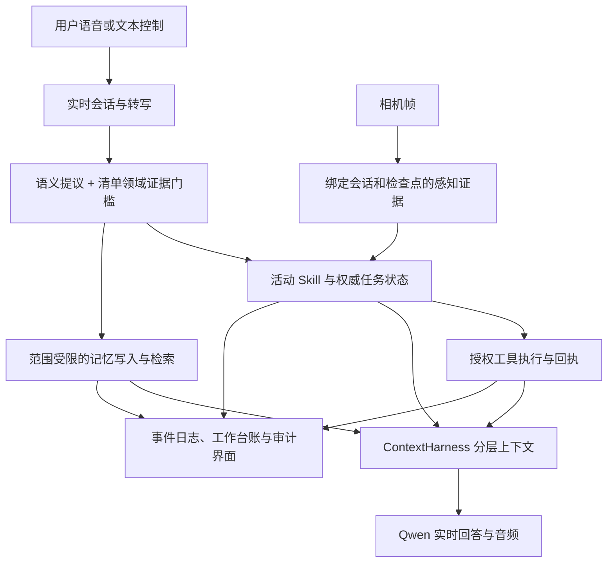

# Skill 架构、产品边界与真实测试（2026-09-09）

当前 Skill 机制值得保留，但需要清晰区分领域政策、运行状态与执行能力。本次已完成加载器拆分、上下文分层、错误隔离和两种新工作流，并通过真实 Qwen 回归。当前证据支持浏览器上的软件 Demo，不代表真实眼镜硬件或所有物理任务已完成验收。

## Skill 的意义

Skill 是可复用、可版本化的领域工作流包：说明何时适用、怎样处理用户目标、使用什么资料、允许调用哪些已接通工具。它使相同任务的指导方式一致，并让研究人员追溯一次回答采用了哪版规则。Skill 本身不会训练出新模型，也不自动提供视觉检测器、数据库写入或后台执行器。

三个概念分别负责不同事实：

| 概念 | 所有者 | 回答的问题 |
|---|---|---|
| SkillPackage | `realtime/skill_package.py` | 本领域采用什么政策、资源和工具声明？ |
| TaskSpec | `realtime/task.py` 与包内 JSON | 这个程序包含哪些步骤与检查点？ |
| SkillRuntime / TaskSession | `realtime/skills.py`、`task.py` | 当前激活什么、执行到哪一步、是否暂停？ |

做菜、装配、打包适合程序式 Skill；现场记录适合无固定步骤的对话式 Skill。强行给每个 Skill 创建一个虚假的固定任务，会导致无意义的选任务、确认和完成提示。记忆、日报/周报/月报、身份权限、提醒投递属于跨领域平台服务，复制进每个 Skill 会造成政策冲突和重复实现。

## 架构各部分的职责



| 部分 | 产品意义 | 科研意义与边界 |
|---|---|---|
| 浏览器与 `run_egoassist.py` | 音视频、身份、会话、HTTP/WS 协调 | 记录真实输入输出与延迟；入口仍偏大，本次仅提取 Skill 包加载职责 |
| 实时 Qwen bridge | 转写、自然对话和音频输出 | 测音频首包、终止状态、打断；语言流畅不证明动作执行 |
| `semantic.py` 与激活门槛 | 把自然语言转成控制提议并校验领域证据 | 分开评估模型提议与实际转换；规则分数不等于校准概率 |
| Skill 包与运行时 | 可复用领域流程，显式启动/切换/退出 | 版本、内容哈希、检查点支持追溯和消融实验 |
| `context_harness.py` | 按预算放入政策、状态、记忆与工具结果 | 测注入来源、上下文成本；不把历史文本当权威状态 |
| `memory/timeline.py` | 用户/案例范围内保存和召回事实 | SQLite WAL、FTS 与实体/时间约束；本次实时主链路不走 FAISS |
| `perception.py` / `ambient.py` | 任务感知证据；可选环境观察 | 帧有效性、过期证据与观察覆盖需独立测；没有视觉输入不能假称看见 |
| tools / artifacts / MCP | 真正访问资料或外部服务 | 以执行回执为准；MCP 客户端模块不等于默认启动已连接全部工具 |
| `work_ledger.py` | 持久化意图、工作状态与结果收件箱 | 台账是记录，不是自动执行循环或持久调度器 |
| journal / product / identity | 事件审计、权限、隐私、产物与连接器状态 | 区分实验事实与界面投影；能生成报告不等于无人值守定时送达 |
| retrieval / habits / abstention / eval | 为数据集检索、习惯推断和评测提供扩展 | 属于科研模块；离线 conformal 校准不自动覆盖实时 Skill 的规则判断 |

保留模块的标准是明确输入、输出和责任。可选 Temporal/通知连接器接通后才可能提供持久提醒；Skill 清单中的能力描述不能把 `unsupported` 变成已执行。本次也修正 README 中的生产可靠性承诺，以及把工具、记忆、FAISS 错画为串行实时流程的图。

## 已修改的不合理部分

1. 独立 `skill_package.py`，使用 `yaml.safe_load` 正确读取多行描述与 BOM。校验名称、布尔配置、任务路径、空匹配和重复注册；PyYAML 改为运行时依赖。发布包补齐已有 PDF 参考资料。
2. 目录路由只使用名称和描述；激活后注入独立 `active-skill-policy` 层，带来源哈希。权威 `skill-runtime-state` 为必需层，不能为保留历史而被丢弃。哈希覆盖政策、清单、任务和已加载 Markdown 资源；PDF 字节由产物系统单独管理。
3. 无任务 Skill 正常显示“对话工作流”，加载知识状态与工具声明不再依赖 TaskSession。前端禁用不适用的任务控件，撤下把规则分数写成“100% 置信度”的展示，检查点展示更新来源。
4. 英文别名有词边界，`cook` 不再匹配 `cookie`。保留语义提议与清单领域证据的联合激活门槛；开放表达可能漏激活，用户仍可显式选择。
5. 可选结构化记忆字段独立校验。错误 `memoryDraft` 不再吞掉单独有效的 Skill 激活或退出；丢弃错误部分并记录 `componentErrors`。整体协议与其余字段仍严格校验。
6. 用户陈述与相机观察分开。没有带相机来源及帧 ID 的已接受观察时，回复指令禁止声称看见；有历史帧也不代表场景始终未变。这是约束和测试，不能保证模型永不产生无根据描述。
7. 共享状态机完成后只确认用户已完成步骤，移除无条件的“最后安全检查”。必要检查由具体 TaskSpec 声明，打包流程不能自行增加钱包、耳机或雨伞。

此前退出后旧转写重放、重复激活重置任务的问题已经在 `bce2906` 修复，见 [生命周期验收](SKILL_LIFECYCLE_VALIDATION_2026-09-09.md)。本次新增工作流也检查显式退出与退出后的普通写作。

## 当前可以演示的 Skill

| Skill | 内容 | 本次真实验证 |
|---|---|---|
| kitchen-coach | 番茄炒蛋、水果沙拉、燕麦粥 | 番茄炒蛋激活、重复、暂停、恢复、确认、回退 |
| assembly-coach | 凳子装配、净水壶滤芯 | 凳子流程激活；参考工具解析成功且实际读取 PDF |
| packing-coach | 通勤核对、短途打包 | 通勤清单确认、找齐、随身携带、完成、退出 |
| field-notes | 现场口述草稿、更正和不确定性保留 | 六箱更正为七箱，保留外包装潮湿和内部未检查，退出 |

共 4 个 Skill、7 个固定任务。新包是本项目原创的实用流程，没有声称来自第三方已认证的 Skill 库。打包的具体物品保存在对话证据中，状态机管理三个阶段，尚不是逐件持久化的物品清册。现场记录生成草稿，不代表已发送给别人或自动保存为跨会话记忆。

## 真实失败与修复证据

归档：[validation/2026-09-09-skill-catalog](validation/2026-09-09-skill-catalog/)。JSON 保留来源路径、会话 ID、供应商请求 ID、原始路由输出、回答、关键状态、上下文层与延迟；省略重复包内容。完整运行日志留在 `outputs/`，不提交账户库、媒体或密钥。

- `catalog-failed.json`：第一次新 Skill 验收失败。模型正确提出 `field-notes`，但附带的记忆草稿缺少 predicate，旧解析器使整轮分类失效。人工检查同一轮日志又发现无图像时说“我看到你手边有手机”、完成后多加钱包/耳机/雨伞。旧脚本对这些回答缺陷没有断言，因此其中早期回合的 `passed` 不代表输出质量通过。
- `catalog-passed.json`：修复解析和回复约束，补充相应断言后，10 轮真实请求全部通过。现场记录为“仓库收到六箱配件。其中一箱外包装潮湿。里面的物品尚未检查，无法确认是否损坏。”更正后仅数量变为七箱。
- `original-skills.json`：原有 Skill 的 8 轮真实请求通过，包含实际参考 PDF 验证。
- `memory.json`：随机测试编号写入产生 committed 卡片 ID；关闭写入会话后，在独立新会话召回并用于取物说明。模型曾误提议 `field-notes`，领域门槛拒绝执行；不能报告为模型路由百分百正确。
- `browser.json`：真实 Edge/Playwright 验证任务式与对话式选择、任务控件禁用和重新登录恢复。1440/390 像素视口均无横向溢出，页面异常和失败请求均为空；截图已检查。浏览器操作验证没有测实际眼镜硬件。

## 延迟与验收范围

供应商为真实 `qwen-flash` 路由与 `qwen3.5-omni-flash-realtime` 对话。输入通过生产 HTTP/WS 的文本控制入口发送，输出包含真实音频、最终转写和 `response.done`。这些是人工设计场景，不是录制的真实世界数据集，也没有计入人说话、麦克风端点检测或扬声器播放延迟。

| 项目 | 样本 | 测量 |
|---|---:|---|
| 新 Skill 回归首音频 | 10 轮 | 1086.8–1967.4 ms，中位数 1289.2 ms |
| 新 Skill 云端路由 | 10 次 | 284.1–1096.8 ms，中位数 471.6 ms |
| 原有 Skill 首音频 | 8 轮 | 1184.5–1418.9 ms，中位数 1284.6 ms |
| 新会话记忆召回/使用首音频 | 2 轮 | 1279.0 / 1523.4 ms |
| 保存请求到文本提交回执 | 1 次 | 922.8 ms，其中路由 851.2 ms |
| 本地写入策略 | 1 次 | 8.822 ms，包含策略处理和持久化 |
| 本地检索 | 2 次 | 7.823 / 5.2 ms |
| Python 回归 | 368 项 | 全部通过，53.20 秒；4 个既有 aiohttp 警告 |

此次小规模记忆等待主要在云端，不能把更换数据库当作主要提速方案。当前数据不足以给出稳定 P95/P99，也不能把这轮比历史样本快归因于某一个改动。更大 Skill 目录、长期记忆规模、长会话、不同网络、音频及持续视觉输入需要分别测量。

科研上下一步应固定政策哈希、模型和输入集，对比无 Skill、仅 Skill、Skill 加显式状态三个条件，统计误激活/漏激活、无证据陈述、检查点与回答一致性、实际任务完成率、用户确认负担和各阶段延迟。本次没有完成上述消融，不能声称 Skill 带来已量化的因果收益。

## 复现与运行

在项目根目录，使用已配置真实 Qwen Key 的环境。真实测试输出目录必须不存在：

```powershell
.venv\Scripts\python.exe -m pytest -o cache_dir=outputs/pytest-cache-skills-v2
.venv\Scripts\python.exe scripts/verify_real_skill_catalog.py --output outputs/new-catalog-run
.venv\Scripts\python.exe scripts/verify_real_skills.py --output outputs/new-original-skills-run
.venv\Scripts\python.exe scripts/verify_real_memory.py --output outputs/new-memory-run
.venv\Scripts\python.exe scripts/verify_browser.py --output outputs/new-browser-run
```

更新后的服务地址为 `http://127.0.0.1:8780`，使用已有 `.egoassist-real-demo/runtime.json` 数据根目录。服务另经真实现场记录请求验证，活动 Skill 为 `field-notes`，收到 16 个音频事件且无错误，会话 `668392dc35304b63`。日志为 `outputs/demo-skill-catalog-8780.*.log`。

日报/周报/月报、持久提醒、原生模型工具调用稳定性、真实眼镜的采集/回声/打断和视觉完成判定不在本次新增通过范围内；本次工作不将已有模块的存在等同于这些功能已全部验收。
