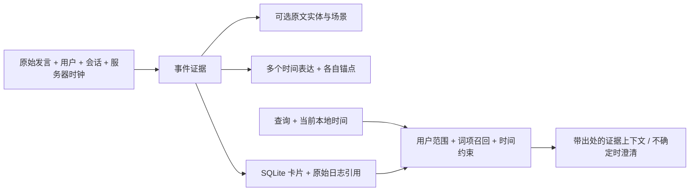

# 人际交流、时间记忆与性能审计

本次结论：旧的单主体/单关系/单时间窗口不足以表示自然交流。现在保留原始发言，在同一次语义路由中附加可选的人名、场景和多时间索引，并沿用 SQLite、用户范围与证据引用。真实 Qwen 已通过跨会话双时间查询和显式嵌套锚点查询，但不能据此宣称具备完整社会认知或任意时间语言理解。

## 已删除的测试

删除 `tests/test_console.py` 的 8 项、`tests/test_no_intent_keyword_hardcoding.py` 的 4 项，共 12 项源码字符串断言。它们检查 DOM ID、函数拼写、固定文案或禁用词，无法证明浏览器操作或路由行为正确，并且妨碍合理重构。保留身份、隐私、生命周期、任务状态、真实接口及浏览器行为测试；没有清除历史失败日志，也没有删除旧数据来制造通过结果。

增加时间边界、证据归属、事件结构、导出损坏处理、性能归因等行为回归。后续又加入报告、删除期间取消生成、动态 DNS 和会话更新去重回归。完整运行 **374 项通过，54.74 秒**，4 项既有 aiohttp 警告，结果见 `outputs/insights-tests-final.xml`。随后对轻量审计投影新增一项回归，受影响的接口和审计 **42 项通过**，最终集合 375 项；不把重叠运行相加报告。

## 自然建模的最小结构



`memoryEvents` 允许只输出 `scope`、`consent`、`context`，无需重复生成主体、关系、值和摘要。单事件直接使用原始发言；多事件的可选摘录必须出现在原文。旧的事实三元组继续用于电话号码、物品位置等明确单值关系。复杂事件的关系查询可以匹配事件原文，不再被单个提取谓词限制。

`context.entities` 是原文标签，`scene` 是可选场景片段，`times` 是带关系标签的时间引用列表。标签必须出现在输入中；不存在的标签记录为拒绝。没有加入人物类型体系、亲密度分数、图数据库、额外 embedding 或第二轮模型分析。

`evidenceNetwork` 是从当前范围的活动卡片生成的共现投影：标签节点连接事件和证据，不直接创建“朋友”“同事”等推断边。同名可能是不同的人，同一个人也可能有别名；目前没有可靠的自动实体消歧。界面卡片可展开原文、来源 ID、场景与时间证据，网络投影不是完整关系推理器。快照最多检查 200 张近期卡片，完整数据仍在数据库与账户导出里。

“最小归纳偏置”不等于没有约束。应保留用户隔离、原文依据、时钟运算和执行权限等可验证约束，把开放语义留给模型；不预先强迫每句话都成为固定三元组，不用模型编出的数字替代证据。代价是同义词、别名、复杂时间结构可能漏检；不能把严格原文校验称为完全开放语义检索。

## 时间究竟如何解释

系统注入服务器当前 UTC 时间、用户时区和本地时间。记录时间 `recordedAt` 与事件有效时间 `effectiveAt/effectiveEnd` 分开。新增多个时间引用，日期运算由代码执行，模型只选择原文时间片段、关系和锚点，不接受模型凭空生成的 ISO 时间。

以用户当地日期 **2026-09-09** 为例：

| 表达 | 讨论时间 | 约定时间 |
|---|---|---|
| 昨天讨论的前天的约定 | 9 月 8 日 | 9 月 7 日，两者以当前发言为锚点 |
| 昨天讨论、以那次讨论为参照的前天的约定 | 9 月 8 日 | 9 月 6 日，第二个时间以第一个事件为锚点 |
| 昨天他说“前天的约定” | 需正确识别引语锚点 | 若指代不清应澄清，不能固定减两天 |

旧代码遇到“昨天”和“前天”会按关键字优先级选前天并丢失另一个时间。现在检测多日期，不再把它们硬压成一个有效时间；已解析的事件角色分别匹配，顺序相反的记录可排除。无法对应原文的角色或不明确锚点会标记 `needs-clarification`，生成指令要求澄清。模型仍可能选错一个看似合法的锚点，这不是形式验证的自然语言解析器。

本机另发现 Windows 缺少 `tzdata`，只有 `Asia/Shanghai` 而没有传偏移量时会退回 UTC。已加入运行依赖并安装 `tzdata==2026.3`；审计披露 `timezoneSource=iana` 或 `fixed-offset-fallback`。本地回归覆盖日界线、嵌套锚点，已有 DST 测试也继续运行。没有验证所有星期、节日、农历或长距离跨句时间指代。

## 自报置信度是否可信

模型说“90% 确信”是生成文本，不是经验证的正确率。它可能包含有用信号，但若没有独立标签和校准，无法知道其数值含义，也不能据此授权、自动确认任务完成或把推断升级为事实。

本次不要求模型输出置信度。证据结构明确 `calibratedProbability=null`；检索分数标注为词项排序/精确键优先级。原文匹配仅证明标签有出处，不证明陈述真实。审计保留接受与拒绝原因、时间解析、来源、用户范围和模型原始输出。

科研评估应分别报告实体/角色提取正确率、时间锚点正确率、召回覆盖率、答案忠实度、误保存/越权率和延迟。若研究置信度，应在保留集上测 Brier score、可靠性曲线、风险-覆盖关系，按任务分布校准；现有离线 conformal 模块不能自动校准实时模型或 Skill 规则。

## 用户数据保留与审计边界

已验证本轮事件写入有用户 ID、会话 ID、来源 ID，关闭连接后在独立会话召回；账户导出的记忆卡片引用可以在导出日志中找到对应原始发言。切换另一个用户后不能读到这些卡片或日志。原始事件不因简短口述摘要省略信息而丢失。

新增修复：

- 召回注入保留记录时间、事件时间、时区、原始来源 ID 和多时间上下文，避免只把一条摘要交给模型。
- 修复 `case+participant` 合并召回被快照清空的问题；界面从同一用户会话日志恢复最近检索与注入事件，支持重新登录后审计。近 160 条事件外的记录需查完整导出，不声称无限历史都在当前屏幕。
- 修复账户导出静默跳过损坏日志：有效行继续导出，损坏行保留原文和行号，返回 `complete=false` 与错误列表。
- 普通事件请求不能仅因模型给出 `consent=explicit` 就升级到参与者长期记忆。没有显式保存请求或兼容的保存草稿时，事件留在当前案例，并记录 `scopeAdjustment`。这沿用现有显式命令边界，不是已经完成所有自由表达下的同意验证。

**不能说所有数据都完整永久保留。** 原始音频/视频默认不落盘；转写也不等同于完整声学证据。普通事件默认案例范围，显式保存才跨会话可用；账户所有权和自动跨案例召回是两件事。系统仍有保留策略、删除功能、有限 UI 投影和短索引文本，完整发言在持久日志。没有本轮新增的云端同步、跨设备账号服务或备份恢复承诺。已有保留策略涉及数据库和日志等多份副本，不能把一个数据库的保留操作等同于所有副本均已物理擦除。

## 性能审计与真实日志

新增 `realtime/performance.py` 只投影已有实测事件，不发额外模型请求。前端首屏展示路由、检索、写入策略、响应首文本/首音频、最新 Token 用量和窗口内超时数。首包指标通过 WS 即时推送，其余随约 1.2 秒状态刷新更新；事件 ID、响应 ID、时间戳和窗口中位数在提示信息中可查。缺值显示未测量。

响应首包从“创建响应请求”起算，不含之前的路由、麦克风端点检测和扬声器播放。不同指标可能来自不同回合，不能简单相加。界面明确最近 160 个事件的窗口，不是全会话 P95/P99。文本输入入口无需申请摄像头/麦克风，仍使用真实实时提供商。

| 真实验收 | 结果 |
|---|---|
| 双日期、不同事件角色，新会话召回 | 通过，首音频 1853.3 ms；路由 1066.8 ms，本地检索 7.143 ms |
| 显式锚定昨天讨论的“前天”，另一组人物/场景 | 通过，首音频 1727.3 ms；路由 957.2 ms，本地检索 4.881 ms |
| 双日期事件保存回执 | 1574.4 / 1898.2 ms |
| 嵌套锚点事件保存回执 | 1879.6 / 1951.0 ms |
| 简单编号写入、新会话召回、使用 | 通过，保存回执 1033.0 ms；首音频 1394.9 / 1316.2 ms |
| 简单编号本地写入/检索 | 6.617 ms / 5.915、4.966 ms |
| Edge 真实文本请求与性能恢复 | 通过，1440/390 视口无横向溢出；无页面错误或失败请求 |

测试真实调用 `qwen-flash` 和 `qwen3.5-omni-flash-realtime`，接收音频、最终转写及 `response.done`。人物/场景是人工构造的测试数据，编号随机生成，不是真实录制数据集或眼镜硬件实验。

原文事件格式减少可要求生成的冗余字段，但供应商仍偶尔使用旧格式，不能宣称输出成本已稳定下降。历史运行出现 3 秒路由超时，旧浏览器验收也记录过一次；最终通过不证明超时被消灭。主要等待在云端，本地新增标签和时间校验为毫秒级；未引入额外模型请求、向量库或后台反复重试。

## 失败保留与剩余问题

[验收归档](validation/2026-09-09-social-memory/) 包含全部运行结果摘要和最终关键证据，完整日志保留在 `outputs/`。没有提交密钥、账户数据库或原始媒体。

1. 双时间第 1 轮：查询放错字段，退回宽泛检索后答错。兼容有明确结构的只读查询信封并记录规范化。
2. 第 2 轮：回答正确，但前端快照清空注入证据；修复日志投影。
3. 第 3 轮：写入路由超时，查询角色又被翻译成英文，答错；保留原文兜底，拒绝无原文依据的角色，时间不明确时要求澄清。
4. 第 4、5 轮和普通最终轮通过。嵌套锚点第 1 轮漏掉相对锚点，未召回；第 2 轮回答正确但事件被冗余顶层字段连带拒绝，严格证据断言失败；第 3 轮完整通过。
5. 浏览器中发现普通现场记录被模型错误标为显式长期保存，已加事件范围约束。约束修复后的首次浏览器测试因回答省略人名而失败；之后把浏览器断言限定为真实输出交付、性能、范围与恢复，并记录实际回答。**口述摘要偶尔省略人名仍是输出忠实度限制**，没有用界面通过掩盖它。

尚未实现自动别名消歧、无误的跨句社会关系推断、大规模低成本图检索或任意时间表达解析。最值得继续测的是固定留出集上的召回遗漏、锚点错误、模型输出忠实度及云端尾延迟，而不是增加更多未经校准的“置信度”字段。

## 复现

```powershell
.venv\Scripts\python.exe -m pytest -o cache_dir=outputs/pytest-cache-social
.venv\Scripts\python.exe scripts/verify_real_social_memory.py --output outputs/new-social-run
.venv\Scripts\python.exe scripts/verify_real_social_memory.py --output outputs/new-anchor-run --relative-anchor
.venv\Scripts\python.exe scripts/verify_real_memory.py --output outputs/new-basic-memory-run
.venv\Scripts\python.exe scripts/verify_browser.py --output outputs/new-social-browser-run --real-turn
```

真实测试输出目录必须尚不存在。当前更新后的 Demo 为 `http://127.0.0.1:8780`，沿用 `.egoassist-real-demo` 用户数据，最终服务日志为 `outputs/demo-insights-final2-8780.*.log`。

## 提示词、报告与主动建议追加验收

模型自然语言策略集中到 [egoassist/prompts](../egoassist/prompts/README.md)，领域指令仍在各 Skill 的 Markdown 中。核心记忆继续使用原始用户日志和可选索引；报告不另建记忆库，也不把生成摘要再当成新的事实源。代码保留用户隔离、执行权限、结构验证、日历计算和明确控制边界，不声称已经删除所有程序规则。现有明确保存命令、紧急停止等规则仍存在；任意自然语言下无误的授权识别尚未解决。

前端新增提示词文件路径、SHA256、真实路由 messages、实际 session.update / response.create 指令、检索证据及报告请求/原始输出。只展示当前登录用户所选案例的日志。完整提示词和来源留在日志，按需通过 `/api/prompts` 读取；高频状态刷新只投影摘要与引用，避免反复传输完整请求。模板修改后重启服务并新建模型会话，保证模块级常量也更新。

日报、周报、月报共用 `memory/insights.py`：按用户时区划分自然日、周一开始的一周和自然月，对原始用户发言做一次真实 Qwen 生成。范围可选当前案例或本人全部案例；当前按**记录时间**筛选，不声称已经找出所有“实际发生在本月但在别月说起”的事件。来源不足时不生成有内容的报告；每条摘要/建议必须引用存在的 sourceId，未知引文拒绝并留存原始输出。引用存在不证明语义完全忠实，更不证明陈述真实。

单次预算 300 条/32,000 字符，超过预算明确披露 omittedRecords 和 complete=false，原始日志不因此截断或删除。complete 仅表示纳入范围内可读取的用户发言都进入本次输入，不表示系统观察了用户全天生活。此版本不归纳原始音视频或尚未转写的观察。相同模型、提示词、时间段和证据复用持久结果；账户导出包含请求、结果及原始来源。账户删除先取消在途生成，避免晚返回结果重建已删除文件。

在线主动建议默认关闭，启用后当前案例有新用户发言且对话结束时评估；请求间隔至少 30 秒，相同证据不反复调用模型。建议显示在界面，允许为空，不自动发消息、建提醒或改变任务。浏览器关闭后不继续调度；没有把在线建议冒充为离线定时通知，报告也不是自动定时送达。

两轮 Edge + Qwen 浏览器验收均通过日报、周报、月报、在线自动建议、真实提示词可见、登出/重新登录、1440/390 无横向溢出。测试使用人工输入的现场记录，模型调用、服务器日志与浏览器均真实；不是眼镜硬件或长周期真实生活数据集实验。

| 最终真实运行 | 耗时 |
| --- | --- |
| 日报 | 1280.022 ms |
| 周报 | 1119.208 ms |
| 月报 | 926.237 ms |
| 在线主动建议生成 | 3003.989 ms，不含最多 30 秒调度间隔 |
| 对话路由 | 1074.3 ms |
| 对话响应首音频 | 714.911 ms，从 response 请求起算，不含路由 |
| 本地检索 / 写入策略 | 15.148 / 23.994 ms |

上一轮浏览器本地检索/写入为 3.761/6.422 ms；机器并发负载会影响毫秒级数值，不能只挑最低的一轮。最终现场记录回复保留了张岚和会议室，但之前确实出现过遗漏，单次成功不构成一般忠实度保证。

还定位并修复两个延迟来源：

1. 关闭虚拟网卡后系统 DNS 返回 IPv6 优先，而 SDK 没有 Happy Eyeballs、建连固定等待 5 秒，真实前台/服务复测均超时。同一次 DNS 的 IPv4 对照通过后，双栈解析动态优先使用当前 IPv4 答案，保留主机名 TLS 校验，不写死地址。正式 8780 服务随后真实连接并回答“今天是9月9日”。
2. 状态刷新重复发送相同会话配置。现在只有提示词、工具、语音或连接发生变化才更新供应商会话；重连仍完整初始化，失败的更新不会被记作成功。这个改动也避免审计被重复提示词淹没。

新增归档 `insights-browser-20260909-1.json`、`insights-browser-20260909-release.json`、IPv4 前后记忆测试结果和正式服务复测。旧失败保留，未声称所有云端尾延迟与模型语义错误已经消失。
