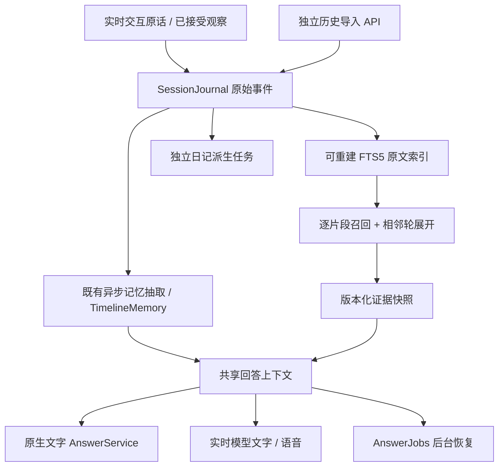

# 原始证据底座：第一阶段实现与开发验证

2026-09-17。目标是“原始证据始终可检索，结构化记忆和摘要是可重建辅助层；回答渠道共享证据上下文”。本次交付可运行的基础版本，尚未完成全部四阶段。

## 先给结论

- 原生历史导入不经过通用交互路由；逐轮原文落盘后进入 FTS5，抽取未运行也能检索。模型、路由配置均未升级。
- 账户和会话严格隔离。证据包保存原始 ID、说话人、来源时间、接收时间、原文位置、候选审计和覆盖信息；实时渠道与后台恢复使用同一个回答上下文对象。
- 独立日记接收有明确时间的原始历史事件；未知时间或时区标记为未归入周期，不使用接收时间冒充发生时间。原日记数据格式与旧归档指纹保持兼容。
- 两个冻结开发会话 788/788 轮原文成功索引。校正复合引用并单列对抗题后，233 道可回答题的最终证据召回为 **225/309，72.82%**，未达到 80% 目标。此前 77.43% 使用了混合题型及未拆分引用的口径，已撤回；原始实验文件保留。没有宣称错误拒答率达到 10% 以下。
- 真实回答发现独立时间错误：即使给标准证据，模型也曾把昨天当作来源当天。增加来源日历表达式注释后，开发样例日期修正；失败版本保留。这证明本次问题不能全部归结为检索。

## 模块与契约



| 文件 | 责任 |
| --- | --- |
| `core/source_events.py` | 接入字段校验、历史逐轮来源和既有日志的统一原文投影 |
| `memory/source_index.py` | 账户本地 FTS5、长文片段位置、相邻轮、完整候选审计、持久快照 |
| `memory/evidence_service.py` | 幂等导入、不可变 ID、查询与维护边界 |
| `memory/source_time.py` | 用已知来源日历展开相对日期；保持未知时区和未知事件归属 |
| `product/answer_service.py` | 共享上下文、结构化原生回答、引用校验、连接复用及可用性错误 |
| `application/history_api.py` | 认证后的导入、查询、回答、来源删除；不构造实时控制动作 |

`SourceEvent` 原始记录保存在账户会话 journal 的 `source.event` 中，每轮独立 ID。`source_at` 可为 ISO 日期、带或不带时区的日期时间、null；`receivedAt` 由服务端确定。来源 ID 和正文来自接入层，模型不生成它们。非法必填字段拒绝，原始版本不覆盖；更正使用新的 ID 和 `supersedes` 指向本会话已有版本。

导入响应分别给出 `accepted`、`indexed`、`extraction: not-requested`、`vector: not-indexed`。本阶段没有虚报“抽取待处理”：原生导入尚未接入新的 MemoryClaim 抽取后台任务。现有实时记忆链仍运行。

`users/<uid>/source-index.sqlite3` 是可删除重建的投影，不替代原文。读取时检查 journal 文件变化，追加文件只读新增尾部，文件替换/缩短重建会话索引。SQLite 连接每次操作结束关闭。索引失败时返回原文已接受、索引待恢复；下一次查询重建，不丢原文。

检索按会话过滤，英文 FTS5 porter、中文二元词项；长原文按 1,800 字符切片，重叠 160 字符，保留源位置，不截掉永久尾部。查询最多 64 个词项、256 个候选片段、12 个锚点、24,000 字符，再按预算展开前后相邻轮。另保存最多 8 条、8,000 字符的同会话近邻对话上下文。存在明确预算并不等于证据完整。

原文不受指代、主体、谓词的模型判断硬排除；既有派生卡片规则保持原状。原文可见不等于其中所有事实可靠。当前只有原文词法召回与相邻上下文，还没有接入向量融合或多跳规划。

快照绑定账户目录、会话、问题、原文哈希；后到消息不会扩大旧快照。回答发布前和后台恢复时再次核对来源。删除原文会清除依赖记录并使快照失效；账户删除及保留策略清理索引。原始引用位置、来源时间和接收时间都进入回答上下文。

`turn_answer_context()` 的同一个对象传给实时 bridge 与 AnswerJobs，原生问答使用同一 `answer_context()` 投影。语音继续使用原有实时提供商表达，尚未改为“同一结构化答案再统一 TTS”；语音的全部会话输入及输出格式也不与原生文字完全相同。此处验收的是共享事实证据输入，不能推断所有语音/视觉任务效果相同。

原生回答返回 `answer`、`claims[].supporting_source_ids`、`unanswered_parts`、`conflicts`、`status`。引用必须存在；语义正确性并不能仅靠这个校验保证。网络/模型错误为 `unavailable`，与 `insufficient` 区分。连接故障/超时最多重试一次，每次请求、响应或失败独立入日志；HTTP 拒绝不无限重试。

旧 WebSocket 路径仍保留。意图的 `text` 继续限 500 字符用于简短描述，过长原始执行内容另存 `source_text`（最多 100,000），所有执行消费者使用 `execution_text`。因此不是把原文裁掉或无限扩大意图描述字段。

候选审计从 Timeline 的 `candidateAudit` 读取完整扫描结果写入 journal；页面预览仍可保留前 20 条，避免把全量审计塞入周期状态轮询。审计缺席不再自动解释为候选未生成。

## 真实证据与实验范围

- [第一次原生实验](../outputs/source-evidence-20260917-r1/verification.json)：保留时间误答。
- [时间注释后复测](../outputs/source-evidence-20260917-r2/verification.json)。
- [冻结协议](../outputs/source-evidence-20260917-r2/protocol.json)。
- [原 WebSocket 语音中断与重启恢复](../outputs/source-evidence-legacy-recovery-20260917/acceptance.json)。

数据集 LoCoMo，开发会话固定为 `conv-26`、`conv-30`，分别 419、369 轮；其余八个会话本轮未读取题目内容或运行回答。整个数据集在之前实验中已用过，因此不能把保留部分称为从未见过的独立测试集。

| 阶段 | 命中标准引用 | 召回率 |
| --- | --- | --- |
| 词法候选 | 275/309 | 89.00% |
| 排序选中锚点 | 176/309 | 56.96% |
| 相邻轮展开后最终证据 | 225/309 | 72.82% |

上表限类别 1–4 的 233 道可回答题。类别 5 的 71 道对抗题另记为引用上下文覆盖，不能算可回答题召回或拒答正确率。全部 304 题共有 382 个规范化引用，混合上下文覆盖为 295/382，但不用于本轮质量目标验收。见[校正报告](../outputs/source-evidence-lifecycle-fix-20260917/recount-final.json)，其记录原始输入 SHA256，重算不调用检索或模型。

这些是“标准引用所在轮次进入上下文”的比例，不是事实完整率或答案准确率。与旧协议全数据的 13/2,355 不可直接作为同条件提升倍数：会话集合、导入协议和回答输入发生了变化。

每个开发会话仅选前 3 题调用真实 `qwen-flash`，共 6 个原生答案；未向这条路径供给标准证据。额外每会话第 1 题分别做标准证据直接供给、全原文上下文两种诊断，共 4 次，明确不计入正式成绩。每轮有 request ID、usage、原始输出、来源和失败审计。

第一次中 Caroline 参加小组被答为 5 月 8 日（标准答案 5 月 7 日），Jon 失业被答为 1 月 20 日（标准答案 1 月 19 日），即使 oracle/full-context 诊断也出错。复测用独立来源日期展开昨天、去年、本月，四道日期题给出相符日期或年份；没有把来源时间改成事件时间。原文、旧答案和诊断结果均保留。

教育方向题仍存在泛化和不完整：回答扩展到创意/自然等推测，却没有完整明确给出标准答案中的心理学与咨询认证。6 题全部返回 `supported` 是模型声明，不能当成 6/6 正确。小样本没有拒答，也不能证明全量错误拒答率小于 10%。

原协议真实测试使用包裹取件码问题，在语音输出后打断，并在后台请求中重启服务；恢复耗时约 4.29 秒，回答包含原取件码，没有重放控制动作。重启前后请求的证据快照 ID 相同，证据上下文逐字段相等。不是全部语音、视觉能力的泛化评测，也没有重跑旧协议全套 1,986 题。

## 回归与使用

本机最新服务：<http://127.0.0.1:8780/>，原生日记演示的 8779 端口未重启。隔离开发账号 `evidence-dev`，密码 `Evidence-local-demo-20260917`；账号内两条历史会话 ID 见 `verification.json` 的 `imports`。可以在同一登录 cookie 下调用下列 API，或进入已有助手会话询问历史问题。

新测试覆盖长原文尾部命中、中文检索、幂等与不可变导入、无抽取可检索、完整候选审计、相邻轮 ID、未知时间、相对日期、跨账户/会话隔离、快照边界、删除及重建、渠道上下文与后台恢复一致、网络故障区分、旧长意图不丢执行原文、日记历史来源归属。

此前完整回归为 682 项通过，见[历史回归日志](../outputs/source-evidence-20260917-r2/regression.txt)。本次删除传播、快照生命周期及评测口径修复后，最新完整回归为 **691 项通过**，64.19 秒，3 条已有 aiohttp timeout 弃用提示。修复详情和真实模型链路见[后续修复记录](SOURCE_EVIDENCE_LIFECYCLE_FIX_2026-09-17.md)。独立日记实现本轮未改动，其测试包含在完整回归中。

```http
POST /api/history/import
{"conversation_id":"<已登录账户的会话>","events":[
  {"id":"D1:1","speaker":"Alice","text":"My bicycle is blue. It is in the garden shed.",
   "source_at":"2023-05-08T16:00:00","timezone":null}
]}

POST /api/history/query
{"conversation_id":"<会话>","question":"What color is Alice's bicycle?"}

POST /api/history/ask
{"conversation_id":"<会话>","question":"What color is Alice's bicycle?",
 "evidence_snapshot_id":"<query 返回的 snapshotId，可省略>"}

POST /api/history/delete
{"conversation_id":"<会话>","source_id":"D1:1"}
```

接口沿用原账户 cookie 认证，导入每批 1–500 轮，单轮正文最多 100,000 字符，还受原 HTTP 请求体 3MB 上限约束。日记对缺少来源时间/时区的历史记录显示未归入周期，不静默放到导入当天。

```powershell
.\.venv\Scripts\python.exe -m pytest -q -o addopts= -p no:cacheprovider
.\.venv\Scripts\python.exe scripts/verify_source_evidence_real.py --output outputs/source-evidence-new-run
.\.venv\Scripts\python.exe scripts/verify_real_answer_recovery.py --output outputs/source-evidence-legacy-new-run
```

## 后续阶段边界

当前没有宣称全部建议架构已经完成。后续包括：原文向量召回与三路融合、事实级 MemoryClaim 抽取和引用位置校验、可靠时间/关系查询、多跳扩展、系统级冲突判定、所有语音输出统一结构化回答、日记复用统一持久派生快照、分级路由消融，以及反复启动关闭的长期内存压力测试。导入和明确问答已跳过复杂路由；实时模糊请求仍沿用既有路由模型。

80% 最终证据召回、10% 以下可回答题错误拒答继续作为开发目标。本次测量不足以证明达标，更没有证明达到或超过既有向量 RAG 基线。
