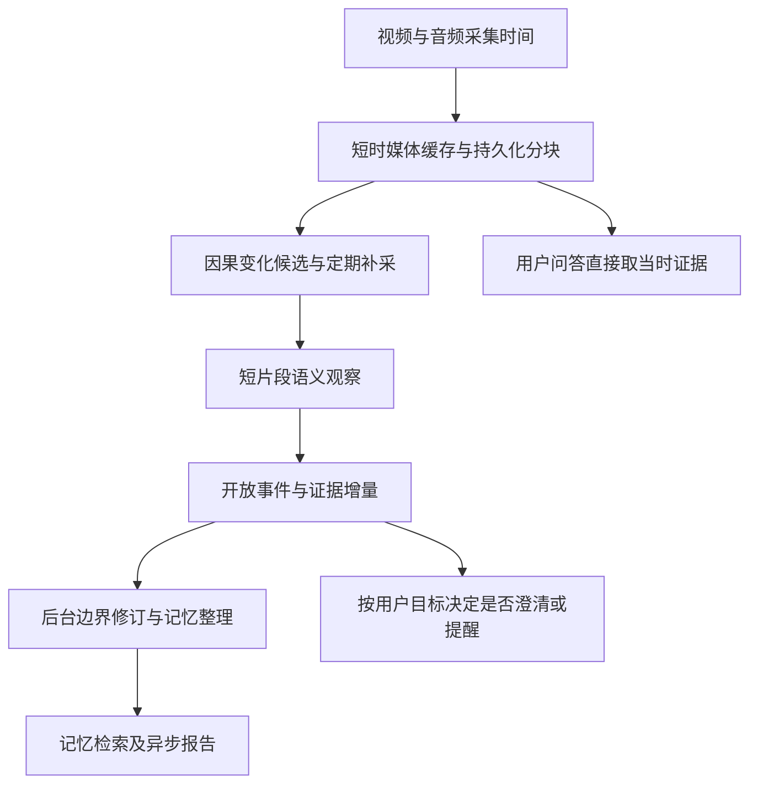

# 视频流实时事件分割与重要内容提取调研

日期：2026-09-10。项目基线：`20362cd`。本次核对官方仓库、项目页及项目本地实现；没有运行这些外部模型，也没有进行新一轮 Qwen 延迟测试。下文明确区分已有测量、作者报告与待验证方案。

## 结论

对第一视角智能眼镜，建议采用“连续短时证据 + 低成本候选检测 + 按需短片段理解 + 异步事件整理”。优先借鉴 Dispider / StreamBridge 的分工，使用现有 Qwen 处理语义；GEBD 作为无类别边界检测的实验基线。暂不整体替换成另一个大型流式模型。

事件切段、动作识别、重要性判断和主动开口是四个不同决策。可以先观察到并记录一个变化，在证据积累后修订解释；不应必须等动作结束才响应，也不应每个事件都打断用户。

“最少归纳偏置”可实现为不设固定行为白名单、不要求先填人员/地点/动作分类表。时间、证据引用、资源预算、任务状态仍需明确约束。任何压缩或触发策略都有取舍，不能承诺全行为零漏检。

## 方法比较

| 方法 / 项目 | 能解决什么 | 实时性与主要局限 | 对本项目的价值 |
| --- | --- | --- | --- |
| 帧差、图像哈希、PySceneDetect [1] | 发现外观变化、剪辑切镜；计算成本较低 | 眼镜转头、走动、曝光变化容易误触发；同场景细微动作容易漏。AdaptiveDetector 的窗口也需计入输出滞后 | 便宜的候选信号，不能独自决定丢弃证据或写入事实 |
| GEBD / EfficientGEBD [2][3] | 不要求动作类别，估计事件边界 | “边界在哪”不等于“发生了什么”。需要核对具体模型的未来帧依赖；高 FPS 不证明严格因果、低端到端延迟 | 最值得对照的学习型边界基线；需要第一视角域内评估 |
| LSTR / TeSTra [4][5] | 从历史特征在线识别当前动作，支持流式推理 | 通常输出训练集中的类别；官方流程使用预提取 RGB / 光流特征，完整特征提取成本不能省略 | 对确定工序有用，不宜作为开放生活事件的唯一入口 |
| EgoVLP / VideoMAE [6][7] | 学习片段表示，支持相似度、检索或动作识别 | 编码器本身不是事件切段器。外观相似不保证动作相同，时间池化可能丢掉先后顺序 | 对照图像特征与真正时序特征，判断增加模型是否值得 |
| Dispider / StreamBridge [8][9] | 持续感知、触发决策与较大模型回答分离 | 触发器也会漏报；专用模型、权重、依赖有部署成本。StreamBridge 所需训练权重未公开 | 最适合借鉴调度结构，避免每次观察都生成长回答 |
| VideoLLM-online / MMDuet / LiveStar [10][11][12] | 流式接收画面，学习什么时候说话，部分任务包含时段定位、密集描述和高光提取 | 要适配流式训练或专门权重；输出时机正确不等于事实正确。8GB 本地完整部署未验证 | 中期研究对照，不能把替换模型直接当成降延迟保证 |
| StreamForest [13] | 保留近期精细信息，压缩长期事件历史 | 偏长上下文视频理解；压缩会影响可回溯细节，不是独立轻量分割 SDK | 借鉴近期细、远期粗，但原始证据不随摘要压缩而删除 |
| ColorTrigger [14] | 连续灰度观察、按需彩色采集，因果触发与视觉 token 分配 | 仍需连续灰度流；代码 README 暂未给出运行教程。节省 RGB 数量不等于节省相同比例总功耗 | 硬件选型阶段的重要方向，尤其关注采集与传输成本 |

补充：空间分割/跟踪回答“哪个人或物体在哪里”，时间事件分割回答“什么过程何时发生”。前者可辅助人手与物体关系，但不能单独确认说话人、左右手归属或吞咽行为。声音事件、ASR 和说话轮次变化应作为并行证据，不能只靠画面变化触发。

## 重点项目核查

### Dispider 与 StreamBridge

Dispider 官方当前 README 描述：CLIP 编码 16 帧片段，Qwen2-1.5B 承担 Perception-Decision，Qwen2-7B 承担 Reaction，并提供增量推理和可选 Decision KV cache。值得借鉴的是回答生成期间继续感知。16 帧片段的采样跨度也属于延迟预算，不能只计模型运行时间。[8]

StreamBridge 将轻量 activation model 与原视频大模型解耦，并使用 round-decayed memory compression。官方明确说明由于视频版权原因不发布所需训练权重，快速启动的 checkpoint 仍为 TBD；不能承诺下载即可运行。README 的 8 张 A100-80G 是默认评估配置，也不能反向解释为所有推理都必须 8 卡。代码为 ASCL，数据为 CC-BY-NC-ND。[9]

当前项目可借鉴两者的调度和触发思想，但“本地变化检测 + 云端 Qwen”只是受启发的工程方案，不是复现其论文方法或性能。

### GEBD、在线动作检测与 FPS

GEBD 面向通用事件边界，无需给每个片段指定固定动作类，符合开放观察的需求；标注粒度仍含人的判断，并非唯一客观分界。[2]

EfficientGEBD 官方表格中不同骨干报告 847–2386 FPS，但本次没有复核计时脚本、批大小、预处理和未来上下文。因此不把这些数值用于本机服务延迟估算，更不将其解释为眼镜每秒可理解上千个事件。[3]

LSTR 明确区分 batch 与逐帧 stream evaluation；TeSTra 提供 THUMOS、EPIC-KITCHENS 的预提取 RGB/光流特征。完整链路必须重新计入视频解码、特征提取和传输。固定动作集模型仍可成为专用技能的一部分，但不承担所有生活事件的总分类器。[4][5]

VideoLLM-online 作者报告 RTX 3090 上 5–10 FPS、A100 上 10–15 FPS，采用视觉编码、帧转发、回答生成异步并行。这是作者特定设置的吞吐结果，不是当前 RTX 5070 Laptop 的测量，也不是事件发生到首次有效响应的延迟。[10]

### ColorTrigger 与真实硬件

官方项目页称，持续灰度流配合 8.1% 的 RGB 帧，在相应实验设置下保留 91.6% 的全彩基线得分。它保留连续灰度时序，而非只看 8.1% 的画面；还包含模型内的动态 token routing，不能假定现有云 API 可直接支持。[14]

普通 RGB 摄像头拍摄后再转灰度，不等于真正低功耗灰度传感器按需唤醒彩色摄像头。需要测摄像头、ISP、编码、无线传输、模型推理的总功耗和唤醒时间。颜色变化本身重要时，灰度触发也存在遗漏风险。

### LightMem-Ego 的实现经验

本地参考代码 `research_references/LightMem-Ego/src/backend/online_short_term/` 中：

- `frame_diff_detector.py` 使用直方图差异与 pHash 差异，按 0.6 / 0.4 合成分数。它是外观变化检测，不是通用动作语义模型。
- `frame_stream_event_builder.py` 用变化阈值或最大时长关闭事件，再交由后台 refine；该流式路径的默认最短时长为 1 秒、最长 10 秒。
- `close_open_event` 会丢弃不足最短时长的开放事件，并记录 `ignored_short_event`。极短但重要的动作不能照搬这种处理。
- `online_preprocess/segment_video.py` 的 30 秒分片是媒体分块，不是语义分段。

建议借鉴开放事件状态、后台精炼和审计记录；不能因为某项目具有“事件记忆”名称就假设它能可靠感知所有动作。本次是本地参考快照的静态检查，没有运行其整体系统。[15]

## 当前 EgoAssist 的差距

1. `run_egoassist.py` 默认环境观察间隔为 5 秒；`egoassist/prompts/perception.json` 的 `ambient_open` 明确只处理当前单帧。上一帧的文字描述不能恢复两帧之间发生过的动作。
2. `egoassist/realtime/scene.py` 的 SharedScene 有最多 64 帧内存缓存和最多 90 秒音频缓存；选中用于模型的媒体会保存哈希证据。这不是连续视频落盘，也不保证每个时段都可恢复。
3. 语音轮次会关联多个候选帧，但使用服务端收到媒体的时间匹配，并明确同步精度未测。动作时间与声音归因仍需设备采集时间、时钟映射和误差审计。
4. 活跃任务主要走任务检查点感知，不能把其覆盖范围等同于完整环境事件记录。
5. 现有真实 EgoLife 抽帧实验的观察耗时为 1618.2 / 1692.4 / 1947.8 ms，只有三次样本；不是连续动作召回率，也不能推算 p95。[16]

延迟至少分解为：

`首次有效结果延迟 = 等待采样 + 必要的后续证据等待 + 排队 + 编码/上传 + 模型推理 + 结果投递`

理想情况下若独立每 5 秒采样、事件开始相位均匀，则仅采样平均等待就为 2.5 秒；实际非重叠调度还可能更长。持续时间短于间隔的动作可能完全漏掉。即便把单次 API 加快，也解决不了未采集证据的问题。

必须同时记录 `首次候选时间`、`首次有用语义时间` 和 `事件边界确定时间`。检测候选很快但随后长时间无可用解释，用户仍会感到卡顿。

## 建议架构

### 采集与候选

持续采集不等于持续调用大模型。保留压缩的短时媒体，以便触发时回看动作前后；若要求完整科研复查，需要持续分块落盘及索引。只有环形缓存会覆盖未被选中的内容，不能宣称全量保留。

先对比廉价画面变化、补偿相机整体运动后的残差和小型语义特征变化。全局运动补偿可减少转头误报，但近景视差、运动模糊会导致失败，应记录质量并保留补采。手/物体跟踪是可选增强，不把“检测到手”设为所有事件的必要条件。

门控只决定哪些片段先处理，不直接删除原始证据。持续保留定期补采以及用户主动查询通道，防止静止谈话、细微动作、新出现文字等低运动事件被过滤。与用户目标相关的信号可提高优先级，但不能关闭开放观察。

### 语义与事件

使用包含有序帧和各帧采集时间的短片段，结合对应音频或转写。先验证现有 Qwen 路由是否真正接收并利用多帧顺序；开源 Qwen-VL 支持视频，不代表当前 realtime API、封装和配置具有完全相同的能力。

首次触发使用已经存在的历史窗口立即判断，无需为凑满窗口等待未来帧。需要后续证据才可确认的行为先记录可见事实与未解决解释，再增量更新。多帧越多不必然越好，可能增加视觉 token、首响应和尾延迟。

事件描述用自然语言，不强制先映射动作类别。容许同时发生的多个过程、嵌套事件和边界修订；例如“讨论约定”与“把钥匙放到桌上”可以重叠。分段主要帮助索引和检索，不强迫现实成为互斥片段。

最小审计元数据包括事件 ID、原始采集时间范围、发现时间、来源片段、模型与提示词版本、修订关系。语义边界晚到可以修正事件范围，不能把模型返回时间当成事件发生时间。长任务刷新或重启后从持久队列恢复，按证据版本去重。

### 重要性与主动介入

分别问“发生了什么”“值得存吗”“现在值得打断吗”。重要内容可能运动很小，运动很大也可能没有记忆价值。模型可结合当前目标、状态变化、后续可用性和重复程度解释重要性，但不得通过高分覆盖缺失证据。

不让模型自报一个置信度就成为事实。区分直接可见、用户确认、模型解释与无法判断；模型概率、困惑度和响应触发分数都不是事实真实性的校准概率。若需概率阈值，必须用独立标注数据检验可靠性。

以服药为例：连续证据可支持“拿起药盒”“手靠近嘴”“喝水”；遮挡下仍不能推出药名、剂量和已经吞下。只有当澄清有实际记忆价值时才问，并把回答绑定原事件。无需为这种能力写死服药流程。

### 调度与前端

用户问答、持续观察、后台整理分队列，优先保障交互。观察推理采用有界并发，积压时合并重复待处理候选，同时保留证据引用和未处理覆盖范围；历史补算不得伪装成实时提醒。云 API 失败应保留待处理片段、有限重试并展示超时。

前端应展示：当前视频时间、最新已处理时间、积压秒数、观察覆盖缺口、候选触发依据、原片段与选中帧、模型请求与结果、开放/已修订事件、原始事实与解释、首次结果及尾延迟。避免用一个“AI 正在思考”掩盖采集、上传、排队、推理或后台整理的区别。

## 可复现实验

以下是待执行方案，不是已实现能力或实测承诺。

### 对照组与起始参数

| 组别 | 策略 | 要验证的问题 |
| --- | --- | --- |
| A | 当前 5 秒单帧观察 | 基线遗漏和真实成本 |
| B | 相同 API 预算下的均匀短片段多帧观察 | 时序信息本身是否改善动作理解 |
| C | 候选触发 + 定期补采 + 短片段理解 | 预算相同是否比均匀观察更少遗漏、更快发现 |
| D | GEBD 或时序特征替换廉价候选器 | 增加本地计算是否显著提高召回，而非只增加复杂度 |

可先扫描本地候选采样 2 / 5 / 10 FPS、历史窗口 2 / 4 / 8 秒、短片段 4 / 8 帧，再根据性能调整。它们都是实验网格，必须前端或配置可调，不是写死的产品参数。采集帧率与送入模型的帧率分开记录。

先锁定真实视频及文件哈希、问题脚本、模型版本、提示词、解码设置和 API 预算。按原速回放，禁止在线决策读取未来画面。固定请求次数还不够，多帧的分辨率、视觉 token 或实际计费也需对齐。重复运行观察 API 波动，并保存失败与超时。

### 数据与标注

- EgoLife：连续生活第一视角，适合验证记忆用途；抽样短片段实测不能替代连续覆盖测试。
- EPIC-KITCHENS：细粒度手物交互，可检查动作时序；厨房领域结果不能代替开放生活结果。[5]
- HoloAssist：交互与操作过程，可利用动作及多模态时间标注，但与普通单摄像头眼镜的传感器条件不同。[17]
- 补充真实录制：转头但未换任务、静止时微动作、不到一秒的放置动作、长遮挡、多过程重叠、只说话不动作、动作无声、网络抖动、刷新与重启。

人工标注应包含可见证据起止、可接受边界范围、关键状态变化和首次可判断时刻；有争议的样本保留分歧。模型可以辅助标注，不能同时当唯一真值和被测系统。

StreamMemBench 可测下游记忆与未来帮助，但其五分钟处理窗口不等于事件边界真值，不用于直接证明亚秒事件检测。[18]

### 指标与验收方式

| 维度 | 必须报告 |
| --- | --- |
| 分段 | 多种时间容差下的边界 precision/recall/F1、过度切段、漏段、边界确定延迟 |
| 动作与事实 | 关键动作召回、短动作召回、顺序判断、无证据事实率、遮挡样本表现 |
| 用户价值 | 指代问答、位置变化回忆、约定与报告证据正确率、主动提醒命中率、误打断次数/小时 |
| 性能 | 候选延迟与有效语义延迟分别计算 p50/p95，处理水位积压、超时率、队列峰值、恢复耗时 |
| 资源 | 解码/特征/上传/推理各阶段、API 成本/分钟、CPU/GPU/显存、实际端侧功耗 |
| 可审计 | 原媒体覆盖率、时间误差、证据缺失、重复写入、重启前后任务及结果一致性 |

验收同时从事件物理开始时间、首次可判断时间两个基准统计，避免惩罚尚不可见的事实，也避免掩盖等待证据给用户造成的真实延迟。优先找相同成本下改善召回与延迟的方案，先报告准确性和资源的取舍，再确定产品目标。

## 来源与复查

官方 README、项目页及来源哈希归档在 `outputs/video-event-research/`，索引为 `sources.json`，抓取脚本为 `fetch_sources.py`。该目录不随 Git 克隆分发；以下 URL 可用于重新核对。抓取期间网络受限后使用获批只读外联完成补充资料。主分支内容可能变化，未锁定所有外部仓库的 commit。

1. [PySceneDetect detectors](https://www.scenedetect.com/docs/latest/api/detectors.html)
2. [GEBD 官方代码与标注](https://github.com/StanLei52/GEBD)，[论文](https://arxiv.org/abs/2101.10511)。仓库展示 CC-BY-NC 4.0。
3. [EfficientGEBD](https://github.com/Ziwei-Zheng/EfficientGEBD)，[论文](https://arxiv.org/abs/2407.12622)
4. [LSTR](https://github.com/amazon-science/long-short-term-transformer)
5. [TeSTra](https://github.com/zhaoyue-zephyrus/TeSTra)
6. [EgoVLP](https://github.com/showlab/EgoVLP)
7. [VideoMAE](https://github.com/MCG-NJU/VideoMAE)
8. [Dispider](https://github.com/Mark12Ding/Dispider)，[论文](https://arxiv.org/abs/2501.03218)
9. [StreamBridge](https://github.com/apple/ml-streambridge)，[论文](https://arxiv.org/abs/2505.05467)
10. [VideoLLM-online](https://github.com/showlab/videollm-online)，[论文](https://arxiv.org/abs/2406.11816)
11. [MMDuet](https://github.com/yellow-binary-tree/MMDuet)，[论文](https://arxiv.org/abs/2411.17991)
12. [LiveStar / LiveStarPro](https://github.com/sotayang/LiveStar)，[LiveStar 论文](https://arxiv.org/abs/2511.05299)
13. [StreamForest](https://github.com/MCG-NJU/StreamForest)，[论文](https://arxiv.org/abs/2509.24871)
14. [ColorTrigger 项目页](https://lvgd.github.io/ColorTrigger/)，[代码入口](https://github.com/lvgd/ColorTrigger)，[论文](https://arxiv.org/abs/2603.22466)
15. [LightMem-Ego](https://github.com/zjunlp/LightMem-Ego)，本次实现结论来自本地参考快照。
16. [当前项目既有真实测试记录](HARDCODING_REFACTOR_2026-09-10.md)，`outputs/runs/hardcoding-real-ambient/`。
17. [HoloAssist](https://holoassist.github.io/)，本地 `research_references/HoloAssist/`。
18. [StreamMemBench 论文](https://arxiv.org/abs/2606.14571)，本地 `research_references/StreamMemBench/`。

除明确核对的许可证与发布情况外，其余模型权重下载完整性、依赖兼容性及部署许可本次未逐一验证；外部模型在 Windows / RTX 5070 Laptop 8GB 上的可用性仍需实际安装与运行确认。
