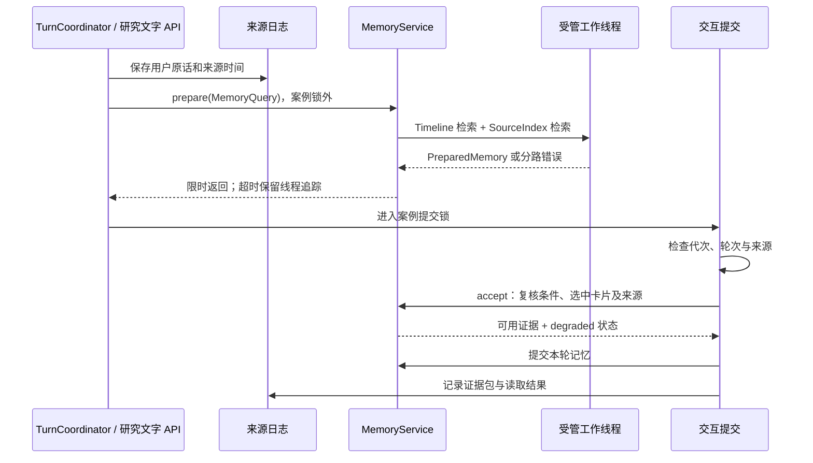

# 三链路边界核对与拆分（2026-09-23）

结论：观察、交互、记忆的职责已进一步分开，关键检索准备与观察状态发送不再占用案例提交锁。当前仍是共享进程和存储的模块化单体；“职责清晰、部分执行隔离”是准确表述，“三个完全独立服务”不是。

## 已落地的边界

| 关注点 | 当前实现 | 边界与限制 |
| --- | --- | --- |
| 观察结果 | `ObservationService` 校验上下文、保存原始观察，传递 `AcceptedObservation` | 不决定澄清、不摄入任务状态、不发送 WebSocket；仍在案例锁内顺序提交 |
| 观察后的交互 | `ObservationInteraction` 摄入任务证据、检查当前交互状态、决定澄清/播报 | 候选观察不能直接替用户确认；消费者与观察服务是同步调用关系 |
| 前台记忆入口 | `MemoryService.prepare/accept/commit`、观察/场景/工具效果写入方法 | 管理 API、状态查询、任务偏好及专用后台任务仍使用适配器，不是所有存储的总网关 |
| 记忆提交依赖 | `MemoryCommitService` 接收标识、日志、记录操作回调 | 不接收 Runtime 或 CaseOwner；短存储操作仍同步 |
| 记忆恢复依赖 | `MemoryRecovery` 接收 `MemoryExtractor` 协议对象，组合根注入解析器 | 恢复只处理记忆，不重放语音控制和工具动作 |
| 模块归属 | `episodes/preferences/policy/long_events` 的实现归入 `memory/` | 原 `realtime/` 模块保留兼容导出；测试禁止记忆反向导入交互与应用模块 |
| 状态可见性 | 会话恢复、Insight、长事件与账户日记分别投影 | `ThreeLaneRuntime` 只聚合状态，不负责统一调度或资源优先级 |

## 前台读取与提交



检索请求固定账户、案例、政策、原始时间、原文、语义条件和排除来源。复核阶段不重新同步整个 SourceIndex。选中卡片按 ID 查询；同案例的来源记录与证据包来源重新检查。删除或替换后的内容不进入本轮注入，未选候选的旧正文也不重新写入审计。

实时轮次在准备后重新检查 socket/epoch、终态、显式修订和来源存续。研究文字 API 在进入提交段后重新读取记忆政策、拒绝已经删除的输入。无会话 API 继续使用 participant 适配语义，保留旧路径的检索/注入状态。

## 失败与维护

- 前台读取默认等待 2 秒，可由 `EGOASSIST_MEMORY_READ_TIMEOUT` 配置。最多 4 个受管读任务，同一账户最多 1 个；繁忙或维护时直接返回降级状态。
- Timeline 与 SourceIndex 分别报告错误，成功的一路仍能提供证据。整体超时不会把晚到结果补进已提交回答。回答上下文携带 `memoryRead`，不把无结果等同于历史不存在。
- 超时与请求取消不会终止底层线程。删除前先阻止新读取并等待已启动读取结束，随后失效索引。维护等待被取消也须等工作线程停止后才能清理。
- `/api/history/delete`、`/api/memory/delete`、`/api/privacy/delete` 与账户保留维护使用受管读取的生命周期；应用退出也等待剩余读取。此保证覆盖 `run_read` 管理的线程，不代表所有后台模块都被这个服务统一监管。
- 观察写卡失败保留已接收原始观察并记录失败；待确认草稿读取失败时停止本次主动澄清；任务偏好读取失败不丢弃已接受任务观察。
- 观察状态发送发生在观察提交返回之后。其他交互控制路径仍有在案例锁内发送的操作，本次没有声称全部网络等待都已移出共享锁。

## 状态语义

`runtimeLanes.memory.jobs` 继续表示当前会话的记忆任务，并新增 `long_event.job`；批次以 requestId 为键。新请求替代尚未完成的旧尝试，旧尝试不继续算作待执行任务；`long_event.reset` 清除旧批次投影。`lastRead` 暴露最近一次读取的完成/降级状态。

`runtimeLanes.memory.accountDiary` 单独展示账户日记，SQL 只查询状态、ID、周期等字段，不加载日记正文，不创建不存在的账户目录。日记的生成开关及账户范围不等于当前会话的事件记忆开关。

## 验证

新增 `tests/test_lane_isolation.py`，验证请求条件改变、卡片删除/替换、来源擦除、单路读取失败、超时后的受管线程、维护取消、历史删除等待、轮次取消/修订/代次改变、慢客户端发送、观察记忆失败、长事件与日记状态范围，以及模块依赖方向。

最终完整回归 **774 项通过**，其中新隔离测试 24 项；保留 3 条已有 aiohttp WebSocket timeout 参数弃用警告。`git diff --check`、Python 编译检查、前端 JavaScript 语法检查通过。复现命令（项目根目录）：

```powershell
.\.venv\Scripts\python.exe -m pytest -o addopts= -q -p no:cacheprovider
.\.venv\Scripts\python.exe -m compileall -q egoassist scripts/verify_memory_recovery_real.py
node --check egoassist/console/app.js
git diff --check
```

本轮只运行本地回归与静态检查，未重新进行云端模型、摄像头、麦克风或真实设备性能验收。测试不能证明模型语义准确率或硬件时间同步精度。

## 仍然共享的部分

SQLite、SessionJournal、事件循环与案例锁仍共享。任务偏好适配、状态快照、日志落盘及恢复可能占用同步时间；已有同步调用方仍可直接执行记忆读取。日志文件被外部替换时，按 ID 读取前的日志刷新仍可能重新加载文件。记忆写入没有全面的故障隔离或跨库原子事务；跨案例 participant 卡片依赖卡片状态与删除传播，不逐轮扫描全部原始来源。线程若永久挂起，维护也可能等待，当前没有进程级强制隔离。

后续若需要更强独立性，应以测量结果决定是否拆进程、增加持久跨服务队列或统一资源调度，而不是只继续拆文件。

对外可介绍为：**EgoAssist 是一个以可追溯来源为底座的第一视角助手。观察负责记录现场，交互负责理解与行动，记忆负责跨时间保留和检索；每次回答区分提问时现场、历史原文与派生结论。** 这是系统组织和证据约束的特色，不是未经验证的新算法优势。
